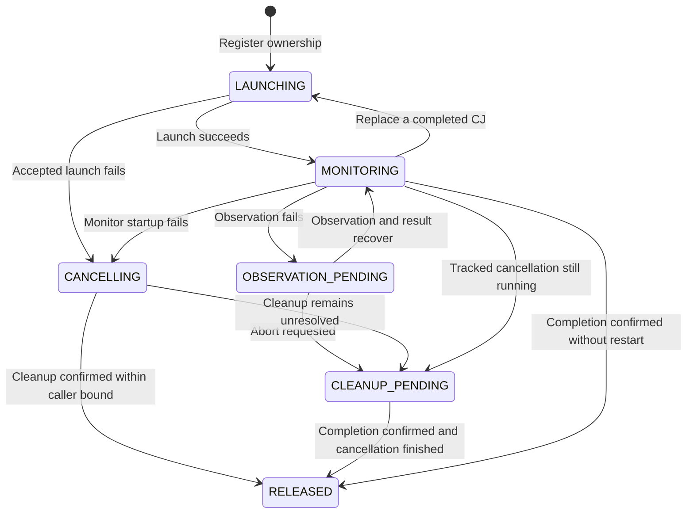

# Automatic client-job recovery

CP automatically replaces a failed CJ using the same job ID, launcher, metadata,
resource reservation, and persistent job workspace. The replacement uses normal
`GET_TASK` delivery: the unchanged server resends an outstanding assignment with
its existing task and attempt IDs. User code restores its own checkpoint.

Implemented for eligible resident (`execution_lifetime="job"`) Process, Docker
and Slurm client jobs, and for Kubernetes client jobs in job or task lifetime.
Kubernetes requires the persistent jobs PVC profile and confirmed shutdown of the
CJ and its workers. See the
[Kubernetes persistence and resume contract](../user_guide/admin_guide/deployment/kubernetes_task_launcher.rst#persistent-files-and-cj-resume).
Local Process/Docker task execution is deferred; the
[retired Process task-mode eligibility gap](#process-task-mode-recovery-gap) is described below.
CP and the server must remain running.
Hierarchical federation recovery is outside this feature's scope. Intermediate
CJs retain their existing failure behavior because replacement cannot restore
their in-memory child-result receipts; automatic recovery is limited to leaf CJs.
The job's client registration must also remain valid: re-registering CP creates a
new token that the existing server job does not adopt. Migrating that registration
is outside this client-only recovery feature.

## Recovery setting

`max_cj_restart_failures` is configured on CP, with default `3`.
Set `NVFLARE_MAX_CJ_RESTART_FAILURES` in CP's environment before startup, or add
`max_cj_restart_failures=<value>` to the `--set` arguments of CP's Python launch
command. `--set` takes precedence over the environment variable.
`0` disables recovery. No application opt-in is required.

The limit counts consecutive attempts to get a replacement initialized. There is
no lifetime restart limit. CP increments the counter when it launches a replacement
and resets it when that CJ completes runner initialization and reports READY.
The original failure does not consume an attempt. Three replacement startups that
fail consecutively end recovery; a successful replacement restores the full budget.
A two-day task can therefore span twelve or more four-hour allocations without
exhausting the budget, provided its checkpoint and server assignment remain valid.

This measures initialization success, not training progress. A CJ that repeatedly
initializes successfully and then crashes can continue restarting. Application
checkpoint compatibility and progress remain the application's responsibility.

## Allocation wall-time and task lifetime

In Kubernetes task mode, a confirmed worker crash or scheduler timeout exits CJ without
closing the server assignment. CP waits for CJ and its workers to stop, then
uses the same restart policy. A valid committed result takes precedence;
application errors, rejected submissions and cancellation do not trigger recovery.

Kubernetes supports this path with the persistent jobs PVC. Slurm
([task adapter](https://github.com/NVIDIA/NVFlare/pull/5513)) uses the shared
workspace: a worker allocation settling as TIMEOUT, PREEMPTED, OUT_OF_MEMORY,
NODE_FAIL, BOOT_FAIL or a signal-killed FAILED exits CJ, and CP replaces it after all workers settle. No
signal precedes the wall-time limit, so work since the last checkpoint repeats. Local Process/Docker
task mode is deferred because its CJ restart gates do not establish worker
settlement; see the [eligibility gap](#process-task-mode-recovery-gap) below.

### Wall-limit and owner-loss timeline

| Event | Recovery behavior |
| --- | --- |
| Kubernetes worker allocation expires | After confirmed worker settlement, CJ exits and CP replaces it using the existing recovery policy. Application code restores its partial checkpoint. |
| Kubernetes CJ dies while a worker may still exist | CP retains cleanup ownership and replaces CJ only after both executions have stopped. |
| Result reply is lost while CJ remains alive | CJ retransmits its saved result without launching another worker. |
| CP dies | Ownership adoption is unsupported; persistent files alone do not authorize replacement. |

Replacement CJs derive fresh physical worker IDs while normal server delivery
preserves an outstanding assignment's IDs. Existing assignment deadlines still
apply; recovery does not extend them.

### Native task-resume follow-up requirements

Partial-progress checkpoints remain application-owned. Applications must publish
complete, compatible state that survives abrupt termination; the framework's
completion-bound checkpoint handoff does not periodically save unfinished work.
Slurm task-adapter integration, GPU recovery and Lustre qualification remain
separate work. CP restart adoption remains outside this feature.

## Implementation

- `JobExecutor` keeps its existing logical job entry through replacement and
  queueing, so CP's ordinary heartbeats continue listing the job. It uses one
  monitor and reports a terminal outcome/releases resources once, at the end.
- Physical launch reuses the original launch specification with current CP
  bootstrap tokens. The per-job certificate stays until the logical job ends;
  application files and checkpoints are preserved without redeployment.
- STARTED still marks command availability before initialization, preserving
  graceful aborts during startup. READY resets the restart counter after
  `ClientRunner.init_run`; CP continues exposing STARTED as the job status.
  Notifications retry within the existing timeout without failing the CJ.
  A private CP/CJ launch ID rejects mismatched notifications from old executions
  when provided. Notifications without an ID remain accepted for compatibility
  with older CJs and custom launchers. Both launcher option representations carry
  it, including Docker and Kubernetes.
  STOPPED cannot regress. There is no new server protocol.
- Job abort cancels pending/in-flight replacement through the existing pending
  handle. A task abort during replacement or after confirmed death aborts the job.
  Otherwise it retains the existing best-effort command behavior and does not
  permanently disable recovery. Task-abort delivery is not journaled or replayed.

## Confirmed failures only

`JobHandleSpec.can_restart()` supplies termination evidence; unsupported launchers
return false. CP separately checks the failure code, cancellation, completion,
and consecutive-attempt limit.

| Backend | Required evidence |
| --- | --- |
| Process | The launcher-owned CJ has exited, its process group is absent, and no external-trainer launch bootstrap remains. |
| Docker | Container wait/inspection confirms exit, rather than merely losing its record. |
| Slurm | Accounting reports COMPLETED, FAILED, TIMEOUT, OUT_OF_MEMORY, or PREEMPTED, and the allocation has left the active queue. |
| Kubernetes | The same CJ Pod UID has confirmed container/sandbox shutdown, its PVC workspace finished initialization, and all CP-owned task workers have settled. |

Normal success, STOPPED teardown, cancellation, configuration errors, and unsafe
component failures do not trigger recovery. Missing accounting, node loss, backend
API errors, and network/heartbeat failures are not proof of termination. A launch
exception ends recovery rather than risking duplicate submission when acceptance
is unknown. If a handle was published or returned before launch setup failed, CP
attempts cancellation and observation before releasing its resources. Unconfirmed
cleanup retains ownership as described below. Docker physical launches use
unique container names, allowing delayed auto-removal of the previous container.
Existing scheduler queue/startup timeouts remain in effect.

Process recovery is skipped when an `external_process` trainer launch bootstrap
remains in the app directory. The backend writes this existing file before
launching a detached trainer and removes it only after confirming trainer-group
exit. After an abrupt CJ loss, the file remains even if the trainer subsequently
exits, so CP ends the job instead of risking overlapping trainers. The existing
trainer watchdog handles detached-group termination. Docker and Slurm retain
recovery when the container or allocation is confirmed dead.

After a failed CJ exits, the Process handle waits up to 10 seconds for
its owned group to drain, kills remaining members of that group, and waits up to
10 more seconds to confirm exit. Recovery requires the group to be gone; cleanup
timeout or uncertain observations end recovery. Job/task cancellation during
cleanup prevents replacement. No restart-blocker file or new orphan-process
manager is introduced.
Slurm/container recovery assumes training remains inside the managed allocation
or container. CP is the restart owner; independent scheduler/container requeue
policies must not compete with it.

Kubernetes task mode uses the jobs PVC; resident CJs require
`persist_resident_workspaces`. The PVC replaces the workspace `emptyDir`.
The first CJ downloads into it; replacements reuse it to preserve checkpoints.
If shutdown exceeds `cleanup_timeout` (60 seconds for resident CJs), recovery
stops while CP continues worker cleanup. Replacement Pods get fresh launch IDs,
task capabilities and credential Secrets; the old task capability is closed.
Old CJ Pod deletion is best effort; the final Pod is retained for diagnostics.

Native worker attempt IDs include the CJ launch ID; server task and attempt IDs
stay unchanged. Logs map server attempts to physical worker IDs.

### Process task-mode recovery gap

In the retired Process task implementation, each task worker started a separate
process group. `ProcessHandle.can_restart()` checks the CJ's own group and
`client_api_bootstrap_*.json` external-trainer files; it does not check task-worker
groups or exclude task lifetime. Consequently, CP could find CJ replacement eligible
without proof that its task workers had stopped. The worker's startup parent-PID
check was not CP-owned settlement evidence after a later CJ failure.

This eligibility gap motivated deferring local Process/Docker task execution.
Shared client-parent admission now rejects local task-lifetime jobs before
launching a CJ. The deferral adds no task-worker recovery owner and leaves
resident restart gates unchanged. CJ-group exit alone must not be used as proof
that an independently launched worker has settled.
See the [backend/lifetime matrix](task_worker_lifecycle.md#backend-and-recovery-boundaries).

## Failed launch cleanup and retained ownership

This client-parent behavior applies to initial and replacement CJ launches whose
launcher publishes an accepted handle through `publish_job_handle()` or returns
one. CP attaches that handle before applying a saved abort. A launch exception,
a missing return handle after publication, an AFTER_JOB_LAUNCH failure, or monitor
startup failure initiates cancellation and completion observation. Cancellation
failure cannot skip observation. The original launch failure is logged first.

### Ownership and observation

While CP lives, each accepted handle it owns has one registration that holds the
admission allocation and credentials. Release requires backend completion
evidence and no cancellation still in flight. The start caller and monitor
coordinate so only one claims release. Both recheck the current cancellation
under the executor lock before removing the registration. The monitor keeps
the recorded CJ outcome if it has to wait for a later stop. Heartbeat presence
continues through outcome reporting, even after the monitor has claimed release.

Each registered run has an explicit client-parent lifecycle in `_RunState`.
`ClientStatus` retains its existing CJ-reported STARTING/STARTED/STOPPED values;
`get_status()` returns those values without overlaying parent cleanup phases.
The human-readable `check_status()` can describe pending cleanup or observation.
The parent phases describe launching, monitoring and ownership release:

`job_launch_cleanup_timeout` bounds each caller wait for cancellation and the
first observation (default 10 seconds each, finite and positive). Configure it
on CP through `NVFLARE_JOB_LAUNCH_CLEANUP_TIMEOUT` or
`--set job_launch_cleanup_timeout=<seconds>`; `--set` takes precedence. A saved
abort has its own bounded cancellation wait. Cleanup reuses a saved cancellation
while it is running or after success, and retries a completed failure once.

One daemon monitor owns observation for the logical run, including replacements
and failed launches. The initial caller and explicit admin retries can wait on
that monitor's observation event. Pending heartbeat cleanup schedules a stop
and ensures the monitor is started, then returns without waiting on either
backend operation. If `wait()` raises, the
same monitor retries after the backend's `poll_interval` (10 seconds for backends
without that setting). Heartbeat cleanup and reachable admin aborts can wake this
retry backoff and retry a completed cancellation, including one that raised or
returned without stopping the runtime. A running cancellation is reused, and
concurrent cleanup requests are serialized. Heartbeat retries stay quiet while
that call and the monitor are already running. Ordinary abort, saved abort and
failed launch cleanup use the same cancellation record for each handle. The
executor registers the stop under its ownership lock before waiting for it, so a
stop begun before an observation failure is visible to later retries and to the
release check. The normal teardown grace for a started or stopped CJ still applies.
Query failures do not themselves request cancellation. A healthy run
uses OBSERVATION_PENDING during an observation outage, preserving heartbeat
abort handling and normal CJ recovery once observation succeeds. This is distinct
from CLEANUP_PENDING after a failed launch or requested cancellation.

Slurm cancellation is retried until one `scancel` request is accepted. After that,
CP continues observation without sending more cancellation requests, including
while the allocation remains COMPLETING. This also applies to a later explicit
admin abort: it does not force another accepted Slurm cancellation. Cancellation
observation uses intervals
of at most one second during the first 10 seconds after the initial request,
then returns to `poll_interval`. Repeated requests do not extend this fast window.
Scheduler query outages and slow settlement can exceed the caller deadline.

If cleanup is unresolved, CP keeps the registration, exact handle, admission
allocation/token/resource-manager references and credentials. The start request
returns `JobCleanupPending`, transferring release responsibility to the monitor;
the scheduler must not free the allocation, even if the monitor completes before
that error reaches it. Cleanup that settles synchronously instead rolls back to
the start caller. A failed replacement remains with the existing monitor and
cannot report a terminal outcome before its accepted handle has settled.

Once observation succeeds and cancellation is no longer in flight, the monitor
uses its ordinary completion path. Removing the exact registration under the
executor lock is the release commit point. It then frees admission resources,
removes the credential and reports the outcome once, outside that lock. A per-job
directory fence prevents another start or deletion from racing these actions.
A separate finalizing set keeps the job in heartbeat reports until the outcome
report returns, including while admission release or credential removal is in
progress. The server must continue seeing that presence while its outcome is
pending. This set records protocol presence, not another resource-release owner;
registration removal remains the release commit point. Other jobs and heartbeats
can continue. Errors releasing admission or removing
credentials are logged critically for operator reconciliation; they do not
suppress terminal outcome reporting or automatically repeat a possibly partial
resource-manager release.

A cleanup-pending run rejects repeat starts, including after a CJ reported
STARTED. A repeated start releases only its new allocation. Deletion rejects all
registered runs and runs whose directory cleanup is in progress. Status exposes
`cleanup pending` with its age. The first unresolved cleanup emits a critical log;
the existing heartbeat job-list read emits at most one reminder per run every
five minutes, even if its backend wait remains blocked. Heartbeat cleanup keeps
retrying completed cancellation attempts while the client still owns the run;
an observation outage or failed launch must not disable this path. Confirmed late
completion is logged and releases ownership automatically, without an admin abort.

Admin abort is available only while the server can route the command to that job.
After the server drops a job, an explicit admin abort cannot be relied on as the
remedy. The client continues advertising its owned run, allowing server-triggered
heartbeat cleanup to retry cancellation. Persistent backend failures require the
backend operator to reconcile the exact owned runtime.

### Guarantees and operator escalation

A normal `JobHandleSpec.wait()` return is the backend's existing completion
contract. CP relies on that contract; it does not independently audit physical
GPU reclamation. Cancellation acknowledgement, elapsed time, and a task's result
are separate from runtime completion. Verified task results retain their existing
success semantics. An observation error alone does not trigger CJ replay or an
application failure; normal CJ recovery still applies if subsequent completion
evidence satisfies the existing recovery rules.

If the normal monitor cannot start, launch cleanup retries monitor startup. If
that attempt also fails, the run remains owned and logs that automatic observation
is unavailable. A later heartbeat cleanup request or a reachable admin abort
retries startup, reusing a cancellation that is still running. No observer is
claimed to be running while thread creation is failing.

Uncertainty can persist indefinitely if the backend never provides reliable
completion evidence. Preserve the exact runtime identity, workspace, launch files,
credentials and CP logs, and involve the backend operator when reminders persist.
For Slurm, cancel only a verified owned allocation and use its queue/accounting
records according to the backend contract. A name match or absence during a query
outage is insufficient. Stuck scheduler/node teardown may require cluster-admin
action; CP cannot guarantee that the OS or scheduler will release resources by a
deadline. Do not clear admission state or restart CP to bypass an unresolved run.

Control operations and the monitor use daemon threads. This permits CP exit; it
does not terminate an external runtime. Ownership is held in memory and automatic
reconciliation operates only while CP lives. After CP loss, an operator must
reconcile its owned runtimes and rebuild admission state before restarting or
resubmitting. Restart adoption, uncertain submission before a handle exists and
server-side ownership remain separate work. There is no force-finalize command
that treats uncertain completion as proof of release.

### Resident Slurm submission gap and qualification

The resident `SlurmJobManager` currently registers its handle only after `sbatch`
returns a usable ID. An accepted submission whose reply times out, raises, or lacks
an ID can therefore fail before publication; its current exception path removes
launch files. `ClientSlurmJobLauncher` also releases the task owner when that CJ
launch raises. These paths are **not fixed by caller retention**. The server launch
path does not install JOB_HANDLE_CALLBACK and registers SJ only after launch returns;
this client change claims no SJ ownership fix.

A separate Slurm slice must register/persist an uncertain submission identity
before invoking `sbatch`, retain its files, avoid blind retry, reconcile only exact
owned identities, and give both CP and SP explicit bounded cleanup ownership.
Nonzero/signal exits and missing replies are not automatically rejection. That
slice must review the existing resident terminal/missing-record settlement rules,
which are weaker than the CP-owned task submission path. It must preserve task
success when allocation cleanup remains unconfirmed.

Unit fault injection verifies caller policy, not scheduler or GPU behavior. Live
Slurm qualification must exercise accepted-but-lost replies, cancellation/query
outages, controller/accounting lag, allocation/step teardown and physical GPU
release for CJ and SJ as applicable. Earlier operator-inventory hardware runs do
not qualify this change or the pending Slurm slice.

### Kubernetes settlement limitation

The current `K8sJobHandle.terminate()` marks the handle terminal and releases its
job resources even when Pod deletion raises an API or network error. Its `wait()`
then returns without confirming Pod/container shutdown. The caller can therefore
release ownership despite a surviving Pod; this PR does not fix that backend
contract. Track the separate [Kubernetes ownership follow-up](https://github.com/NVIDIA/NVFlare/issues/5791).
Do not describe the caller-retention fix as Kubernetes settlement protection.

## Task and checkpoint boundaries

Native task checkpoints atomically record the logical assignment and its saved
result. If CJ dies after promotion, its replacement verifies and resends that
result without advancing the checkpoint again; missing result artifacts fail
the assignment instead of rerunning it from already-advanced state.

No task journal, model-input cache, result outbox, or checkpoint API is added.
If the server already accepted the result, its existing receipt handling applies.
If a replacement cannot synchronize with its server job within the existing
timeout, it uses the existing server-parent GET_CLIENTS query to confirm whether
that job has ended. Only an explicit response for this job saying it is no longer
active lets the replacement finish normally; communication errors remain errors.
If the task expired or the workflow moved on, normal task delivery governs what
the new CJ receives. Existing task deadlines must cover training and queue delays.

Task-send callbacks and filters may run again, so this is not byte-identical replay
of arbitrary filters or exactly-once execution. Checkpoints must match the received
task/round. Work since the last complete checkpoint can repeat.

## Validation

The automated provisioned-process test kills CJ four times during one task,
exceeding the default failed-start limit. Five distinct CJs reuse the same
job/task/attempt IDs, restore an on-disk checkpoint, and produce the uninterrupted
arithmetic result with one server result receipt. Unit coverage also exercises
twelve consecutive successful replacements.
An external-process regression kills CJ while its detached trainer ignores
SIGTERM and verifies that CP ends the job without launching another trainer.
The server implementation is unchanged.

Focused tests cover repeated successful replacements, exhausted/reset failure
budgets, stale status messages, cancellation during launch, unchanged terminal
outcomes, credentials/resources, launcher options, confirmed server-job closure,
and backend termination evidence.

Sources: [CP lifecycle](../../nvflare/private/fed/client/client_executor.py),
[CJ readiness](../../nvflare/private/fed/client/client_app_runner.py),
[existing task redelivery](../../nvflare/apis/impl/wf_comm_server.py),
[executable acceptance test](../../tests/integration_test/fast/cj_recovery_e2e_test.py).
