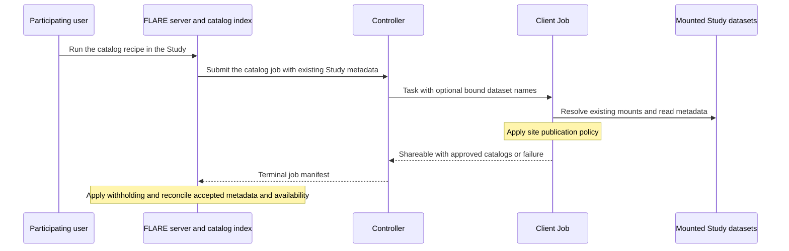

# Federated Data Cataloging Design

**Status:** Proposed implementation design
**Date:** November 1, 2026
**Parent:** Federated Data Network Engineering Design
**Requirements:** Federated Data Network Feature Requirements, CAT-01 through CAT-07

## 1. Purpose and assumptions

Discover and describe datasets within an existing FLARE Study. The pilot reads datasets already mounted by the site's launcher. When preparation is enabled, committed datasets in the existing site service also enter the same catalog (Section 3.1). Cataloging creates no additional source registration or access boundary.

Use FLARE's existing concepts:

| Existing concept | Use in this design |
| --- | --- |
| Study | The existing study name, membership and dataset bindings |
| Participating users | Existing users of the Study; permissions come from FLARE authorization and the site's Study policy |
| Client | The participating site running the job; identity comes from FLARE |
| Dataset | A dataset mounted for the Study, or a committed derived dataset resolved by the existing site service |
| Job, Task, Shareable | Execution, request/result correlation, transport and serialization |

The first release publishes one site-approved metadata view for the participating users of a Study. It does not introduce a separate audience identity or membership registry. The site's Study policy may withhold fields or the entire dataset from that shared view. Metadata requiring different user-specific views is withheld from the shared index until a separately qualified use of existing user authorization supports it. Catalog visibility never grants access to source records.

## 2. Read flow



The job is the catalog recipe a user runs with `python job.py` or `nvflare catalog read`. Search reads the index and never triggers source reads. The job obtains its Study from existing FLARE job metadata and the client identity from FLARE execution context. The optional dataset selection contains existing Study dataset names; derived references are also accepted once preparation is qualified. No request supplies a filesystem path, database endpoint, credential, namespace or Python import path.

The pilot uses bounded full metadata reads per dataset. There is no incremental checkpoint protocol, progress object, or client-side comparison with previous catalog versions. The server already stores previous versions and owns comparison. Incremental reads are deferred until measured cost justifies a provider-qualified extension.

## 3. Components and data

### 3.1 Existing Study dataset bindings

Reuse [study runtime configuration](../../nvflare/app_opt/job_launcher/study_runtime.py) and [StudyDatasetMount](../../nvflare/app_opt/job_launcher/study_data.py). The mounted path for a dataset is derived from the existing binding, such as `/data/oncology-study/clinical-research`. The mount, read/write mode and source belong to site configuration. FDN adds no second source-registration file. The strict study-runtime parser accepts the existing `datasets` key in process mode too; only the catalog executor reads it there, and the process launcher mounts nothing.

Launchers set the reserved `NVFLARE_JOB_LAUNCHER_MODE` environment variable on each job. In process mode, dataset `mode: ro` is advisory: jobs retain the host user’s filesystem permissions. Use container launchers or OS permissions for enforced read-only access. Process jobs use explicit runtime source bindings ahead of directory discovery; container jobs use their remapped dataset mounts, even if the host runtime file is visible. This is launcher-owned information, not a site or job configuration option. A custom launcher that remaps source paths must set the variable; when it is absent the executor assumes process mode and reads the runtime file's host paths, so a dataset whose host path does not exist in the container is not bound and shows as unavailable, without a launcher error. Bare-process Slurm retains its existing restriction against dataset declarations.

The site binds each dataset to a reader appropriate for its source: Parquet, CSV, a SQL database or Unity Catalog. A Study may mix source types, so the reader is chosen per dataset (see `catalog_site.json` below). Remote services use site-owned endpoints and credentials, with metadata-only access. Provider/version authentication and permissions still require deployment qualification; discovery grants no execution access.

#### Data-source formats and catalog services

The catalog covers the following four source categories. A source is selected **per dataset at each site**, not once for the federation or in `job.py`: two sites can expose the same logical clinical dataset through different storage systems. The site's configured source type selects its installed connector, which produces the shared `CatalogInfo` model. `CatalogRecipe` owns workflow wiring; `catalog_reader=` is an optional extension for custom reading logic.

| Source category | Metadata read and configuration | Implementation status |
| --- | --- | --- |
| **1. Parquet** | Read column names, physical types and nullability from file footers, including partitioned files. Site-authored `catalog.json` supplies declared keys, relationships, semantic profile and provenance references. Use the built-in `parquet` connector with the existing dataset binding. | Implemented; demonstrated in the OMOP example. |
| **2. CSV + header** | Built-in `csv` delegates CSV parsing and type inference to PyArrow. One UTF-8 file per dataset, unique nonempty headers. Infer from the first 64 KiB block with at most 1 MiB of locally staged input for record boundaries/read-ahead, plus site call/time/schema budgets. Preserve Arrow physical type names (`int64`, `double`, `date32[day]`, `bool`, `string`, `null`, etc.). Null and numeric-identifier interpretation follow Arrow defaults; leading zeros can be lost in inferred integer types. Nullability is unknown; keys are not inferred. Inference describes only the initial block, not full-file validation. Only schema metadata is published, never row values. | Implemented; site-1 adds `lab_results` and `visits` alongside Parquet OMOP. |
| **3. SQL database** | Use the general `SQLConnector` and SQLAlchemy reflection for tables, columns, physical types, nullability and declared constraints. Connection/schema/table selection is site-owned. Do not query application rows. | Mounted SQLite remains read-only. Network databases use a site environment URL and installed SQLAlchemy driver; each database/version needs qualification. |
| **4. Unity Catalog** | Use `UnityCatalogConnector` with a site-owned REST endpoint, catalog/schema and optional table selection. Copy column names, `type_text` and nullability; do not fetch table data, storage credentials or object paths for publication. | REST connector exercised against UC OSS. Controlled API-contract tests also cover Databricks-shaped responses, complex types and pagination. Configure the HTTPS Databricks workspace API root and a site-owned bearer token; live workspace privileges need separate qualification. The connector publishes schema metadata only, without lineage or PK/FK constraints (Databricks list-table responses omit constraints). |

**Provider interfaces.** The connector uses the [Unity Catalog list-tables REST API](https://docs.databricks.com/api/uc-tables/v1/list-tables) at `/api/2.1/unity-catalog`, shared by UC OSS and Databricks. It follows continuation tokens even on empty pages. Databricks [get-table](https://docs.databricks.com/api/uc-tables/v1/get-table) constraints and information-schema queries are outside its current metadata coverage.

**Optional dependencies.** Install `nvflare[catalog]` at sites that use Parquet/CSV or SQL metadata readers. The extra supplies `pyarrow>=14` and `SQLAlchemy>=2.0,<3`; network SQL backends also need their own driver. These remain optional and are included in the broad `app_opt` extras. SQLAlchemy and PyArrow license/notice files are shipped from `3rdParty/`. Unity Catalog REST access uses the existing Requests dependency.

**Common connector contract.** All source categories preserve observed column/type differences and source provenance rather than forcing a common physical schema. Publish keys and relationships only when observed in the source metadata or explicitly declared by the site; declaration does not establish that a constraint is enforced. Apply the same site publication policy, read budgets and result validation before metadata leaves the site. Source credentials and endpoints remain in site-owned configuration/environment; catalog tasks cannot supply them. Remote deployments must qualify metadata visibility, pagination, rate limits and authentication for their specific provider/version. Currently `parquet`, `csv`, `sql` and `unity-catalog` resolve without installing another connector; the same recipe, controller and executor serve all four categories.

The operator selects installed readers in approved site configuration. Installing another `CatalogConnector` requires no controller/server change or dynamic registry. Task payloads cannot select executable code. `CatalogRecipe(catalog_reader=...)` can also install a reviewed `CatalogReader` component, analogous to a FedStats generator, with normal job/component authorization. It receives site-owned dataset bindings; the executor still applies the site publication policy, budgets and result validation.

#### `catalog_site.json` contract v1

This site-owned file configures **reader selection only**, with optional site-wide limits and capabilities. It is not a catalog result, a duplicate dataset registry, or a place to enter column schemas. The normative keys and defaults are:

| Key | Required / default | Contract |
| --- | --- | --- |
| `format_version` | Required; integer `1` | Reject booleans and unsupported versions. |
| `default_connector` | Optional; `"parquet"` | Reader for mounted datasets without an explicit override. Built-ins are `parquet`, `csv`, `sql` and `unity-catalog`; installed custom names may also be referenced. |
| `studies` | Optional; `{}` | Map Study names to dataset-name maps. Existing Study runtime bindings supply dataset paths; repeat a dataset here only to override the default reader or configure a custom source. |
| `studies.<study>.<dataset>.connector` | Required only for an explicit binding | One known built-in or installed connector name. An undefined name is an error; there is no format guessing or fallback after a selected reader fails. |
| `studies.<study>.<dataset>.options` | Optional; `{}` | Non-secret, connector-specific options for custom integrations. Parquet/CSV readers accept no nonempty options. SQL accepts `schema` and `tables`; Unity Catalog requires `catalog` and `schema`, with an optional `tables` list. In particular, do not repeat `storage_format` or put `metadata` here. |
| `connectors` | Optional; built-ins already installed | Advanced map of additional reader names to `{ "class": "fully.qualified.Connector", "args": {} }`. `args` is optional and non-secret. Standard built-in readers need no class paths. Named remote readers use non-secret arguments naming environment variables for endpoints and credentials. |
| `limits` | Optional | Positive integer overrides: `max_duration_s=60`, `max_calls=1000`, `max_records=10000`. Omitted values retain these defaults. |
| `installed_operations` | Optional; `[]` | Explicit operations this site can actually execute. A catalog-only deployment leaves this absent. It does not enable operations or grant execution access. |

Reject unknown keys and wrong field types at the file, connector-spec and dataset-binding levels. Reject nonempty options for Parquet/CSV and unsupported option keys for SQL/Unity Catalog. Invalid or missing site configuration follows the fail-closed publication behavior below. Connector-specific extensions must document their own `args`/`options` rather than silently accepting unrelated fields.

The complete minimal Parquet file is:

```json
{"format_version": 1}
```

A site whose mounted datasets are SQLite files needs only:

```json
{"format_version": 1, "default_connector": "sql"}
```

For mixed formats within a site, override only the relevant existing dataset:

```json
{
  "format_version": 1,
  "studies": {
    "oncology": {
      "registry": {"connector": "sql"}
    }
  }
}
```

**Separate inputs by responsibility.** Existing `study_runtime.yaml` bindings own source paths and mounts; `<study>/catalog_policy.json` owns publication rules. Optional source declarations own descriptive and semantic metadata: a Parquet directory's `catalog.json`, or `<database>.catalog.json` beside a SQLite file (`registry.sqlite` uses `registry.catalog.json`). If declarations are absent, readers still discover structure, use the dataset name as display name, and leave optional semantic/descriptive fields unknown. Parquet keys/relationships require declarations; SQLite obtains them from database constraints. Sidecars are bounded to 1 MiB and reject unsupported declaration keys. Source observations take precedence over annotations for structural metadata. No user must enter observed columns, inferred keys, output timestamps, version counters or provenance into `catalog_site.json`.

**Explicit site examples.** Each site has its own `catalog_site.json` and declares its reader, including `"default_connector": "parquet"` at a Parquet site and `"default_connector": "sql"` at a SQLite site. Protocol defaults remain available for compatibility, but example sites do not rely on another site or leave their intended source format implicit.

**Examples are source artifacts.** Check the complete `catalog_site.json`, publication policy and optional declaration examples into the example directory. Data preparation creates the synthetic source tables/files, copies those versioned configurations, and resolves runtime paths; it does not synthesize the catalog input specification. `job.py` only configures/runs the recipe and prints its result.

**One policy source.** Each site keeps `catalog_site.json` and `<study>/catalog_policy.json` outside job packages. The Study comes from trusted job context. Dataset paths belong to `study_runtime.yaml`; publication policy belongs to these catalog files. A replacement is read on the next catalog task.

The site may explicitly select an absolute policy directory through `NVFLARE_CATALOG_POLICY_ROOT` in its site-owned Study runtime `env`, which the launchers forward to the job. For a process launcher inside a site container, set it in that container's deployment environment; Compose uses this to select the site's `/fdn/policy` mount. Setting only the parent process environment does not automatically forward it through a container job launcher. Bare process jobs otherwise use only their own `<workspace>/local/fdn`; an unrelated host `/fdn/policy` directory never overrides that default.

| Launcher | Policy deployment | Dataset access |
| --- | --- | --- |
| Process | Own `local/fdn`, or explicit `NVFLARE_CATALOG_POLICY_ROOT` for an isolated site container | Host paths in site-owned runtime `datasets`; `ro` is advisory |
| Docker | Read-only `secret_mounts` directory at `/fdn/policy`, or the read-only `local/fdn` bind | Remapped `/data/<study>/<dataset>` binds |
| Kubernetes | Explicit read-only Secret projection at `/fdn/policy`; `local/fdn` is excluded from the transferred workspace | Dataset PVCs at `/data/<study>/<dataset>` |
| Slurm Apptainer/Pyxis | Read-only policy bind at `/fdn/policy`, or read-only `local/fdn` on the shared workspace | Dataset binds; sources must be accessible to the compute nodes |

For container launchers, an existing `/fdn/policy` mount is the default; an explicit policy-root environment setting takes precedence. Missing or invalid policy fails closed. Kubernetes does not create policy Secrets automatically. A site owner can configure its existing Secret as follows, with `catalog-site.json` and `publication.json` as Secret keys:

```yaml
format_version: 2
studies:
  oncology:
    secret_mounts:
      catalog-policy:
        source: site-a-catalog-policy
        mount_path: /fdn/policy
        items:
          catalog-site.json: catalog_site.json
          publication.json: oncology/catalog_policy.json
```

For Docker and containerized Slurm, use the same `secret_mounts` entry with `source` set to a site-owned directory already containing that file hierarchy, and omit Kubernetes-only `items`. An explicit Slurm source must be outside `workspace_path`; its existing `local/fdn` fallback is already bound read-only. Bare Slurm (`sandbox: none`) does not support runtime dataset declarations; general file-backed catalog reads are not supported through that mode. Remote-only connectors still require separately qualified bindings, credentials and shared workspace access.

The reader configuration selects connectors, per-dataset options, limits and installed operations. Jobs cannot supply endpoints, credentials or policy files. Existing unmarked component allowlists remain operator-owned; when upgrading such a deployment, explicitly permit the built-in `CatalogController` and `CatalogExecutor` or install the current default policy. Setup must not silently expand an operator's allowlist. Catalog reconciliation requires a deployed `CatalogManager`; there is no separate simulation collector.

#### `catalog_policy.json` contract v1

One JSON file defines the publication policy for one Study at one site. The source examples are `config/site-1/catalog_policy.json` and `config/site-2/catalog_policy.json`; deployment installs each into its site's `<policy_root>/default/catalog_policy.json` for the example's `default` Study. A named Study such as `oncology` uses `<policy_root>/oncology/catalog_policy.json`. `catalog_site.json` stays at the site policy root. The Study comes from trusted job context, not a field supplied by the catalog task or repeated in this file.

The smallest useful policy explicitly shares one dataset:

```json
{
  "format_version": 1,
  "datasets": {
    "omop": {"share": true},
    "internal": {"share": false}
  }
}
```

| Field | Type / default | Meaning and validation |
| --- | --- | --- |
| `format_version` | Required integer `1` | Booleans, floats and unsupported versions are invalid. |
| `datasets` | Object; default `{}` | Existing dataset names map to publication rules. Keys must be nonempty strings. An omitted dataset is withheld; an empty or omitted object shares nothing. |
| `datasets.<name>.share` | Required boolean | `true` permits only the policy-filtered metadata view. `false` withholds the whole entry. It does not grant access to source records or execution. |
| `exclude_tables` | Array of nonempty strings; default `[]` | Remove these tables from the published metadata. |
| `exclude_columns` | Object mapping table names to arrays of nonempty column names; default `{}` | Remove only those columns from those tables. |
| `exclude_resources` | Array of nonempty strings; default `[]` | Remove these resource types from the metadata. |
| `exclude_metadata` | Array; default `[]` | Allowed names are exactly `description`, `owner`, `modalities`, `semantic_profile`, `source_version`, `lineage`, `provenance`. Removed fields become null or empty collections in the output. Dataset identity, display name and structural fields are not accepted here; withhold the entire entry if those cannot be shared. |
| `operations` | Array of nonempty strings; default `[]` | Only these operations may be advertised. The published list is the intersection of the reader's declarations, this list and `catalog_site.json.installed_operations`. It enables no execution capability. Catalog-only examples omit this field. |

An optional filtering rule can be added without changing any source configuration:

```json
{
  "format_version": 1,
  "datasets": {
    "omop": {
      "share": true,
      "exclude_columns": {"person": ["person_source_value"]},
      "exclude_tables": ["measurement"]
    }
  }
}
```

**Matching and structural consistency.** Names match exactly and case-sensitively; there are no wildcard rules or automatic schema harmonization. A name that matches nothing is ignored. Lists represent sets, so duplicate entries add no effect. Excluding a table/column also removes relationships that reference the excluded structure. A primary key involving an excluded column is removed; the executor validates the resulting view before publication.

**Strict validation and failure behavior.** Unknown fields at either the root or rule level, wrong types, an invalid excluded-metadata name, or missing `share` invalidate the entire file. `derived`, per-user rules, paths, connector settings and credentials are not accepted by v1. Missing, unreadable or invalid policy releases no metadata and reports `POLICY_UNAVAILABLE`; selected previously indexed datasets are withheld. No other Study's file, cached permissive policy, old `<study>.json` filename or site-global fallback is used. A replaced policy is reread on the next catalog read. Restoring a valid policy and running another read may restore publication. Exclusion names (`exclude_tables`, `exclude_columns`, `exclude_resources`) match without regard to case. A table or column exclusion that matches nothing in the catalog is logged at the site, with the dataset and the entry, and excludes nothing, so check the site log after editing a policy.

A valid `share: false` is a normal policy decision, not a source-read failure. Previously published metadata for that selected dataset becomes hidden on reconciliation, while other datasets remain governed by their own rules. Policy visibility is one shared view per Study; the file defines no per-user authorization scheme.

**Derived datasets, when preparation is enabled.** The site service already journals immutable committed outputs with their Study and authorized users. `catalog.read` adds a reader over that journal through the existing job-bound service RPC (no raw manifest paths, no new endpoint). At commit, the preparation step stores the output's candidate v1 metadata (tables, columns, lineage, `validation_ref`, `mapping_version`), unfiltered and local to the site, in the committed manifest. The reader enumerates only committed outputs authorized for the job's Study, one entry per dataset ID: the service's current committed version. Older versions stay in the site store for explicitly pinned operations and are not listed, so a result never repeats a dataset name. It hands that metadata to the handler, which applies the policy and returns it with the mounted datasets in the same result. Staging and failed outputs are never enumerated. After `DATASET_COMMITTED` a read naming that dataset can be run with the recipe; if none is run, the next read lists it.

Use the committed manifest's existing opaque dataset ID as `dataset` and its immutable output version, as a string, as `metadata.source_version`. An expiring capability/token is not a catalog identity. The original mounted source remains a separate entry, linked through `metadata.lineage`. No operator mount or second catalog registration is needed. Subsequent operations resolve derived references through the existing site service, and mounted names through existing Study bindings. Qualifying this reader and its job authorization is a prerequisite for preparation/conversion delivery, not for the mounted-data pilot.

### 3.2 Connector interface

A connector declares its `source` label and reads one dataset at a time, from the existing mounts resolved by the handler or, for a remote source, through the dataset's binding `options` and the Study's credentials. Its dictionary keys are existing dataset names; paths come from site-owned bindings, never a request. Construction retains these paths without opening every source. Open/read only the dataset named by each call; a bad mount must not fail a shared constructor before independent reads begin.

```python
class CatalogConnector(ABC):
    source: str                          # what this connector connects to, e.g. "parquet"; copied to provenance.source
    def __init__(self, datasets: dict[str, Path]): ...
    def read_catalog(self, dataset: str, limits: ReadLimits, options: dict | None = None) -> CatalogInfo: ...   # options: the dataset's non-secret settings from catalog_site.json
    def close(self) -> None: ...
```

The handler iterates selected datasets, catches a safe `ConnectorError` per call, and continues with the others. Each successful call returns one complete dataset catalog. A corrupt footer, missing mount, denied source access or invalid metadata affects only that dataset and produces an explicit `unavailable` name. No incomplete table/column inventory is returned for that dataset. A budget/cancellation error without source-validity evidence changes read health only. Enforce each dataset deadline before the job's response deadline, leaving time to return completed results; qualify cancellation of blocking provider calls under the actual launcher. Keep the reader's failure state isolated: discard/reopen a failed connection when needed before reading the next dataset.

The handler returns the completed catalogs alongside explicit `withheld` and `unavailable` names in the ordinary result dictionary. It can return healthy A and C even when B is unavailable. This needs no per-dataset outcome class: a catalog is success, the unavailable list names checked failures, and omitted names establish no source-state change. Policy suppression is handled separately under Section 3.1. Removed previously indexed bindings are explicitly reported unavailable after policy evaluation; omission itself is never evidence of absence.

Enforce both per-dataset read limits and the enclosing job's aggregate budgets. If a dataset exceeds its budget, discard only that dataset's incomplete metadata. If the overall budget is reached, stop further reads and report safe scheduling health; completed, validated catalogs are still returned. A selected, previously indexed dataset skipped for budget or cancellation gets no permitted projection, so the handler lists it in `withheld`; its availability and check time are unchanged. A hard framework timeout/abort that prevents a result from arriving changes health only. Read success describes completion of that dataset's metadata read, not scientific correctness or source deletion.

The pilot Parquet adapter accepts file mounts and nested partition files beneath each top-level table directory. It verifies all footers within read budgets and fails a dataset on corrupt or inconsistent parts. It does not infer partition-value types or replace existing local catalog engines.

Built-in source names `parquet`, `csv`, `sql` and `unity-catalog` map to their connector implementations in site configuration, allowing different sites to use different storage without configuring a reader in the recipe. The general SQL adapter uses SQLAlchemy reflection, keeps mounted SQLite databases read-only, and supports network databases through site environment URLs and installed drivers. The Unity Catalog adapter reads schema/table metadata through its REST API without Spark. Neither reads application rows. Database versions and remote deployments require qualification. Configuration and limitations are documented in [`catalog/README.md`](../../nvflare/app_opt/fdn/catalog/README.md). `catalog_reader=` remains an optional extension for custom reading logic, with the same site publication-policy enforcement.


### 3.3 Data structures

The read path uses these structures. Class names follow the Unity Catalog SDK (`CatalogInfo`, with nested `TableInfo` and `ColumnInfo`), so users who know it find the same names; one dataset is one `CatalogInfo`.

| Structure | Meaning | Producer and consumer |
| --- | --- | --- |
| `CatalogInfo` | The catalog of one existing Study dataset | Connector returns it; handler filters it and puts completed ones in the result |
| `ReadLimits` | Resource budgets for the metadata read | The site's `catalog_site.json`; the connector enforces `max_calls` and the time per dataset, and the executor enforces records across the whole read |

```python
@dataclass
class ReadLimits:
    max_duration_s: int
    max_calls: int
    max_records: int

@dataclass(frozen=True)
class CatalogInfo:
    dataset: str                         # existing dataset name within the Study
    # typed fields of the normative metadata format v1 below (display_name, tables, resources, ...),
    # built and validated through from_wire; metadata_wire() returns the v1 dict
    observed_at: str | None              # actual source observation, RFC 3339 UTC; None means unknown
```

The server's federated catalog (Section 4.1) is the stored set of these entries per `(study, client, dataset)`; it is not a separate type.

`CatalogInfo.metadata` describes tables/columns with the types the source reports, semantic profile, supported operations, source-provided versions and approved lineage. Its schema enumerates allowed fields and bounds; it is not an unrestricted dictionary that may be serialized without validation. Physical source paths, credentials, raw rows and private annotations remain local. `CatalogInfo.observed_at` is a source observation supplied by the dataset or metadata provider; the time the handler reads a mount is not a substitute.

The handler applies the one protected Study policy before constructing the returned `Shareable`. The same structures can be convenient local models; they are not custom wire objects and do not require a new serializer. The server additionally stores catalog/schema versions, publication time, `available`, `last_checked_at` and a `withheld` search-suppression flag. These are managed state. Withholding changes permission to show an entry; availability records a dataset check. Neither establishes scientific correctness.

#### Metadata format v1 (normative)

The task's `format_version: 1` selects this schema. Every metadata object has the following fields; nullable fields use JSON `null` when unknown and lists may be empty. Unknown fields are rejected rather than silently indexed. Fields excluded by the Study policy use `null` or an empty list; if the dataset name or required display name cannot be shared, withhold the entire entry. Identity is the enclosing `dataset` plus authenticated Study/client, not a second `dataset_id` supplied by a connector.

| Field | Type and meaning | Comparison class |
| --- | --- | --- |
| `display_name` | Nonempty string | Descriptive |
| `description`, `owner` | String or null; approved description and public steward alias | Descriptive |
| `tables` | List of table objects defined below | Structural |
| `resources` | List of FHIR resource objects defined below | Structural |
| `semantic_profile` | Profile object defined below; declarations, not inferred validation | Semantic |
| `modalities` | Unique strings, e.g. `clinical_tabular` | Descriptive |
| `operations` | Unique installed operation names, free-form strings the site chooses, e.g. `cohort.count`; intersection of configured implementations and site permissions | Operational |
| `source_version` | Opaque source revision/snapshot string or null; do not synthesize from read time | Provenance |
| `lineage` | List of `{dataset: string, source_version: string or null, relation: "derived_from"}` within this Study/client | Provenance |
| `provenance` | `{source: string, declaration_ref: string or null, validation_ref: string or null}`; `source` is the connector's own `source` label (the kind of source it reads, never a path, endpoint or credential); the references are approved and opaque | Provenance |

Nested objects have exactly these fields:

- Table: `name: string`, `columns: list`, `primary_key: list[string]`, `relationships: list`. A relationship is `{columns: list[string], target_table: string, target_columns: list[string]}` with equal, nonzero column-list lengths. These are declared structural relationships, not sampled values.
- Column: `name: string`, `type: string`, `nullable: bool or null`. `type` is the type exactly as the source reports it (for example `int64` or `VARCHAR(20)`). The catalog does not map types to another vocabulary; the operation's own mapping decides whether a type is usable.
- Resource: `type: string`, `supported_search: list[string]`. Preserve declared capabilities only; actual requests still validate required support. Detailed profile information belongs in the semantic declaration reference.
- Profile: `standard`, `version`, `vocabulary_version`, `mapping_version`, `declaration_ref`, `validation_ref`, all strings or null. `mapping_version` identifies the site's pinned mapping package; the reader copies it from configuration/metadata. It is not inferred or incremented by cataloging. Missing declarations remain null.

Every string except `description` is nonempty and at most 256 characters where present (names, operation names, public owner aliases, opaque references, types, modalities and profile fields); `description` is at most 4096 characters and may be empty. Lineage entries are unique by `dataset`. The only list the service orders is `operations`, which policy publishes as the sorted intersection of the catalog, the rule and the installed operations. When policy excludes `provenance`, `source` stays (it is required and names no path) and the two references become null. A dataset name appearing in more than one catalog entry of one result rejects every copy. Identifiers are unique within their containing list. Report what the site has, as given: the catalog does not sort, rename, retype or otherwise rewrite lists, names, types or case, and never infers semantic equivalence by case folding. Nested table/column references must resolve within the entry; lineage may name another catalog entry of the same Study/client. `max_records` counts dataset, table, column, relationship, resource and lineage objects. Wrong value types, unresolved references, duplicates, unsupported keys or exceeded bounds fail validation; do not publish a truncated schema.

Policy filtering precedes schema validation. Remove excluded tables, columns and resources, then remove relationships whose source columns, target table or target columns are no longer visible. Track which objects policy excluded; remove relationships affected by those exclusions, not unrelated broken source references. If any component of a primary key is excluded, set `primary_key` to an empty list rather than publishing a smaller, misleading key. Apply the same rule to other references to excluded fields. Validate the remaining permitted view; do not fail an otherwise usable dataset merely because policy hid a relationship target. A genuine invalid source reference that policy did not remove is still a dataset validation failure.

The manager produces `catalog_version` (starts at 1, increments for any metadata change) and `schema_version` (starts at 1, increments only when `tables` or `resources` changes). They are stored/search fields, not connector fields. `mapping_version` in an operation binding is the exact string from `semantic_profile.mapping_version`, or null; a mapping-dependent operation rejects null. Structural, semantic, operational, descriptive and provenance changes are classified by this table. Structural, semantic and operational changes flag affected pinned requests for live revalidation; additive structure is compatible only when existing required fields/types are preserved. Neither version number alone certifies compatibility. Search v1 supports dataset/client, display-name text, modality, declared standard/version, operation, availability and schema/mapping version filters, using these exact fields. Undeclared extensions are not filterable.

### 3.4 FLARE task payloads

Use existing `Task`, `Shareable`, framework return codes, authenticated cell/client identity and FOBS serialization. Retain one application schema version in the `catalog_read` payload. Do not add another transport envelope or duplicate task IDs, attempt IDs, site identity or Study identity inside the payload. When persisted, the controller's manifest binds each result to its existing job, task assignment and authenticated client; user-supplied fields never establish that identity.

The optional dataset list is the operation's only source selector:

```json
{
  "catalog_read": {
    "format_version": 1,
    "datasets": ["clinical-research", "imaging"],
    "previous_datasets": ["clinical-research", "imaging"]
  }
}
```

An omitted `datasets` list selects all current Study bindings (and authorized committed outputs when preparation is enabled). The controller supplies `previous_datasets`, the names it already indexes in this selection, so the handler can evaluate policy for an earlier entry even after its mount is removed. These names provide reconciliation context only: they cannot add a path, binding or execution authority. An explicitly selected name that is neither current nor previously indexed is skipped and never named in the result (or reported unavailable if policy shares it); a previously indexed name with no current binding is checked as absent. The controller never trusts a user-provided replacement: `CatalogManager` writes this context, with the job's key, to `catalog_context.json` in the job's run directory on `BEFORE_JOB_LAUNCH`, and the controller reads it from there. For the pilot, one bound dataset is one catalog entry; tables are nested metadata.

A successful application result is a primitive dictionary inside `Shareable`:

```json
{
  "catalog_read": {
    "format_version": 1,
    "status": "OK",
    "catalogs": [
      {
        "dataset": "clinical-research",
        "metadata": {
          "display_name": "Clinical research", "description": null, "owner": null,
          "tables": [], "resources": [],
          "semantic_profile": {
            "standard": null, "version": null, "vocabulary_version": null,
            "mapping_version": null, "declaration_ref": null, "validation_ref": null
          },
          "modalities": ["clinical_tabular"], "operations": ["cohort.count"],
          "source_version": null, "lineage": [],
          "provenance": {
            "source": "parquet", "declaration_ref": null, "validation_ref": null
          }
        },
        "observed_at": null
      }
    ],
    "withheld": [],
    "unavailable": ["imaging"]
  }
}
```

The handler evaluates configured publication policy before reading sources. `withheld` lists selected dataset names whose metadata must not be shown, including previously published names even if their mounts are gone. Evaluate `previous_datasets` and selected current names before resolving mounts. `unavailable` lists selected datasets actually checked and found absent, inaccessible or invalid. Names in these lists and `catalogs` must be unique and disjoint. If another payload portion conflicts with a valid withheld name, withholding wins and the conflicting publication is rejected; do not discard the restriction. The controller's recorded selection bounds these reports; refreshing all supplies previously indexed names for explicit policy/absence checks. Unknown request names never select a new source.

A completed policy-only read with no shareable datasets is also `OK`, including on first publication. Only connectors needed for selected, policy-shared datasets are opened. An `OK` application result carries completed dataset reads; it may contain healthy catalogs and unavailable names together, even when other selected datasets could not be checked. Returned catalogs become available. Each selected, previously indexed name appears in exactly one of `catalogs`, `unavailable` or `withheld`: a name skipped for budget or cancellation is withheld, keeping its availability and check time, until a later read returns a permitted catalog. Unselected entries are unchanged. A safe `reason_code` can report skipped work, such as an aggregate budget limit; job health records that gap rather than inventing dataset outcomes.

Withholding is an independent restriction. After verifying authenticated job/task/client identity, current assignment, supported format, bounded list types and names within the recorded selection, apply valid `withheld` names even when other parts of the payload are invalid or fail. A bad catalog elsewhere in the payload cannot discard a valid restriction. Ignore/reject invalid restriction names; never derive authority from payload identity. Suppress entry content, facets, totals, shared history and cached projections. Omission/unavailability never clears suppression. Only a later permitted catalog for that dataset restores it.

Handled application outcomes use framework `ReturnCode.OK`. `FAILED` reports a read failure rather than an empty permitted catalog; it may still carry valid restrictions and explicit checked unavailability. For example:

```json
{
  "catalog_read": {
    "format_version": 1,
    "status": "FAILED",
    "reason_code": "INTERNAL",
    "withheld": [],
    "unavailable": ["clinical-research"]
  }
}
```

Only explicit checked `unavailable` names update availability on failure. The pilot defines two statuses, `OK` and `FAILED`; a result with any other status is read as `FAILED`. Non-OK framework codes, launch errors, cancellation, disconnects and task timeouts update client/job health only. They cannot establish that a dataset was checked. A valid restriction extracted from a handled result is still applied if its metadata portion is malformed. A named replacement rejected by server parsing or validation also hides that dataset's previous cached entry: it cannot confirm that old fields remain permitted. Preserve its versions, availability and check time, report `INTERNAL`, and require a later accepted catalog to restore it. Healthy independent datasets still apply; a wholly rejected read does not advance the last successful read time. Never expose source exceptions, paths or credentials in shared errors.

The server sets `last_checked_at` to the time it accepts the result, only for accepted catalogs or explicitly checked `unavailable` names, never from omission. The site supplies no check time. A source `observed_at` later than that time plus 300 seconds, or not valid RFC 3339 UTC, is stored as null (unknown). The catalog's permitted metadata is still accepted, so a bad timestamp never keeps older metadata searchable.

### 3.5 Resource limits and failure

The approved handler combines task deadlines with site-configured call and record limits. Connector code enforces provider calls and read volume; the launcher/process boundary enforces available runtime limits. Validate each completed dataset catalog before release. Exceeding a dataset limit discards that dataset's incomplete metadata, while completed independent dataset catalogs can still be returned. A framework timeout or abort that prevents a result from arriving changes job health only. Catalog responses use the existing FLARE transport without a separate catalog-specific byte cap.

Source traversal progress and exception detail belong in protected local diagnostics. The shared result reports complete individual catalogs, explicit restrictions/unavailability and safe scheduling diagnostics. A `complete` flag cannot establish a source guarantee and is not part of the contract.

### 3.6 Declared format and version

Read the actual tables, columns and types, and preserve any site-declared standard, format, version, vocabulary release and mapping information from approved metadata. Record the declaration's provenance. Missing declarations remain unknown; the catalog does not guess a standard or version from table names.

A declaration describes the dataset; it is not a validation result or a grant to execute an operation. Optional standards validation is a separate concrete check (Section 4.4). The catalog reader performs no extra data-row reads to identify a standard or retrieve version hints.

### 3.7 Users, permissions and credentials

The participating users are the existing Study users. Commands use the authenticated FLARE session and current Study authorization. The site's approved policy determines which metadata may be published to those users. No separate group identifier or user-membership service is introduced.

The initial path reads mounted data or mounted approved exports and needs no separate remote catalog credential. Existing Study secrets, if needed for later qualified connectors, retain their existing semantics: all jobs of that Study receiving a secret can read it. Do not claim per-operation secret isolation from a purpose field or a Python wrapper. Such a connector is supported only if existing site authorization and approved job configuration meet its actual credential trust requirements.

Process mode shares an OS user and is for development/POC. Production qualification uses the chosen launcher and its real mount, execution and cleanup behavior. FDN does not create an additional dataset isolation boundary beyond the Study's existing bindings.

## 4. Published metadata and semantics

### 4.1 Stored catalog

A stored catalog is identified by the existing Study, authenticated client and dataset name. It contains the permitted metadata, catalog version, publication time, source observation and the following availability/permission state:

| Field | Meaning |
| --- | --- |
| `available` | The latest completed check found the dataset accessible and its catalog usable for discovery; this is not an execution guarantee |
| `last_checked_at` | Server time at which the latest completed dataset check was accepted; scheduling/transport failure does not advance it |
| `withheld` | Server search suppression from an explicit site decision; never inferred from unavailability |

While `available` is false, the entry exposes only its client, dataset name, availability and `last_checked_at`. The server retains the last metadata but does not show it until a successful read replaces it, because a failed read cannot confirm that the old fields are still permitted by current policy. An optional safe diagnostic reason explains the failure without defining additional lifecycle states. Existing Study authorization and suppression control who can see the entry.

**Federated catalog.** The server's combined view for one Study is the set of its stored catalogs, each identified by `(study, client, dataset)`. `site-a` and `site-b` may both hold a dataset named `clinical-research`; they remain distinct entries. Aggregation collects metadata with its site identity; it does not merge schemas, infer scientific equivalence or combine patient populations.

The manager updates this view as each client's result is reconciled under Section 6.2. Updating one client's datasets never replaces another client's entries, and sites need not finish a read together. Authorization and withholding are applied before exposing the view. The stored rows are the only copy: search returns ordinary dictionaries with the client, dataset, metadata and stored state described in Section 7, and a site never supplies a combined view or asserts another client's identity.

### 4.2 Comparison and versions

**Last applied update wins.** Each successful read returns permitted complete metadata per dataset. For each `(study, client, dataset)`, the last valid update the server applies determines the current state, regardless of job submission time, launch time or source observation time. Reads may overlap within the same Study. A complete catalog replaces that entry; an explicit withdrawal hides it; a later permitted catalog may publish it again. A dataset with no update in a result is unchanged. The manager compares accepted metadata with the current entry to detect changes; no job-order timestamps or generation counters are needed.

| Dimension | Rule |
| --- | --- |
| Metadata | Changed metadata creates a new catalog version; a change to `tables` or `resources` also creates a new schema version |
| Availability | Update `available` and `last_checked_at` independently; a flag or timestamp change does not create a metadata version |
| Observation | Store the latest reported `observed_at`; null means unknown, no longer shareable or invalid. A failed check leaves it unchanged |

Compare the reported metadata exactly as given, before inserting server fields, so unchanged reads and a server restart create no false versions. Apply the dimensions as one atomic update. A failed dataset check retains metadata and observation, hidden from search while the entry is unavailable, and updates availability. Infrastructure failures update health only. Withholding suppresses the entry independently of all three. If policy narrows the allowed fields, the next read replaces the searchable metadata with the narrower view; never merge disallowed old fields back in. The pilot keeps only the current accepted metadata per dataset. A superseded version is not retained, and the metadata of an unavailable or withheld dataset is kept but shown to no one. Version history and point-in-time views of the catalog are a later extension. The pilot has no change feed or change records: a client sees that a dataset changed from its `catalog_version` and `schema_version`. Shared views return version identifiers, never old field values.

For service-owned derived datasets, `metadata.source_version` is the opaque version of the committed output. It is an equality value like a mounted-source revision; the latest accepted read decides the current entry.


### 4.3 Semantic boundaries

Names and types are structural evidence, not proof of scientific equivalence. An execution mapping still defines units, terminology, observation windows, subject linkage and unsupported criteria. Cataloging may advertise an operation only when its structural requirements, qualified implementation and existing Study/site permissions all allow it. Catalog visibility does not authorize execution or result release.

Source/derived lineage stays within the same Study policy. Do not count two representations of the same population independently by default. Detailed identity crosswalks remain local.

### 4.4 Optional standards validation

OMOP and FHIR metadata retain the site's declared standard/profile, release, vocabulary and mapping versions, together with provenance. Cataloging publishes those declarations and the observed structure without automatically confirming scientific meaning or synthesizing a reviewed status.

When a Study needs standards validation, run a concrete check through an explicitly approved quality operation or preparation-validation step. For example, an OMOP 5.4 schema check can compare tables, columns and compatible types with that pinned specification and report missing or incompatible fields. It must identify the specification it checked and its limits; a passing structural check does not establish clinical equivalence, vocabulary correctness or permission to run an analysis. There is no generic matcher interface, candidate-version scoring or catalog hint-query protocol.

Each requested operation validates its own inputs at admission and execution:

- Resolve the mounted binding or committed service reference and verify current Study/site permission.
- Check that a qualified implementation supports the declared format/version and execution backend. If the required version is unknown or unsupported, return an explicit incompatibility outcome.
- Validate the tables, columns, types, units, terminology mappings and temporal/subject-linkage rules that the operation actually uses.
- Reject missing or incompatible inputs; never substitute a guessed interpretation based on similar names.

Catalog entries may list operations enabled by the site's approved configuration. Their detailed input requirements belong to the installed operation/mapping specification, not another untyped catalog field. That list is discovery metadata, not evidence that every request is executable. A schema or semantic change can require request revalidation even when the configured operation list is unchanged.

FHIR-to-OMOP conversion remains the separate preparation workflow in the parent design. It pins the source release/profile, target CDM, vocabulary and mapping package, validates the output and publishes approved lineage. The resulting OMOP catalog entry preserves those declared versions and validation-report references. Source and derived representations are not counted as independent populations by default; detailed identity crosswalks stay local.

## 5. Availability and metadata permission

Keep availability separate from permission to show metadata:

| Report | Manager action |
| --- | --- |
| Permitted, complete dataset catalog | Replace its searchable metadata; set available/check time and clear withholding |
| Valid explicit `withheld` name | Suppress that shared entry regardless of failures in other datasets; retain its last metadata, hidden |
| Explicit checked `unavailable` name | Mark that entry unavailable and hide its metadata from search until a successful read; retain suppression |
| Selected, previously indexed name skipped for budget or cancellation | Appears in `withheld`: hide its metadata until a later permitted catalog; keep availability and check time |
| Unselected entry, deferral or transport/framework failure | Update health as appropriate; preserve source/availability/check state |
| Policy cannot be loaded | Publish nothing; return `POLICY_UNAVAILABLE` and withhold selected previously indexed names; diagnose configuration failure |
| Site configuration, connector or dataset listing fails before any dataset is read | Publish nothing; return `FAILED` (`POLICY_UNAVAILABLE` for the site configuration, `INTERNAL` otherwise) and withhold every selected previously indexed name, because the permitted view cannot be rebuilt and a narrowed policy cannot be applied to what the server holds |
| A connector returns a catalog for a different dataset than the one asked for | That dataset is `unavailable`; the catalog is discarded |

The handler evaluates installed policy; no person reviews each read. It returns no incomplete metadata for a failed dataset, while healthy datasets remain independent. Before releasing metadata, apply the common current policy and remove dangling references created by its exclusions. A failed/absent dataset does not prove source deletion; a reused binding name still requires live operation validation.

Search may show unavailable entries by name and availability only, never their metadata, and never withheld entries. Existing Study permissions apply in both availability states. Operations revalidate live bindings, structure and rights; a cached flag grants no authority.

A job that returns no result (timeout, disconnect, deferral) cannot report a policy change either: stored metadata stays visible until the next successful read. This is an accepted limitation of the pilot, and the manager reports the affected clients as stale through health (Section 6.4). Where it is not acceptable, a site or administrator restricts the Study's access through existing administrative controls until the next successful read. An offline site cannot report a new policy decision. Without expiry or live confirmation there is no offline detection bound. Deployments requiring one must use existing administrative Study access restriction until the site can report, or qualify a separate live-confirmation/expiry design. An explicit restriction cannot solve an undelivered change.

## 6. Job execution and reconciliation

### 6.1 Catalog read job

A catalog read is a standard Job Recipe, `CatalogRecipe`, run against a deployment with the standard server `CatalogManager` enabled (the Study comes from the environment). One job covers every site of the Study. `CatalogController` sends the optional dataset selection, and the names the server already holds for each site, in a normal FLARE task. The job carries a meta property, `fdn_catalog_read`, that tells the server to apply its result. `CatalogExecutor` resolves existing mounts, reads metadata, preserves approved declarations, applies the Study policy and returns a `Shareable`.

A catalog read uses the execute task only. No service socket, prepare/commit protocol or separate catalog Study is required by the mounted-data pilot. Cancellation uses normal job/task lifecycle handling and must stop the reader; an interrupted result supplies no metadata, and the manager updates job health without claiming a dataset check.

Collection requires a catalog-marked job and a valid manager-issued signing context. The built-in controller refuses to broadcast or write a manifest without that admission; it never writes unsigned publications, including failed-start cleanup. The site executor rejects unmarked jobs before touching local policy or sources.

Site results are checked for JSON serialization independently before the shared manifest is signed. A malformed site result cannot block healthy sites or valid restrictions. Before archiving, the parent captures an admitted result in `fdn/catalog-results/` and strips reserved context/publication files from every job's run directory, independently of its metadata marker. Failed capture or cleanup blocks archival.

Before an admin download is published, the standard download code stages components into its per-request transfer directory and supplies their paths to `BEFORE_JOB_DOWNLOAD`. The manager checks the workspace ZIP's directory for reserved catalog filenames regardless of job metadata, covering old unsigned or unmarked publications too. A clean archive is not read or rewritten; when redaction is needed, entries are streamed into an atomic replacement of that download copy. The shared stored archive and pending result are unchanged, and download redaction needs no ingestion lock or metadata lookup. Failure blocks transfer and removes the staging directory. Raw publications never serve as downloadable catalog history.

### 6.2 Reconciliation

For each client's terminal result:

1. Verify the authenticated job/task/client binding as recorded in the controller's manifest, and a supported bounded payload format. Apply results only from tracked catalog jobs, and process each completed client result once (Section 6.3). Reject unsolicited messages. Validate `withheld` names against the manifest's selection.
2. In one atomic update, apply valid restrictions first. They need no check time and survive failures elsewhere in the payload. Suppress the shared search projection.
3. Process complete catalogs and checked `unavailable` names independently per dataset. A bad dataset or observation does not block healthy entries. Unselected names are unchanged, and infrastructure failures establish no dataset outcome.
4. Compare accepted metadata under Section 3.3, assign catalog/schema versions, store the reported observation, and commit all accepted changes atomically. The last applied valid update for each dataset wins; no update leaves its state unchanged. Duplicate completion notifications do not apply a job twice.
5. Invalidate affected search caches/cursors; check suppression in the authoritative store until convergence. Report last attempt, last source-check time and health separately. One client's failure does not block another's results.

The server stores catalog publications and read health under `(study, client, dataset)`. Existing `StudyRegistryService` remains the authority for Study membership; these rows do not define membership. There are no source checkpoints, catalog-scope rows, absence counters or duplicate identity registries in the pilot.

### 6.3 Concurrent reads and recovery

Catalog reads may run concurrently, including reads of the same Study. The manager does not hold a Study or refuse an overlapping submission or launch. It applies valid dataset updates as results are processed, using the last-applied-update rule in Section 4.2. A brief store lock keeps each client update atomic; it is not held while sites read their sources. Launch order and observation timestamps do not determine which update wins.

Each launched job receives its own signing key and a snapshot of the dataset names currently indexed for its sites. That snapshot helps a site report withdrawals for previously published names; it does not reserve the Study or define a complete replacement of its index. Absence from a result is not a deletion or withdrawal. Only explicit dataset updates change the catalog.

The manager tracks pending results by job ID for completion handling and retry, never to exclude another read. Transient result-read or catalog-write failures retain that job's result for the recovery sweep while other jobs continue. Each client-state mutation and its application receipt (the job ID) are written in one atomic JSON replacement. Replaying that application is a no-op, including failure counters, even after restart or an overlapping job update. Receipts are pruned on subsequent client updates to the outstanding result-inbox IDs plus the current application; they are delivery bookkeeping, not job ordering or catalog history. There is no separate checkpoint file or process-local applied-client cache. A retried update follows the same last-applied rule. A missing or invalid signed manifest changes no site's health; an explicit missing-site entry in a valid manifest records that site's failure. Result and context cleanup remain independent.

Restart restores both running catalog jobs and retained result-inbox files, including terminal jobs whose application failed. Recovery sweeps also discover retained files after transient filesystem failures. Each result is signature-checked again before application; malformed or deleted-job results are discarded without changing site health. A crash after a client commit but before inbox cleanup is safe: the persisted receipt prevents that client from being applied again. The receipt does not impose ordering on distinct jobs; the last new valid dataset update applied still wins. Source reads never mutate the source dataset.

Only a manifest signed with the job-specific key is applied. Before issuing a key or indexed-name snapshot, the manager validates the deployed server JSON: exactly the built-in `CatalogController`, its supported data arguments, optional standard log receivers, and no custom server code, BYOC entrypoint or server task filters. The gate explicitly rejects effective job-supplied server launcher settings, including defaults, server overrides and legacy nested resource specifications, independently of the BYOC flag. Use site-owned server images and execution settings. Client-only launcher settings and portable server resource requests remain supported. Custom client-side readers remain supported. The default component allowlist alone is not this admission check: authorized BYOC bypasses that allowlist. Site-installed code and principals otherwise authorized to execute arbitrary code on the server remain trusted; a job-local signature does not isolate catalog data from other code with the same filesystem privileges. Existing server BYOC permissions must therefore be limited to trusted principals. Any member authorized to submit jobs to the Study may request a catalog read, while sites publish only what their own policy permits. An offline site retains its last known metadata, and transport failures change health without establishing a new dataset observation.

### 6.4 Refresh and health

A read is `CatalogRecipe` run with `python job.py` or `nvflare catalog read`; there is no special refresh command and the server has no built-in scheduler. An operator who wants regular reads runs one of them from an external scheduler such as cron. Reads may overlap; the last applied dataset update wins (Section 6.3). The server never deletes a finished catalog job, so the job store grows by one job per read.

The site may enforce execution time windows in its approved handler. The site has no persistent read state in this design. Dataset reuse across Studies may require an operator-configured shared resource limit; FDN does not invent another source identity to infer it. A site's hard quota must be enforced by its existing launcher/storage/resource controls.

Show the latest check time and report clients whose checks fail or are deferred. Report any entries hidden because a read skipped them for budget (`reason_code: BUDGET_EXCEEDED`), per client, so operators raise the budget instead of living with hidden entries. A catalog is as current as its last read. There is no catalog validity lifetime to renew.

### 6.5 Catalog CLI contract

`nvflare catalog read` refreshes the catalog on demand and can run from an external scheduler. It exports the same recipe and submits through the shared CLI Session. It waits for terminal job status by default without downloading a workspace; `--no-wait` returns the job id immediately after submission. When waiting, completed jobs exit 0 and failed, aborted or unschedulable jobs exit 1. Both `read` and `show` provide human-readable output by default and one versioned envelope on stdout with `--format json`; diagnostics and progress go to stderr. `show` reports FAILED, DEGRADED and stale site health even when no entries are visible. `--schema` works without a connection.

## 7. Search and execution handoff

Catalog search queries the stored catalogs of the active FLARE Study across its authorized clients. It checks the current user's existing Study authorization on every call and page. Filter before ranking, facets, totals and pagination. Search caches and cursors bind the Study and relevant existing user permissions; never merge metadata across Studies into a broader view.

Results expose the existing client and dataset name, permitted metadata, version, source observation, publication time, `available` and `last_checked_at`. An unavailable entry shows only client, dataset name, `available` and `last_checked_at`, not its metadata, and metadata filters do not match it; an available-only filter is optional. Withheld entries and their history are excluded regardless of availability. Apply Study authorization and suppression before all filters and projections. Shared lineage projections also omit references to currently withheld entries. Detailed failures remain in authorized diagnostics.

Selecting a dataset passes its existing name or committed service reference and pinned catalog/schema/mapping versions to a separately admitted operation in that Study. The site revalidates against its actual binding and live data before execution and release. The catalog is a discovery view, not a new data-access grant.

## 8. Delivery and validation

Build one complete path first: an existing Study with mounted synthetic datasets at three clients; one approved job; full metadata reads; publication; authorized search; and cohort-count handoff. Add connectors and optimizations only after that path works.

Required checks:

- Resolve dataset names from existing Study bindings and the site's `catalog_site.json`; an unknown selected name is never read or named, and request-supplied paths/imports are ignored. Verify actual mounts under the supported launcher.
- Corrupt dataset B among A/B/C: A and C still update; B is explicitly unavailable and contains no partial schema. Exhaust a dataset budget and the aggregate budget separately: skipped entries are withheld with availability and check time unchanged, and reappear after a later successful read. Launch failure or hard framework timeout changes health only.
- Aggregate three clients into one Study's federated catalog, including identical dataset names at two sites: both entries retain their client identity. Refresh one site and verify that the other sites' entries remain unchanged.
- Publish different metadata for the same underlying data in two existing Studies; each participating user sees only their permitted Study view.
- Change metadata, availability and observation together and separately; flags and check times create no false metadata versions. Unselected datasets remain unchanged; an explicitly checked missing binding becomes unavailable, not deleted.
- Replay a result and restart the manager: unchanged metadata creates no false version; a job reported twice (aborted, then completed) is applied once.
- Recover a terminal result retained after a failed commit across a server restart; acknowledged clients are not applied again. Reject catalog jobs with custom server workflows, components, filters, code or BYOC before handing over a signing key. Verify explicit policy roots in site containers and isolation between bare process sites.
- Run overlapping catalog reads of the same Study: both submissions and launches succeed. Apply their results in reverse launch order and verify the last applied update wins. Check explicit withdrawal followed by publication, publication followed by withdrawal, disjoint dataset selections, and an empty result leaving existing datasets unchanged. A result waiting for storage recovery must not block another read; a retry uses the same last-applied rule. After restart, track every running catalog job independently.
- Exercise explicit unavailability, missing mounts, removed bindings, recovery, offline clients and late results. Verify distinct source/check times and that a deferred read does not advance them.
- Withhold a previously indexed dataset, including alongside a future observation or another dataset's read failure: it disappears from search, facets, counts and cached pages; its last metadata is retained, hidden. Omission/unavailability cannot restore it; a later permitted catalog can. Test field restriction by full replacement.
- Validate every metadata example against Section 3.3. Test unknown keys, duplicate/unresolved columns, source types reported unchanged, independent catalog/schema/mapping versions, and future-dated or malformed observations (stored as null with the permitted metadata accepted, replacing a previously published field that policy now excludes).
- Change metadata, availability and metadata permission in one read: each dimension updates independently; replay/restart creates no false versions.
- Make a client's catalog job time out after the site narrows its policy: the manager reports the client as stale, stored metadata stays until the next successful read, and the documented mitigation (administrative Study access restriction) hides it.
- Make the aggregate budget skip an entry in normal operation: the manager reports the skipped entry per client so the budget can be raised.
- With preparation enabled, commit a derived dataset without adding a mount: a recipe run naming it lists it and lineage links source and derived. Run none: the next read lists it. Resolve it through the service. Staging/failed outputs never appear.
- Policy format: an unlisted dataset is withheld; an unlisted derived output is withheld (a `derived` rule is accepted only once the derived-dataset reader exists); an unknown key, wrong type, bad `format_version` or missing `share` makes the file invalid; a name that matches nothing is ignored; `exclude_metadata` publishes the field as null or empty; `operations` absent advertises none.
- Remove/corrupt the protected policy source or make it inaccessible: no metadata is published, selected cached entries are withheld, and health reports configuration failure. Update the source atomically: the next read uses the new revision; no job-packaged/default policy can take over.
- Exclude a referenced table/column: remove dependent relationships and partial primary-key declarations, validate and publish the remaining permitted metadata without leaking excluded names.
- Preserve declared formats/versions and provenance without inferring a standard from structure. Verify that an operation rejects required unknown/unsupported versions, missing columns and incompatible types. If a concrete standards validator is enabled, test it against its pinned specification as a separate approved quality/preparation check (Section 4.4).
- Benchmark calls, bytes, scan time, job startup, spill/memory, queue delay, jobs per Study/day and competition with representative training jobs before setting latency claims.

## 9. Pilot decisions

1. Select existing Study datasets and the initial mounted formats/readers.
2. Select site-configured shared fields within the normative v1 schema (Section 3.3); schema extension requires a new format version.
3. Verify runtime access to existing bindings and protected policy under the actual launcher.
4. Pin the declared standards/versions and operation mappings required by the pilot. Select concrete standards checks only when the Study needs them, and qualify the relevant operation implementations.
5. Set full-read budgets and refresh frequency from measured workload costs, and confirm that no budget skips entries in normal operation.
6. Decide whether the no-result exposure window (Section 5) is acceptable for the pilot Study; if not, plan the administrative Study access restriction as its mitigation.
7. Defer incremental checkpoints, absence inference and per-user metadata projections until requirements and measurements justify their contracts.
