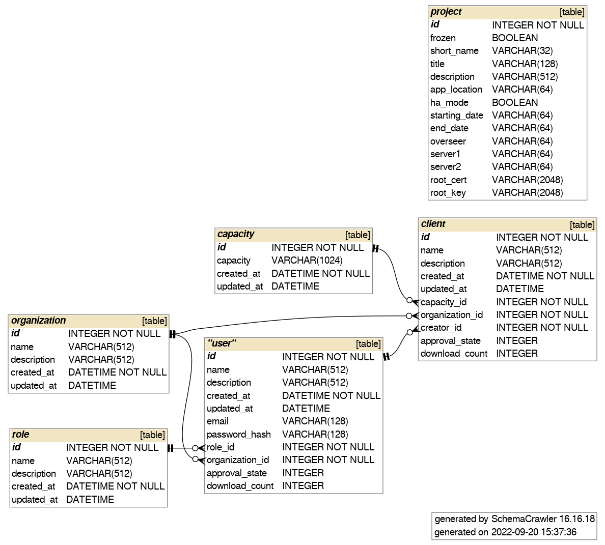

.. _dashboard_api:

#########################
Dashboard in NVIDIA FLARE
#########################

As mentioned in :ref:`provisioning`, the NVIDIA FLARE system requires a set of startup kits
that include private keys and certificates (signed by the root CA) for secure communication between components.
The :ref:`nvflare_dashboard_ui` in NVIDIA FLARE provides a streamlined way to collect information about clients and users from different organizations,
and to generate startup kits for users to download.

For detailed information about provisioning, refer to :ref:`provisioning`. This section focuses on user interaction with the Dashboard and its backend APIs.

.. include:: ../user_guide/nvflare_cli/dashboard_command.rst

***********************************
NVIDIA FLARE Dashboard Backend APIs
***********************************

Architecture
============

The Dashboard backend APIs follow RESTful principles and define four main resources: Project, Organizations, Client, and User. There is exactly one Project per deployment,
which includes information about the server. Clients represent NVIDIA FLARE client instances, while Users represent NVIDIA FLARE admin console users.
The Organizations endpoint is a read-only operation that returns a list of currently registered organizations.

Details
=======

APIs
----

The following OpenAPI 3.0 document describes the Dashboard backend APIs.

All Dashboard API endpoints are prefixed with ``/nvflare-dashboard/api/v1/``. For example,
the login endpoint is ``/nvflare-dashboard/api/v1/login``.

.. literalinclude:: ../../nvflare/dashboard/dashboard.yaml
  :language: yaml

Authentication and Authorization
--------------------------------

Most backend APIs require user authentication to obtain a JWT for authorization. The JWT includes claims about the user's organization and role, and always
contains the user's email address (which serves as the user ID for login).

The following operations do not require a bearer JWT:

   - ``POST /login``
   - ``GET /project``
   - ``GET /organizations``
   - ``POST /users``

Approved users with the ``project_admin`` role have full access to all resources. Authorization reads the current
account state from the database; role and approval claims in an older JWT do not preserve revoked permissions.

User registration and role approval
-----------------------------------

Public registration and the organization/role step of registration accept requests for ``member``, ``lead``, or
``org_admin``. Empty role/organization fields are allowed only while completing staged registration. Every public
registration starts pending, regardless of a supplied ``approval_state``. Self-service cannot request
``project_admin`` or custom roles, grant approval, or change an existing or approved role/organization.

The existing ``role`` and ``approval_state`` fields record the requested role and its approval. A pending Org Admin
applicant can manage only their own pending client-site registrations in their registered organization. Client
ownership is derived from the authenticated identity. Other users' sites are inaccessible, including within the
same organization. An approved Org Admin can manage their own sites, but only the Project Admin can approve,
rename, or delete an approved site. Members and Leads receive an empty client-site list.

To correct the organization of a user who already owns sites, the Project Admin first moves each owned site to
the destination organization, then updates the user's organization. The account update is rejected while any
owned site still belongs to a different organization. This correction does not grant user or site approval.

Approval reviews one user's explicit organization and requested role. Both fields must be nonempty and satisfy
provisioning's format rules. This is a per-user field check, not a check that an organization contains every role,
an Org Admin, or any client sites. For example, ``organization: OrgA`` and ``role: member`` are sufficient fields
to review even when OrgA has no other participants. The administrator must decide whether that person should
receive the requested permissions; field validation cannot establish their real-world organizational affiliation.

Once that Member is approved, a direct API request to change their role to ``org_admin`` returns HTTP 403 and
leaves the approved role and organization unchanged. The same restriction applies to Leads and to legacy
approved accounts with blank fields. An authorized Project Admin must review and assign any changed permissions.

This approval lifecycle belongs to Dashboard account registration. It does not add organization-population
requirements to operator-authored ``project.yml`` provisioning. A project containing a Project Admin and clients
without separate Member, Lead, or Org Admin entries remains valid. ``client`` is a participant type, not a
Dashboard user's authorization role.

To approve the individual registration, the Project Admin submits the values reviewed in the users table:

.. code-block:: json

   {
     "approval_state": 100,
     "reviewed_role": "org_admin",
     "reviewed_organization": "Workshop_org"
   }

``PATCH /users/{id}`` returns HTTP 409 if the reviewed values no longer match or a concurrent approval/profile
change wins. Reload and review the current registration before retrying. A blank role or organization cannot be
approved. A pending participant may register sites before the project is frozen; startup-kit downloads require
user approval, client-site approval where applicable, and a frozen project with provisioned trust material.

Rejected policies return HTTP 403, stale approvals or incomplete project setup return HTTP 409, and invalid fields
return HTTP 400. These responses include ``status: error``, an actionable ``message``, and field-specific ``errors``
where applicable. HTTP 401 indicates an authentication failure. Frontends must handle errors before accessing a
success response's ``user`` or ``client`` object and retain entered values when a correction is needed.

Project Freezing
----------------

Making the project public enables the Sign Up flow in the Dashboard web interface. After finalizing the project and server configuration,
the project_admin freezes the project to enable startup kit downloads and make the configuration immutable. Once frozen, the project cannot
be unfrozen through the Dashboard web interface.

Database Schema
---------------

The following diagram illustrates the schema of the underlying database used by the backend APIs:

