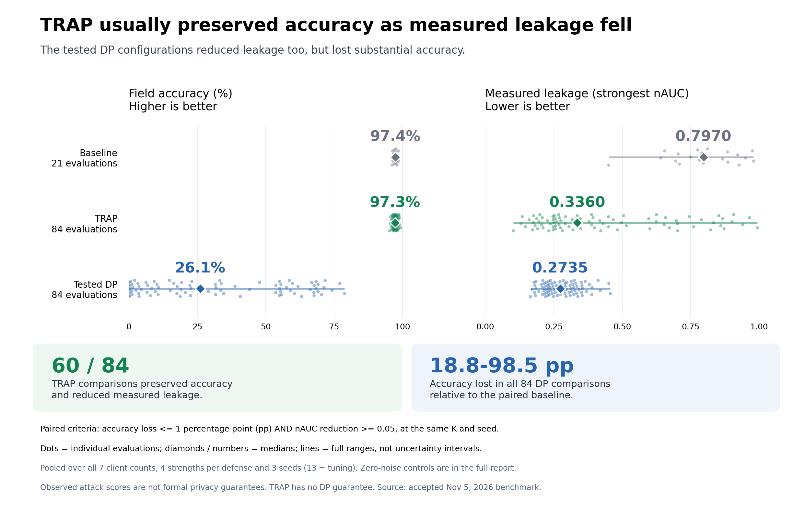

.. _memorization_reduction:

Memorization Reduction (Experimental)
======================================

The PyTorch Target Reference Advantage Penalty (TRAP) changes the local training
objective while retaining ordinary FedAvg or FedOpt aggregation. It penalizes
observed-token log probabilities that exceed a frozen reference by a configured
threshold. It is an experimental mitigation, with no differential privacy guarantee.

The method is introduced by Muhammed Ustaomeroglu et al. (2026) in
`TRAP: Understanding and Mitigating Privacy Memorization in Language Models
<https://arxiv.org/abs/2609.32293>`_, arXiv:2609.32293. The components below
integrate the preprint's reference-based penalty into NVFlare.

The TRAP and auditing components emit NVFlare's experimental API warning when
constructed. Their interfaces may change.

The loss, reference forward passes and audit model evaluation support CPU and CUDA.
Keep the target/reference models and their input tensors on the intended device.
For GPU audits, configure ``PTMemorizationAuditor(device="cuda:0")`` (or the same
argument on its application subclass); its default is CPU. SDK revision
``778d632e`` was validated with Pythia-70M on H100, including numerical parity
and a complete federated workflow.

Loss and diagnostics
--------------------

``nvflare.app_opt.pt.trap_loss.PTTRAPLoss`` returns an additive scalar penalty:

.. math::

   L_{\mathrm{TRAP}} = \frac{\lambda}{|M|}\sum_{t\in M}
       \max\left(0, \log p_\theta(x_t\mid x_{<t}) - \log q(x_t\mid x_{<t}) - \epsilon\right).

Use the same valid tokens and normalization for ordinary cross-entropy and TRAP.
``causal_token_log_probs`` shifts causal logits and labels once; mask prompt and
padding positions in the unshifted labels with ``-100``.

.. code-block:: python

    from nvflare.app_opt.pt.trap_loss import PTTRAPLoss, causal_token_log_probs

    trap = PTTRAPLoss(weight=0.5, threshold=0.0)
    log_probs, mask = causal_token_log_probs(target_logits, labels)
    count = mask.sum().clamp_min(1)
    ordinary_ce = -log_probs.masked_select(mask).sum() / count
    loss = ordinary_ce + trap(log_probs, reference_log_probs, mask)
    loss.backward()
    diagnostics = trap.diagnostics(log_probs, reference_log_probs, mask)

The reference is detached from autograd. Empty masks produce a differentiable zero
penalty. With ``weight=0``, the penalty has zero target gradient; callers can also
skip reference scoring entirely. Weights above one can reverse the active
token-level cross-entropy gradient and should be evaluated as experimental settings.
Diagnostics include valid-token count, mean reference advantage, active-token
fraction, and penalty magnitude.

For gradient accumulation, pass the total valid-token count of the entire
accumulation window as ``normalizer`` to each microbatch penalty, normalize its
ordinary cross-entropy sum by that same count, and sum the contributions. Averaging
microbatch means with different valid-token counts changes the objective.

Frozen reference scoring
------------------------

``nvflare.app_opt.pt.reference_scorer.FrozenReferenceScorer`` accepts a separate
causal language model. It freezes parameters, enforces evaluation mode, and computes
observed-token log probabilities without gradients. Hugging Face is optional for
the SDK: the model may return an object with ``logits`` or a logits tensor.

.. code-block:: python

    from nvflare.app_opt.pt.reference_scorer import FrozenReferenceScorer

    reference = FrozenReferenceScorer(
        reference_model,
        tokenizer_fingerprint="sha256-of-tokenizer-assets",
        scoring_identity="model-config-and-context-recipe-v1;fp32",
        cache_dir="local_reference_cache",  # omit for online scoring
    )
    reference_log_probs, reference_mask = reference.score(
        input_ids=input_ids, labels=labels, attention_mask=attention_mask,
    )

The scorer is a separate object, not a submodule of the target model. Keep reference
parameters out of the target optimizer and transmitted state. A same-task reference
that has not trained on the protected records is the intended starting point.
Provenance cannot rule out unknown exposure during pretraining.

Cache identity includes checkpoint tensor contents, tokenizer/scoring identities,
and all supplied tokenized inputs, labels, and tensor model inputs. Callers must
include model configuration, context construction, and scoring settings in the
scoring identity. Cached values are local tensors loaded with ``weights_only=True``.
Treat them as potentially sensitive artifacts.

Keep the reference immutable. Ordinary in-place changes, storage replacement and
dtype/device conversions are detected; set precision and placement before creating
the scorer and construct a new scorer after any change. In-place writes through
``.data`` or external storage aliases bypass version tracking and are unsupported.
Arbitrary changes to forward behavior also require a new scoring identity. A fixed-order precomputation, indexed by shuffled training
batches, avoids cache misses caused solely by different batch groupings. The
optional cache has no built-in quota or eviction: manage disk usage and retention
locally, or omit ``cache_dir`` for online scoring without input hashing.

Auditing and integration
------------------------

Use :doc:`filters` for the ``ModelFilter`` interface and the report-only
``MemorizationAuditFilter``. The ``PTMemorizationAuditor`` adapter handles a separate
evaluation module, full-weight/difference reconstruction, membership AUROC/nAUC,
before/after scores, and RNG isolation. Task-specific data and extraction probes
are supplied by the application. ``MemorizationAuditReporter`` persists local
aggregate reports and optionally emits explicitly selected scalar metrics.

The adapter requires the complete evaluation module ``state_dict()``, including
persistent buffers, with matching names and shapes. Full updates load strictly;
differences require every key and the matching full baseline for that task round.
Adapter-only/LoRA updates are unsupported. Applications using adapter-only exchange
must reconstruct the exact base, adapters and buffers in an independent evaluation
model and implement a task-specific ``MemorizationAuditor``. Missing keys must not
be silently filled from an unrelated model.

Client-model audits measure the transmitted update at the configured filter stage.
They do not replace evaluation of the selected global checkpoint or of exchanged
reference models. Incomplete audits must not be interpreted as low leakage.
External Client API filters require materialized parameters, increasing runtime
memory and transfer cost relative to forwarding lazy references.

The `TRAP research entry point
<https://github.com/NVIDIA/NVFlare/tree/main/research/memorization-reduction>`_
provides the representative GPU workflow below and an optional download-free tiny
model smoke example for checking API wiring.

Hugging Face adoption and operating limits
------------------------------------------

The runnable `Hugging Face workflow
<https://github.com/NVIDIA/NVFlare/tree/main/research/memorization-reduction/huggingface>`_
prepares a pinned Pythia-70M reference on disjoint synthetic records, trains two
clients with the SDK loss/scorer, performs paired likelihood/TRA audits, and
separately evaluates the saved final global checkpoint on fixed final cohorts.
On H100, 42 focused tests passed, including both CUDA tests, and the two-client,
two-round workflow completed all four client audits and final global evaluation.
It includes independent numerical parity checks and phase memory/runtime
measurements. This is a bounded implementation/adoption example, not production
certification or a replacement for the historical efficacy benchmark.

Budget for live trainer/reference models, the full baseline snapshot, materialized
updates, reconstruction/evaluation models, activations, logits, gradients, optimizer
state and temporary loading/hashing copies. Measure the actual model, sequence
length, precision, concurrency and cadence; tensor state size alone is insufficient.
The `SDK validation report
<https://github.com/NVIDIA/NVFlare/blob/main/research/memorization-reduction/huggingface/SDK_VALIDATION.md>`_
records the measured workload and explicitly limits extrapolation.

The adapter checks deadlines between audit phases, and application evaluators
must check between batches. Deadlines remain cooperative: initialization, hashing
and blocked CUDA calls already in progress can outlive them. Hard resource/deadline
limits require a separate supervised worker and explicit cleanup. The audit filter remains report-only: failure does not prevent
transmission, and this example adds no release-approval mechanism.

The example's ``check_coverage.py`` checks expected site/round identities, completed
status, model/baseline fingerprints and both attack cohort counts. It exits nonzero
on missing, duplicate, skipped, failed, unsupported or incomplete reports. Adapt
expected identities to the task schedule and run it after the observation window
closes. Intentionally unscheduled rounds remain unobserved, not zero leakage.
Monitor report/log write failures as well as metrics: configured scalar analytics
emit only for completed audits and cannot expose missing reports by themselves.
Deployments requiring release approval must enforce coverage/provenance/policy in a
separate fail-closed release step. The checker is an operator signal after execution.

Benchmark evidence
------------------

A separate Pythia-70M study completed **525 fits and 210 final evaluations** across
seven client counts, four strengths per defense and three seeds. TRAP passed the
paired accuracy-and-leakage screen in **60/84** comparisons; **24/84** also passed
the separate cross-entropy screen. The tested DP settings passed **0/84** in this
bounded search. The accuracy/leakage screen requires accuracy loss at most one
percentage point and strongest identifier nAUC reduction at least 0.05, paired at
the same client count and seed; the CE screen requires defended/baseline CE at most
1.01. These are descriptive screens, not significance tests or matched DP budgets.

Dots show all evaluations; diamonds are pooled medians and lines show full ranges,
not confidence intervals. Seed 13 is tuning; seeds 29/47 reuse frozen configurations.
The `complete benchmark report
<https://github.com/NVIDIA/NVFlare/blob/main/research/memorization-reduction/TRAP_DP_RESULTS.md>`_
includes every strength and seed, zero-noise controls, CE results, unattainable
leakage targets, scalar tables, costs, reference provenance, and PNG/PDF figures.
TRAP has no formal DP guarantee, and this search does not establish optimal DP
performance. The measurements used the frozen research implementation before the
SDK refactor. The separate H100 workflow validates its recorded SDK revision;
subsequent fixes are identified in the validation report. It does not
rerun that efficacy study.

The :doc:`design document <../design/federated_memorization_reduction>` describes the
API boundaries, reference assumptions, resource costs and remaining review gates.

.. toctree::
   :hidden:

   ../design/federated_memorization_reduction
