.. _nvflare_dashboard_ui:

####################
NVFlare Dashboard UI
####################

The NVFlare Dashboard collects user and client-site registrations, lets the
Project Admin review them, and distributes encrypted startup kits. The frontend
uses the open-source MUI community components and works with the Dashboard
backend included in NVFlare. See :ref:`dashboard_api` for deployment and backend
API details, or :ref:`dashboard_frontend` for building the frontend from source.

``Member`` and ``Lead`` users can download a FLARE Console startup kit after
approval. ``Org Admin`` users can also register client sites and download their
approved sites' kits. The ``Project Admin`` configures the project and server,
reviews registrations, and can download the server kit.

Screenshots below show a sample project and synthetic accounts. Downloads require
a frozen project and the applicable user and site approvals.

Member and Lead User Experience
===============================

.. _dashboard_homepage:

Home Page with Login and Sign Up
--------------------------------

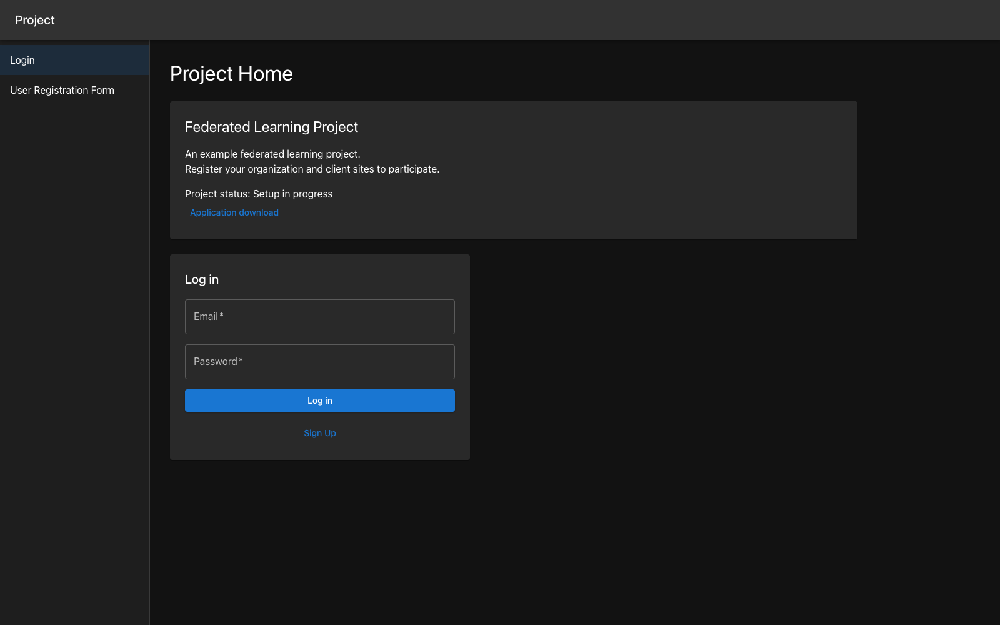

   Project Home with login and public registration.

The upper-left header shows the configured Project Short Name on every page,
including registration. It falls back to ``NVFlare`` when no name is configured
or project details cannot be loaded.

The Project Home shows the project title, description, and configuration status.
Log in with your registered email and password. ``Sign Up`` is available after
the Project Admin makes the project public. If an application download link has
been configured, it appears here as ``Application download``.

After logging in, use the navigation menu to open your dashboard and Downloads.
The Project Home also lists the approved client sites visible to your account.

.. _dashboard_new_user_reg:

New User Registration
---------------------

Choose ``Sign Up`` and enter your name, email, password, and password confirmation,
then click ``Register``.

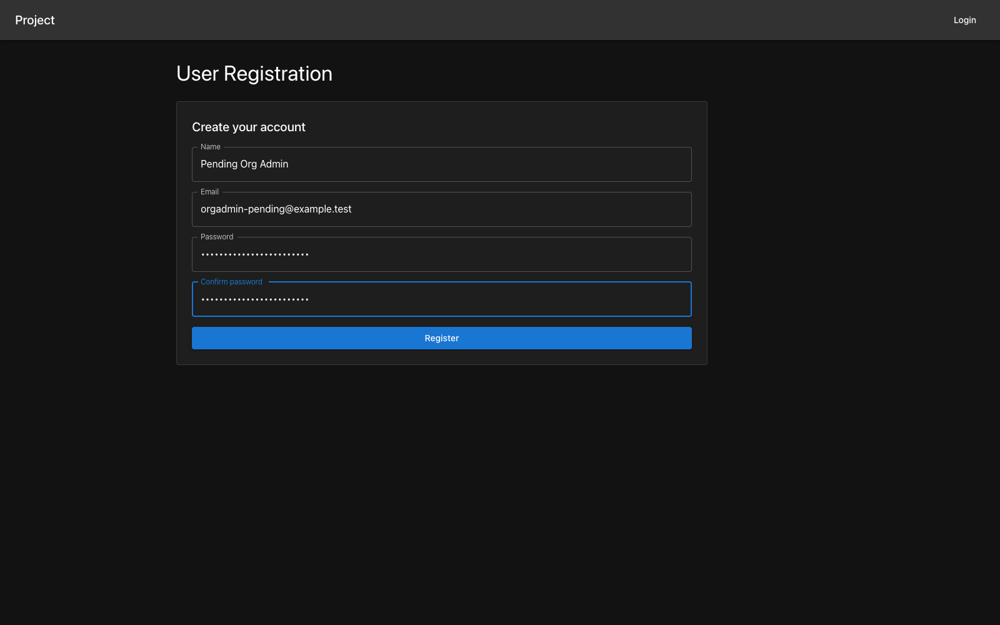

   Create a user account.

Enter your organization and choose ``Member``, ``Lead``, or ``Org Admin``, then
click ``Save``. Organization names use letters, digits, and underscores. Your
role and organization remain pending until the Project Admin reviews them.

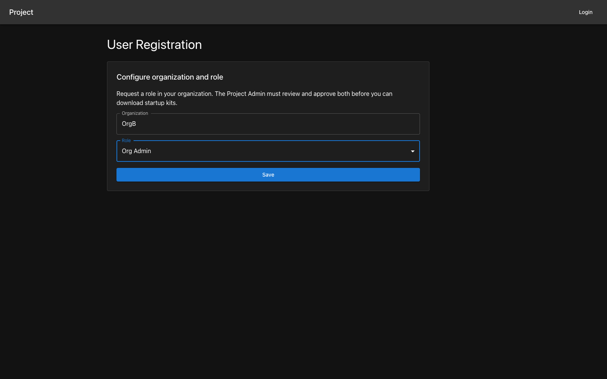

   Request a role in your organization.

Selecting ``Org Admin`` requests permission to manage client sites. It does not
grant Project Admin access. Once set, your role and organization cannot be
changed through self-service, including while approval is pending. Contact the
Project Admin to correct them.

Members and Leads can finish registration and choose ``Go to my dashboard``.
Org Admin applicants can first register their own pending sites as described
below.

.. _dashboard_user_dashboard_members:

User Dashboard
--------------

Your User Dashboard displays your name, email, organization, and role. A pending
account displays its requested role and an approval notice. ``Edit My Profile``
opens a dialog for changing your password; contact the Project Admin for other
account corrections.

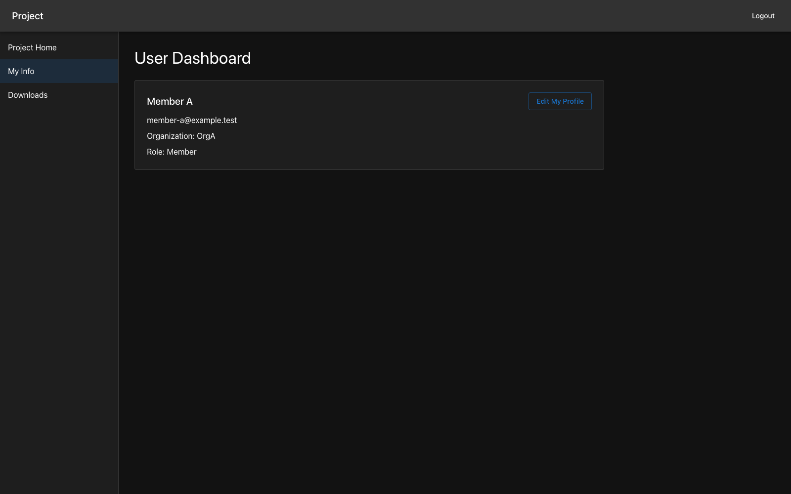

   Participant profile and registration status.

.. _dashboard_user_download:

FLARE Console Download
----------------------

Open ``Downloads`` after the Project Admin approves your account and freezes the
project. ``Download FLARE Console`` downloads ``flare-console.zip`` for the
logged-in user. Buttons remain disabled until the required approvals and project
configuration are ready.

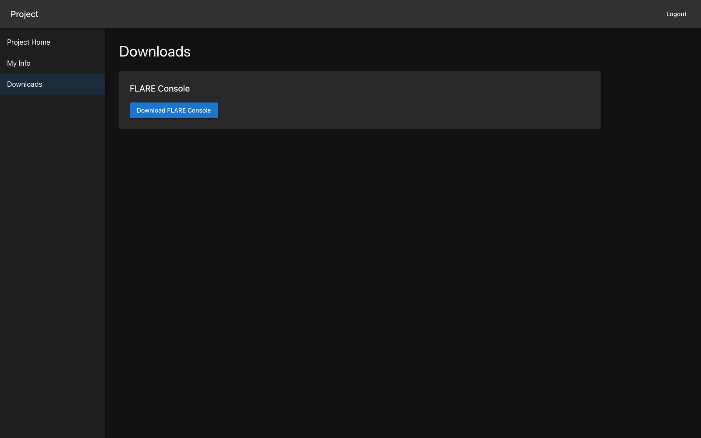

   FLARE Console download for an approved participant.

After a successful download, a dialog displays the PIN for opening that encrypted
ZIP. Record the PIN before closing the dialog. Each download uses a new PIN.

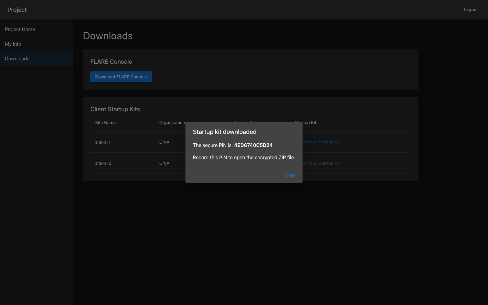

   Record the PIN shown after downloading a kit.

The FLARE Console was called the Admin Client before NVIDIA FLARE 2.2.

Org Admin User Experience
=========================

Org Admins follow the same account-registration steps as Members and Leads, with
an additional client-site registration step.

.. _dashboard_org_admin_user_reg:

Org Admin Registration - Configure Client Sites
-----------------------------------------------

After saving the ``Org Admin`` request, the registration page displays a
``Client Sites`` table. Click ``Add Site`` to open the site editor. Enter the
site name, number of GPUs, and memory per GPU in GiB, then click ``Save``.

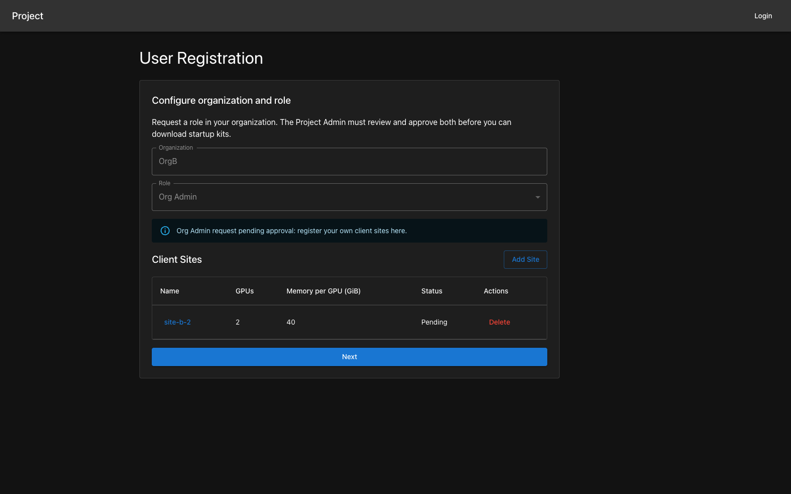

   Register client sites while the Org Admin request is pending.

The saved site appears in the table with ``Pending`` status. Click its name to
reopen the editor, or ``Delete`` to remove a pending site. Changes are saved with
``Save`` in the dialog; clicking outside a field does not save an edit.

You can register, view, edit, and delete only your own pending sites in your
registered organization. Another participant's sites remain inaccessible even
when that participant selected the same organization. User approval and site
approval are separate. Click ``Next`` and then ``Go to my dashboard`` to finish
onboarding without waiting for either approval.

Org Admin User Dashboard
------------------------

The Org Admin User Dashboard includes the profile and client-site table. Sites
registered during onboarding remain available here, and ``Add Site`` opens the
same editor.

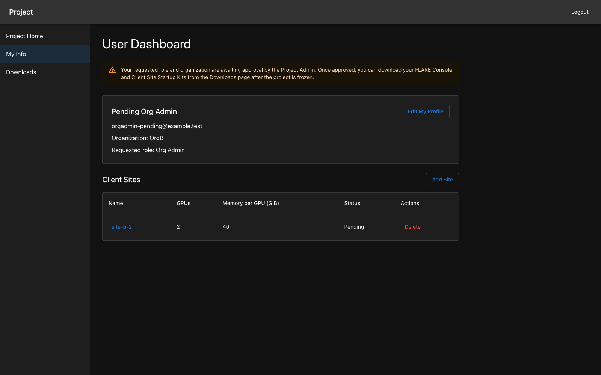

   Manage your own client-site registrations.

Once a site is approved, its name is locked in the participant editor and its
``Delete`` action is disabled. Contact the Project Admin to rename or delete an
approved site. Capacity values can still be edited in the site dialog.

.. _dashboard_org_admin_downloads:

Org Admin Downloads
-------------------

An approved Org Admin can download the FLARE Console and the startup kits for
approved client sites once the project is frozen. Client ZIP filenames use the
site name followed by ``.zip``.

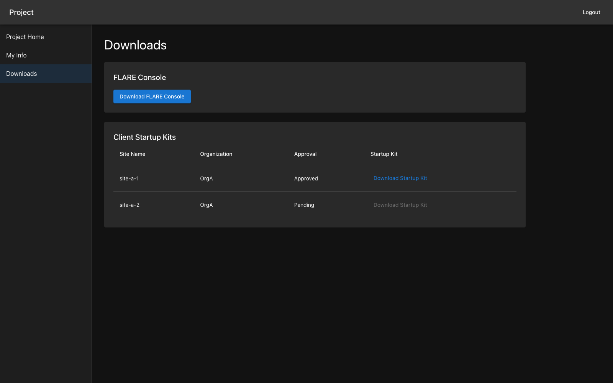

   Download the FLARE Console and approved client-site kits.

Each site's approval is independent, so some site download buttons can remain
disabled while others are enabled. Each successful download displays the PIN
for that ZIP in its own dialog.

Project Admin Guide
===================

Log in using the bootstrapped Project Admin credentials from the deployment
process. A project that is not yet public opens at Project Configuration; public
projects open at Users Dashboard. Use the navigation menu to switch pages.

.. _dashboard_project_configuration:

Project Configuration
---------------------

Configure the following project values and click ``Save``:

- ``Project Short Name``: at most 16 characters, used in certificates and the
  Dashboard header.
- ``Title`` and ``Project Description``: displayed on Project Home.
- ``Docker Download Link``: an optional application location linked from Project
  Home as ``Application download``.
- ``Project Start Date`` and ``Project End Date``: the planned project dates.

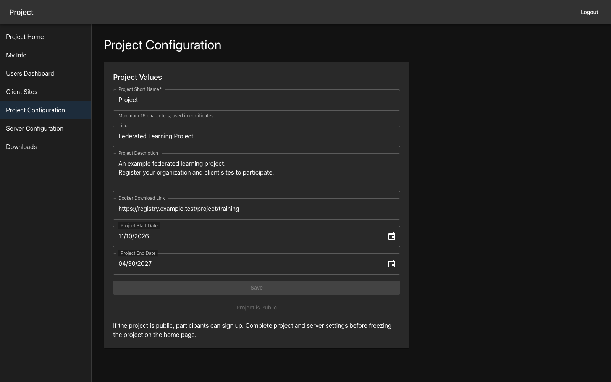

   Configure the project before freezing it.

``Make Project Public`` enables the web interface's Sign Up flow. Save project
and server settings before choosing ``Freeze Project`` on Project Home and
confirming the dialog. Freezing creates the project's trust material and locks
project and server configuration. Participant registration and review can
continue after freezing.

.. _dashboard_server_configuration:

Server Configuration
--------------------

Enter the FL Server hostname or IP address and click ``Save``. If required for
your deployment, ``CC Enabled`` exposes the target deployment environment and CPU
family settings. Complete these values before freezing the project.

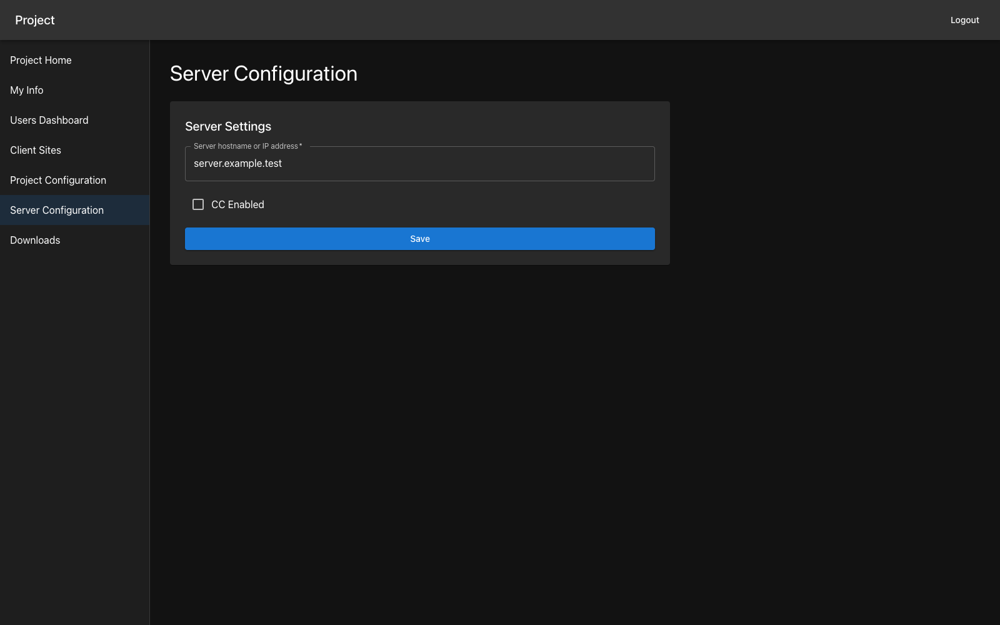

   Configure the FL Server.

.. _dashboard_users_dashboard:

Users Dashboard
---------------

The Users Dashboard lists registered users' names, emails, organizations, roles,
creation times, approval states, and FLARE Console download counts. Pending
site-owner requests appear as ``Org Admin (requested)``.

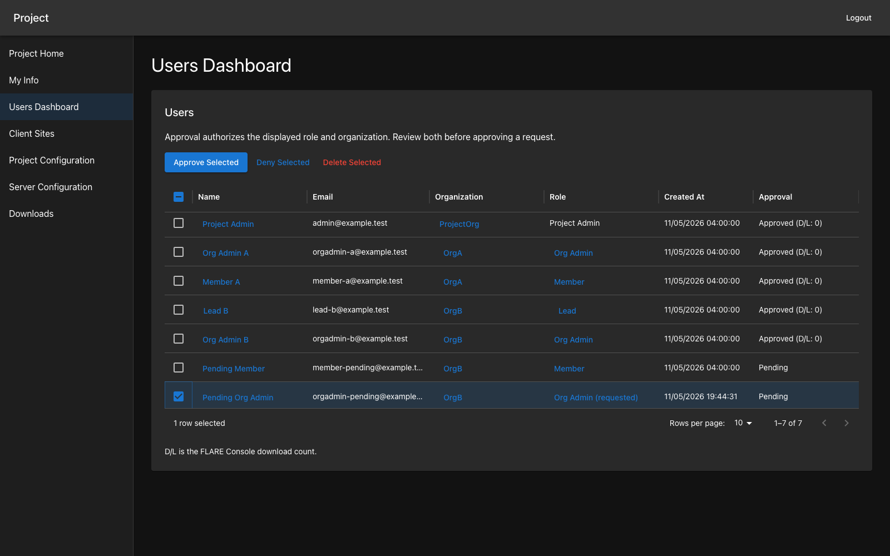

   Review each participant's role and organization before approving.

Approval authorizes the role and organization displayed in the selected row.
Both fields must be complete and valid; an organization does not need every role
or a client site. If a registration changes after the table was loaded, reload
and review the current values before approving again. Approval never authorizes
participants to promote themselves later through the API.

Select one or more rows using their checkboxes, then choose ``Approve Selected``,
``Deny Selected``, or ``Delete Selected``. Deletion requires confirmation and
removes the selected users and their client-site registrations.

Click a name, organization, or participant role to open its edit dialog, then
click ``Save``. The Project Admin can correct those fields; participants cannot
change their own role or organization. User email addresses and the Project
Admin role are not editable in this interface.

.. _dashboard_client_sites:

Client Sites Dashboard
----------------------

The Client Sites Dashboard lists site names, organizations, capacity, creation
times, approval states, and kit download counts.

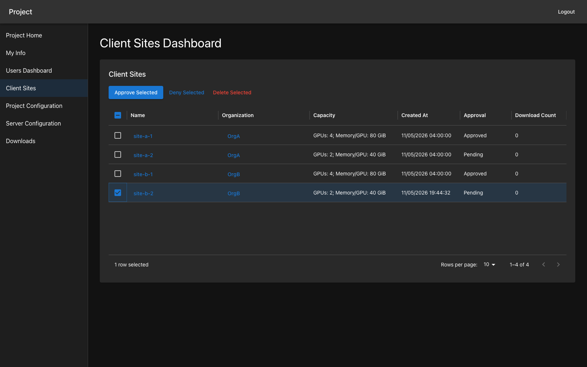

   Review the registered client sites.

Click a site name or organization to open its edit dialog, then click ``Save``.
The Project Admin can correct an approved site's name or organization. If moving
an owner's account to another organization, first move each owned site to that
organization and then update the account.

Select site rows and choose ``Approve Selected``, ``Deny Selected``, or
``Delete Selected``; deletion requires confirmation.

Client-kit downloads require approval of both the site and its owner, as well
as a frozen project.

.. _dashboard_proj_admin_downloads:

Project Admin Downloads
-----------------------

Once the project is frozen, Downloads provides the Project Admin's FLARE Console,
the server startup kit, and approved client-site kits. The console downloads as
``flare-console.zip`` and the server as ``server.zip``. Client kit filenames use
their site names.

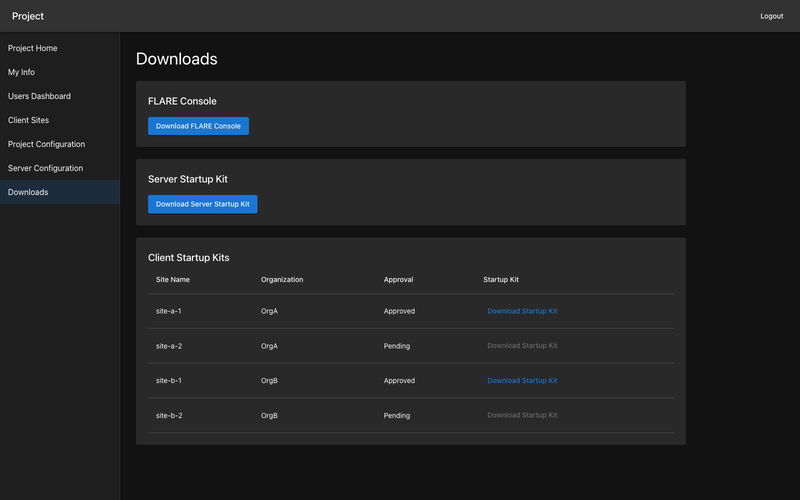

   Download the console, server, and approved client-site kits.

Each successful download displays a separate PIN for opening its encrypted ZIP.
