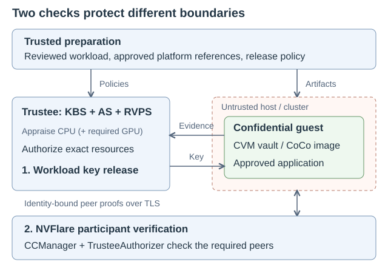
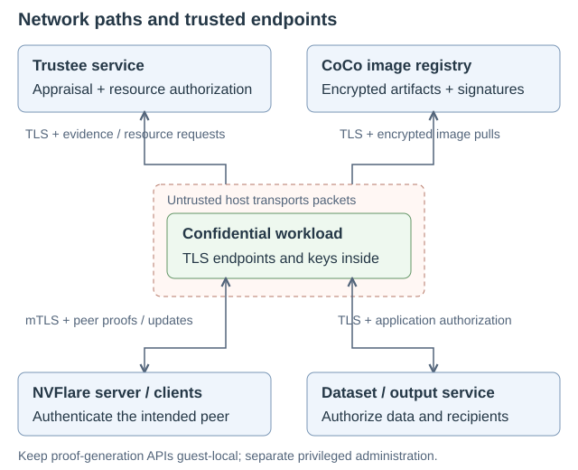

.. _cc_architecture_overview:

Confidential Computing Architecture and Security
================================================

Federated Confidential Computing with NVIDIA FLARE protects approved workloads
on infrastructure operated by another party. This architecture connects the
hardware trust boundary to workload preparation, secret release, and federation
participation. For environment selection and prerequisites, start with
:ref:`cc_getting_started`; provisioning configuration belongs in
:ref:`cc_deployment`.

This description follows the **2.9 implementation and its design contracts**.
Implemented checks are distinguished from deployment requirements: administrators
must supply trusted endpoints, approvals, data-access policy, and output controls.
The configuration does not create those trust relationships automatically.
Hardware acceptance remains profile- and revision-specific; see
:ref:`cc_getting_started` for the validation records.

.. contents:: On this page
   :local:
   :depth: 2

Security challenge and design
------------------------------

A Trusted Execution Environment (TEE) protects memory from the host, but that
alone does not establish which application is running or which secrets it may
receive. Protection must cover both deployment and runtime:

* Before launch, an infrastructure operator could substitute boot artifacts,
  application content, or configuration, or try to obtain decryption keys.
* During execution, approved software can still expose inputs, model weights,
  checkpoints, or logs through its permitted interfaces. Host-backed files and
  authorized outputs need explicit protection and review.

The design therefore combines an approved guest and workload, attestation-bound
secret release, protected execution and storage, and NVFlare participant
verification. These are separate controls with different enforcement points;
a successful hardware appraisal does not make application behavior safe.
The `RATS architecture (RFC 9334)`_ provides the underlying attestation roles
and terminology; :ref:`cc_architecture_references` links the implementation,
design, and platform documentation used by this guide.

Architecture overview
----------------------

TLS.

   Two decisions: authorize a protected workload to receive a resource, and
   admit an authenticated participant to the federation. A participant proof
   does not itself release a workload key.

The diagram shows the shared Trustee-backed layers for standalone Confidential
Virtual Machines (CVMs) and Confidential Containers (CoCo). Their guest startup,
image protection, and resource bindings differ. Azure uses its own confidential
compute deployment and Microsoft Azure Attestation integration; the Trustee
vault and image-release flows below must not be assumed for Azure.

A federation can protect clients, the server, or both. An ordinary participant
can verify protected peers, but its own memory and aggregation remain outside
a confidential execution boundary. The trusted application can see the data
it processes; protected aggregation is not a cryptographic secure-aggregation
protocol.

Responsibilities and trust boundaries
-------------------------------------

.. list-table:: Roles in a confidential federation
   :header-rows: 1
   :widths: 28 72

   * - Role
     - Responsibility
   * - Model or workload owner
     - Reviews application code and dependencies, approves the workload release,
       and defines permitted model and result access.
   * - Data owner
     - Authorizes which workload may access local data and reviews the workload's
       behavior and output policy.
   * - Trust-service administrator
     - Manages trusted reference values, appraisal policy, and secret-release
       authorization. Participants must trust this authority.
   * - Infrastructure operator
     - Runs the host or cluster. The confidential deployment treats this
       infrastructure as untrusted for protected plaintext, but cannot prevent
       the operator from denying service.

One organization may perform multiple roles. The deployment must still preserve
the intended separation of authority. Giving a host operator control of key
release or approved reference values changes the trust model.

Security architecture components
---------------------------------

.. list-table:: Components and enforcement points
   :header-rows: 1
   :widths: 27 43 30

   * - Component
     - Purpose
     - Important boundary
   * - Trusted build and provisioning environment
     - Prepares reviewed application artifacts, participant startup kits,
       approvals, and deployment-specific handoffs.
     - It handles plaintext inputs and signing or publishing credentials;
       the future untrusted host must not inherit those privileges.
   * - Approved guest and hardware TEE
     - Protect execution and enforce the selected guest's boot, image,
       storage, and workload controls.
     - Guest services and application code are part of the trusted computing
       base; host orchestration alone is not enforcement.
   * - Trustee Attestation Service (AS) and Reference Value Provider Service (RVPS)
     - Verify evidence and appraise claims against approved reference values
       and appraisal policy, producing a signed result.
     - Approved values must come from the trusted platform workflow, not
       merely from whatever the future host reports.
   * - Trustee Key Broker Service (KBS)
     - Applies resource-release policy and makes the authorized key or
       resource available to the attested guest.
     - Passing appraisal and being authorized for a particular resource
       are different requirements.
   * - NVFlare ``CCManager`` and authorizers
     - Generate and verify participant evidence at registration
       and periodic cross-site checks.
     - Peer admission is separate from local vault or image-key authorization.
   * - Reviewed application and output controls
     - Constrain admitted code, data access, persistence, and released results.
     - Neither attestation nor encryption implements a dataset access policy
       or proves that an application will preserve input confidentiality.

Trustee policies and reference values
-------------------------------------

`Trustee`_ supplies the attestation and secret-delivery services.
Appraisal policy determines which platform and software claims are acceptable.
Resource-release policy additionally determines which protected resource that
approved environment may receive. Treat both policies, approved reference
values, and their administrative credentials as trusted security inputs.

CPU-only profiles require CPU evidence. GPU-required CVM and CoCo profiles
require successful CPU **and** GPU appraisal before the relevant initial key
release; GPU validation is not deferred until after plaintext workload startup.
A CPU-only profile is a deliberate configuration, not a fallback when GPU
appraisal fails.

Within one trusted administration domain, CVM and CoCo profiles can share
Trustee with separate policies and reference values. This is not administrative
isolation for mutually untrusted tenants. See the
:github_nvflare_link:`Trustee configuration guide
<nvflare/lighter/cc/image_builder/TRUSTEE_GUIDE.md>` and the
:github_nvflare_link:`CoCo secure-services guide
<examples/devops/coco/service/README.md>`.

Boot and workload-release flows
-------------------------------

Standalone CVM: verified root and authenticated vault
~~~~~~~~~~~~~~~~~~~~~~~~~~~~~~~~~~~~~~~~~~~~~~~~~~~~~

1. **Prepare the release.** Approve a reusable generic CVM bundle and build a
   separately sealed application vault containing the reviewed workload and
   participant kit. A compatible new vault does not require rebuilding the
   generic root, but it still requires its own authorization.
2. **Measure the launch.** The platform measures the approved boot inputs.
   The initramfs verifies the read-only root through `dm-verity`_. In the current
   design, initramfs does not perform attestation or retrieve a vault key.
3. **Appraise and authorize.** Services in the verified guest obtain CPU and,
   for a GPU profile, GPU appraisal. Trustee applies the approved bundle
   measurements and resource binding before releasing the vault key.
4. **Bind and open the vault.** The resource identity incorporates the approved
   bundle and vault-header binding. The guest verifies the header it opens;
   authenticated encrypted storage protects the application payload.
5. **Run the approved workload.** Only after these checks does the guest start
   the application. Guest-level reauthorization and integrity enforcement are
   distinct from NVFlare's cross-site participant checks.

The generic root is verified, not the per-application encrypted payload.
Confidential application content and state belong in the authenticated vault.
A boot verification or authorization failure prevents workload startup. Runtime
failure and recovery depend on the CPU/GPU profile; follow the
:github_nvflare_link:`CVM runtime and recovery guide
<nvflare/lighter/cc/image_builder/USER_GUIDE.md>` and
:ref:`CVM Builder security architecture <cc_architecture>` for the detailed
enforcement and recovery behavior.

CoCo: approved guest and encrypted workload image
~~~~~~~~~~~~~~~~~~~~~~~~~~~~~~~~~~~~~~~~~~~~~~~~~~

The `Confidential Containers architecture`_ describes the upstream components;
the following flow summarizes their NVFlare integration.

1. **Prepare the release.** Trusted provisioning builds the participant image,
   includes reviewed code and its signed startup kit, encrypts/signs the
   release, and prepares guest policy, InitData, and Pod handoffs.
2. **Launch the guest.** Kubernetes and Kata start the confidential VM.
   Host-side checks and a runtime name do not establish trust; required
   restrictions must be enforced by the guest and secure services.
3. **Appraise the environment.** Guest services submit the required CPU and
   GPU evidence and launch context to Trustee. Appraisal uses approved
   references and policy.
4. **Authorize resources.** KBS applies resource-specific authorization and
   binds delivery to the attested guest. Image ciphertext may travel through
   the registry or host; plaintext decryption belongs inside the guest.
5. **Enforce guest checks and start NVFlare.** Image verification, decryption,
   and effective guest policy govern workload startup. NVFlare then performs
   its separate participant-verification workflow.

These are conceptual dependencies, not an exact packet sequence; guest checks,
image handling, and resource requests may interleave or repeat. Current CoCo
controls do not prove that every YAML field or exact application image digest
is enforced. See :ref:`coco_security_attack_surface` for the remaining identity
and guest-integrity limitations.

Attestation and workload authorization
--------------------------------------

Boot-time secret release and federation participation are separate decisions:

* **Deployment authorization** checks approved platform evidence and the
  deployment's resource or workload binding before releasing secrets. CPU-only
  profiles do not require GPU evidence. GPU-required CVM and CoCo profiles
  require successful CPU and GPU appraisal before the relevant key release.
* **Participant verification** uses ``CCManager`` and its authorizers to check
  peers during registration and periodic cross-site validation. Unified CVM and
  CoCo provisioning generates ``TrusteeAuthorizer`` components that use the same
  identity-bound peer-proof format through different guest integrations.

Identity binding here describes the Trustee-backed CVM and CoCo proofs.
Azure authorizers retain their `Microsoft Azure Attestation`_ token semantics;
do not assume the same signed site-identity binding for Azure or an equivalent
binding requirement in a mixed federation that includes Azure.

Peer checks are point-in-time and periodic, not continuous hardware monitoring
or a fresh appraisal before every operation. A valid peer proof is not a dataset
access-control policy or, by itself, proof of an exact running application image.
A server rejects a client registration whose CC evidence fails validation.
If a client rejects the server's CC evidence after registration, the client
process exits. A required-peer failure during cross-site validation shuts down
the server or exits the detecting client; it does not selectively quarantine
only the offending participant. See
:ref:`confidential_computing_attestation` for the runtime behavior.

Network architecture and access controls
-----------------------------------------

The host or cluster operator can control network interfaces, routing, DNS, and
packet delivery. A TEE does not make those paths trusted. Protect sensitive
traffic with authenticated encryption whose endpoint is inside the approved
guest; decide separately which remote services are authorized to receive it.

 remains guest-local.

   Runtime paths for Trustee-backed CVM and CoCo deployments. The registry
   pull is a CoCo image-delivery path; a standalone CVM normally receives a
   sealed vault artifact instead. Privileged administration is separate.

Connections and trust decisions
~~~~~~~~~~~~~~~~~~~~~~~~~~~~~~~

.. list-table:: Network paths to approve
   :header-rows: 1
   :widths: 25 37 38

   * - Path
     - Traffic and authentication
     - Required control
   * - NVFlare participant to server or peer
     - Registration, participant evidence, job control, and model updates.
       The standard secure deployment uses mutual TLS (mTLS).
     - Permit the configured federation/listener ports and authenticate the
       intended peer. TLS identity and CC evidence are separate checks.
   * - Confidential guest to Trustee
     - Evidence and resource requests over TLS; authorized resources are
       delivered to the attested guest.
     - Validate the approved service name and trust roots. Allow guest
       attestation/resource access without exposing administrative credentials.
   * - CoCo guest to registry
     - Encrypted image artifacts and signatures over TLS.
     - Separate image-publishing credentials from runtime pull access.
       TLS does not replace guest-side image verification and decryption.
   * - Trusted provisioning or service administrator to secure services
     - Reference values, release policies, keys, and image publication.
     - Restrict management access to trusted administrators. A reachable
       service or source-IP rule does not grant permission to change policy.
   * - Application to dataset, checkpoint, or output service
     - Application-specific authenticated data exchange.
     - Authorize the exact workload and recipient, and encrypt sensitive
       traffic to the approved endpoint. CoCo's example dataset connectors
       require user implementation; peer attestation is not a dataset ACL.
   * - Guest or secure services to infrastructure dependencies
     - DNS, trusted time, and the selected attestation provider's collateral
       or verification services.
     - Approve only the dependencies needed by that profile. Verify DNS and
       reachability from the guest, not only from its host.

TLS termination and local APIs
~~~~~~~~~~~~~~~~~~~~~~~~~~~~~~

For protected application traffic, TLS must terminate inside the trusted
execution boundary or at an explicitly trusted endpoint. A host-controlled
proxy that terminates TLS and forwards plaintext can read the traffic; an
encrypted network hop before that proxy does not preserve the guest boundary.
Keep TLS private keys and application credentials out of host-visible inputs,
logs, and container metadata.

NVFlare also supports one-way TLS, clear connections, and custom connectivity.
These options do not automatically preserve a confidential deployment's trust
model. Review proxies, relays, and each transport segment against
:ref:`communication_security`; do not treat a clear segment through untrusted
infrastructure as protected because another segment uses TLS.

Proof-generation services and credentials are local interfaces, not federation
listeners. In CoCo, keep the attestation/token endpoint on guest loopback; do
not expose it through a Kubernetes Service, host port, or application proxy.
The response can contain private proof credentials. The standalone CVM
integration delivers credentials through its measured guest services, not a
public proof-generation endpoint.

Deployment-specific network enforcement
~~~~~~~~~~~~~~~~~~~~~~~~~~~~~~~~~~~~~~~~

* **Standalone CVM:** measured guest firewall rules apply before networking.
  Bootstrap restricts DNS to the discovered resolver set and gates attestation
  on trusted time. Provisioning derives federation, admin, relay, and listener
  ports from the signed startup kit; ``bare_metal_cvm.network`` adds
  application-specific inbound/outbound TCP ports and optional CIDR restrictions.
  An omitted CIDR list does not restrict those allowed TCP ports to particular
  addresses. DHCP, DNS, time synchronization, and ICMP have separate rules;
  this is not a blanket destination allowlist for all protocols.
  Review the resulting guest policy, not only a host firewall. Forwarded ports
  listen on all host IPv4 interfaces by default; restrict the launch bind
  address and host exposure as appropriate, without treating an untrusted
  host's rules as the security boundary. See the
  :github_nvflare_link:`CVM networking and launch guide
  <nvflare/lighter/cc/image_builder/USER_GUIDE.md>`.
* **CoCo:** Kubernetes networking, CNI, host firewalls, and network policies are
  controlled by the cluster operator. They provide connectivity and operational
  filtering, not independent protection from that operator. Authenticate
  services from inside the guest and keep sensitive endpoints and secrets
  within the intended trust domains. The reference secure-services deployment
  exposes TLS KBS and registry listeners while keeping internal service ports
  private; its management paths require separate authorization. Follow the
  :github_nvflare_link:`secure-services network procedure
  <examples/devops/coco/service/SERVICE-INSTALLATION.md>` for the actual ports,
  publisher/pull origins, certificates, and firewall rules.
* **Azure:** cloud networking and resource creation are managed through Azure
  tooling. Review ingress, egress, routing, and TLS termination in the selected
  :doc:`Azure deployment guide <azure/index>`; do not assume the standalone
  CVM guest firewall or CoCo service layout applies.

Network allowlists reduce reachable destinations; they do not prove that data
sent to an allowed destination is safe. The host can still block or delay
traffic, observe metadata, or interrupt required-peer verification. Validate
both approved connectivity and denial cases, including untrusted certificates,
unapproved endpoints, and unavailable attestation services, before acceptance.

Storage and application-level protection
-----------------------------------------

.. list-table:: Where protection applies
   :header-rows: 1
   :widths: 27 43 30

   * - Storage or interface
     - Protection and intended use
     - Boundary to preserve
   * - CVM generic root
     - Read-only dm-verity verification, bound to approved launch inputs.
     - Not a store for per-application secrets.
   * - CVM application vault
     - Authenticated encrypted application content and protected mutable state.
     - Authentication detects corruption, not general rollback of valid state.
   * - CVM ``user_config``, ``user_data``, and ``applog``
     - Clear host-visible inputs or outputs.
     - Do not put secrets here or assume host-provided input is trusted.
   * - CoCo encrypted workload image
     - Encrypted distribution with guest-side verification and decryption.
     - Does not automatically protect external storage or authorize dataset access.
   * - Models, updates, datasets, and logs leaving the guest
     - Authenticated transport and an explicitly approved recipient/output policy.
     - Authorized outputs can still disclose sensitive information.

CC mode blocks bring-your-own-code (BYOC) jobs, including launcher-defined
executable content. Package reviewed code and dependencies in the approved
workload and use exact, reviewed ``class_allow_list`` entries for additional
components. Code or policy changes require a new approved release.

Validate the executor and persistence behavior for the selected deployment.
External-process execution has failed in sealed CoCo deployments; see the
:github_nvflare_link:`in-process executor workaround
<examples/devops/coco/FL-DEPLOYMENT.md#executor-limitation-and-workaround>`.
An approved executor is not a substitute for reviewing application behavior
and outputs.

Limits of the protection
------------------------

Confidential computing does not establish that approved code is safe, prevent
model inversion from authorized outputs, guarantee availability, or
automatically protect host-backed files. It also does not replace differential
privacy, cryptographic secure aggregation, application review, or organizational
agreements where those controls are required.

Side channels and replay of previously valid mutable storage require separate
consideration. CVM Builder's authenticated vault detects corruption but does not
provide general disk rollback protection. CoCo has deployment-specific
application-identity and guest-integrity limitations described in its
:ref:`security analysis <coco_security_attack_surface>`. Enabling a Trusted
Execution Environment (TEE) alone does not close these gaps or establish
regulatory compliance.

Deployment-specific architecture
---------------------------------

* :ref:`cc_architecture` describes the standalone CVM chain of trust, verified
  root, application vault, and attestation-bound key release.
* :ref:`coco_security_architecture` describes CoCo's trust boundaries,
  attestation and key-release protocol, operational roles, and residual risks.
* :doc:`azure/index` links to the Azure deployment guides and their
  platform-specific requirements.

Use :ref:`cc_getting_started` for the preparation workflow and
:ref:`cc_deployment` for the shared provisioning configuration.

.. _cc_architecture_references:

References
-----------

NVFlare implementation and design
~~~~~~~~~~~~~~~~~~~~~~~~~~~~~~~~~~

The following sources define the behavior summarized above. Use the validation
records for hardware acceptance; these code and design references are not
evidence that a particular deployment has passed those tests.

* **CVM chain of trust and key release:**
  :github_nvflare_link:`builder design <nvflare/lighter/cc/image_builder/DESIGN.md>`,
  :github_nvflare_link:`guest bootstrap <nvflare/lighter/cc/image_builder/cvm/runtime/bootstrap.py>`,
  and :github_nvflare_link:`attestation and authorized-key retrieval
  <nvflare/lighter/cc/image_builder/cvm/runtime/attestation.py>`.
* **CVM network enforcement:**
  :github_nvflare_link:`guest firewall rules <nvflare/lighter/cc/image_builder/cvm/common/firewall.py>`,
  :github_nvflare_link:`startup-kit network derivation <nvflare/lighter/cc/vault_adapter.py>`,
  and the :github_nvflare_link:`CVM provisioning adapter
  <nvflare/lighter/cc_provision/impl/bare_metal_cvm.py>`.
* **Federation verification and mode differences:**
  :github_nvflare_link:`required-peer configuration <nvflare/lighter/cc_provision/impl/cc.py>`,
  :github_nvflare_link:`TrusteeAuthorizer <nvflare/app_opt/confidential_computing/trustee_authorizer.py>`,
  and :github_nvflare_link:`CCManager <nvflare/app_opt/confidential_computing/cc_manager.py>`.
* **CoCo resource, guest, and network boundaries:**
  :ref:`coco_security_architecture`, the
  :github_nvflare_link:`guest token client <nvflare/app_opt/confidential_computing/coco_authorizer.py>`,
  and the :github_nvflare_link:`secure-services implementation and runbooks
  <examples/devops/coco/service/README.md>`.

Platform and upstream documentation
~~~~~~~~~~~~~~~~~~~~~~~~~~~~~~~~~~~~

These references explain the underlying mechanisms. They do not replace
NVFlare's release-specific configuration, supported profiles, or hardware
acceptance records.

* `RATS architecture (RFC 9334)
  <https://www.rfc-editor.org/rfc/rfc9334.html>`_: attesters, verifiers,
  relying parties, evidence, and appraisal.
* `NVIDIA Confidential Computing
  <https://docs.nvidia.com/confidential-computing/index.html>`_: NVIDIA
  platform trust boundaries, deployment modalities, and attestation resources.
* `NVIDIA Confidential Containers Reference Architecture
  <https://docs.nvidia.com/confidential-computing/containers/overview>`_:
  GPU-enabled CoCo architecture, components, and security considerations.
* `NVIDIA Confidential VM Reference Architecture
  <https://docs.nvidia.com/enterprise-reference-architectures/deploying-proprietary-models-confidential-compute-self-hosted-vms/latest/scope.html>`_:
  GPU-accelerated inference on self-hosted CVMs. Its scope excludes training
  and fine-tuning; use it as platform background, not qualification of a
  federated workload.
* `AMD Secure Encrypted Virtualization (SEV)
  <https://www.amd.com/en/developer/sev.html>`_: AMD SEV-SNP platform and
  attestation documentation.
* `Intel Trust Domain Extensions (TDX)
  <https://www.intel.com/content/www/us/en/developer/tools/trust-domain-extensions/overview.html>`_:
  Intel's confidential-VM architecture and documentation.
* `Confidential Containers architecture
  <https://confidentialcontainers.org/docs/architecture/>`_: CoCo design
  and trust model.
* `Trustee <https://github.com/confidential-containers/trustee>`_: upstream
  Attestation Service, Key Broker Service, and Reference Value Provider Service.
* `Microsoft Azure Attestation
  <https://learn.microsoft.com/en-us/azure/attestation/overview>`_: Azure's
  attestation service and policy-based evidence appraisal.
* `dm-verity <https://docs.kernel.org/admin-guide/device-mapper/verity.html>`_:
  Linux read-only block-device integrity verification.
