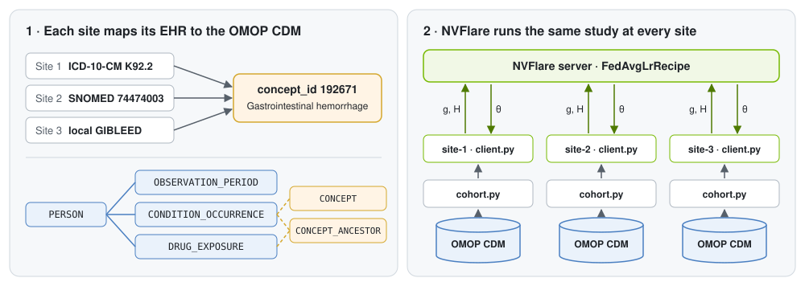

# Federated Learning on OMOP CDM Data

This tutorial trains a gastrointestinal (GI) bleeding risk model across three hospitals that store their records in the OMOP Common Data Model (CDM).
Every hospital runs the same SQL study definition against its own database, and NVFlare combines the results into one model without moving any patient rows.
The federated model is identical to the model you would get by pooling all patients in one place.



## What is OMOP?

The [OMOP Common Data Model](https://ohdsi.github.io/CommonDataModel/), maintained by [OHDSI](https://www.ohdsi.org/), gives every site the same tables and maps every local code to a standard concept, so an ICD-10-CM `K92.2` and a SNOMED `74474003` diagnosis both become concept `192671` (Gastrointestinal hemorrhage).
A study written once against the CDM therefore runs unchanged at every site and yields the same features in the same order, which is exactly what federated learning needs.

## The study

The data is [Eunomia GiBleed](https://github.com/OHDSI/EunomiaDatasets), an OHDSI teaching dataset of 2,694 synthetic patients in OMOP CDM v5.3, released under the Apache 2.0 license.
[prepare_data.py](./prepare_data.py) assigns every patient at random to one of three sites holding 55%, 30%, and 15% of the patients.
It writes one DuckDB database per site with every Eunomia table restricted to that site's patients, plus the shared vocabulary tables.

[cohort.py](./cohort.py) defines the study, a version of the classic OHDSI question about NSAIDs and GI bleeding:

| | Definition |
| --- | --- |
| Target cohort | First exposure to celecoxib (`1118084`) or diclofenac (`1124300`), observed for at least 365 days before and after it, with no GI hemorrhage on or before it |
| Outcome | Gastrointestinal hemorrhage (`192671`) or any of its descendant concepts within 365 days after the first exposure |
| Covariates | Age (centered at 40 years, per 10 years), male sex (`8507`), celecoxib started at the first exposure, and any record on or before the first exposure of peptic ulcer, esophagitis, angiodysplasia of stomach, diverticular disease, ulcerative colitis, polyp of colon, aspirin, ibuprofen, or naproxen |
| Model | Logistic regression |

Every concept is matched through `CONCEPT_ANCESTOR`, so a drug ingredient matches each clinical or branded drug that contains it.
Patients whose `person_id` ends in 0, 1, or 2 are held out for evaluation.

## Code structure

```bash
omop
|-- prepare_data.py   # download Eunomia GiBleed and write one OMOP CDM database per site
|-- cohort.py         # the study: cohort, outcome, and covariate SQL that every site runs
|-- client.py         # site-side Newton-Raphson logistic regression with the Client API
|-- job.py            # FedAvgLrRecipe run in the NVFlare simulator
|-- evaluate.py       # federated vs. pooled check and odds ratios with confidence intervals
|-- figs/             # the figure above
|-- tests/            # checks for the cohort SQL and the federated fit
|-- requirements.txt
```

## Run the tutorial

### 1. Install the dependencies

Run all commands from this directory.

```bash
pip install -r requirements.txt
```

### 2. Create the site databases

```bash
python prepare_data.py
```

```
site-1: 1481 patients -> /tmp/nvflare/dataset/omop/site-1.duckdb
site-2: 808 patients -> /tmp/nvflare/dataset/omop/site-2.duckdb
site-3: 405 patients -> /tmp/nvflare/dataset/omop/site-3.duckdb
```

Each site is an ordinary OMOP CDM, so any OHDSI-style SQL works against it.
For example, the most frequent conditions at site 3:

```bash
python -c "
import duckdb
print(duckdb.connect('/tmp/nvflare/dataset/omop/site-3.duckdb', read_only=True).sql('''
    select c.concept_name, count(distinct co.person_id) as patients
    from condition_occurrence co
    join concept c on c.concept_id = co.condition_concept_id
    group by all
    order by patients desc
    limit 5
'''))"
```

### 3. Run the federated study

```bash
python job.py
```

The job uses NVFlare's `FedAvgLrRecipe` and runs the three sites in the simulator for 15 rounds.
NVFlare ships `cohort.py` together with `client.py` to every site, so all sites run the identical study.
Each site reports its cohort and, every round, the AUROC of the current global model on its held-out patients:

```
site-1: 1387 patients in the cohort, 250 with GI hemorrhage
site-2: 773 patients in the cohort, 135 with GI hemorrhage
site-3: 391 patients in the cohort, 67 with GI hemorrhage
...
site-1 round 14: held-out AUROC 0.686
site-2 round 14: held-out AUROC 0.655
site-3 round 14: held-out AUROC 0.515
```

### 4. Compare with pooled and single-site analyses

```bash
python evaluate.py
```

```
Largest difference between federated and pooled coefficients: 3.3e-06
Held-out AUROC of the federated model: site-1 0.686, site-2 0.655, site-3 0.515, all sites 0.650

Odds ratio (95% CI)                            federated        site-1 alone        site-2 alone        site-3 alone
Age, per 10 years                       1.19 (0.81-1.75)    1.25 (0.75-2.09)    1.31 (0.65-2.62)    0.92 (0.30-2.80)
MALE (8507)                             0.96 (0.75-1.24)    0.87 (0.62-1.23)    1.34 (0.84-2.14)    0.83 (0.41-1.68)
celecoxib (1118084)                     1.02 (0.76-1.37)    1.38 (0.91-2.07)    0.77 (0.45-1.32)    0.62 (0.29-1.36)
Peptic ulcer (4027663)                  4.61 (2.87-7.40)    3.88 (2.03-7.41)   5.64 (2.21-14.38)   7.50 (2.19-25.68)
Esophagitis (30753)                     1.08 (0.75-1.56)    1.51 (0.92-2.49)    0.75 (0.37-1.53)    0.74 (0.29-1.88)
Angiodysplasia of stomach (4310024)     1.06 (0.73-1.52)    0.86 (0.52-1.42)    1.30 (0.63-2.69)    1.61 (0.64-4.04)
Diverticular disease (4266809)          1.02 (0.71-1.47)    0.97 (0.59-1.59)    0.91 (0.45-1.87)    1.27 (0.50-3.20)
Ulcerative colitis (81893)              0.95 (0.66-1.37)    1.13 (0.69-1.86)    0.57 (0.28-1.19)    0.97 (0.39-2.38)
Polyp of colon (4285898)                0.72 (0.50-1.04)    0.66 (0.39-1.09)    0.87 (0.42-1.78)    0.59 (0.23-1.49)
Aspirin (1112807)                       0.80 (0.60-1.07)    0.72 (0.49-1.06)    0.72 (0.42-1.24)    1.40 (0.59-3.31)
Ibuprofen (1177480)                     0.84 (0.63-1.13)    0.87 (0.59-1.27)    0.64 (0.36-1.13)    1.13 (0.51-2.51)
Naproxen (1115008)                      1.04 (0.70-1.57)    1.09 (0.63-1.89)    1.37 (0.65-2.86)    0.76 (0.22-2.60)
```

The federated coefficients equal those of a logistic regression fit on all training patients pooled, up to the float32 precision in which the server stores the model.
A real network can never compute that pooled fit, but the simulation can, which makes it a direct check of the federated result.

The odds ratios show what each site gains by joining.
A prior peptic ulcer is the strongest risk factor, and the federated 95% confidence interval (2.87 to 7.40) is far narrower than what site 3 can estimate alone (2.19 to 25.68).
For celecoxib versus diclofenac, sites 1 and 3 alone even point in opposite directions (1.38 and 0.62), while the federated estimate is close to 1.
The intervals come from the summed Hessian, the same quantity the sites already send every round.

Discrimination is modest, with an AUROC of 0.65 on all held-out patients, as expected for a synthetic dataset with one dominant risk factor.
Site 3's AUROC rests on 113 held-out patients with 22 events and is not a reliable estimate on its own.

## How the federated model is trained

For the current weights $\theta$, [client.py](./client.py) computes the log-likelihood gradient $g = X^\top (y - p)$ and the Hessian term $H = X^\top W X$ over the site's training patients, where $p$ holds the predicted probabilities and $W = \mathrm{diag}(p (1 - p))$.
The server's `FedAvgLR` workflow averages $g$ and $H$ across the sites and updates $\theta \leftarrow \theta + 0.8 (H + \epsilon I)^{-1} g$.
The client sends sums and no sample-count weight, so every site counts equally and the averages are the pooled sums divided by the number of sites.
The update therefore converges to the maximum likelihood estimate of the pooled data, while the damping factor and the small $\epsilon$ only change the step size.
See [Hello Logistic Regression](../../hello-world/hello-lr/README.md) for the Newton-Raphson derivation.

## Adapt it to your own OMOP CDM

To change the study, look up concept IDs in [Athena](https://athena.ohdsi.org/) and edit `CONDITIONS` and `DRUGS` in `cohort.py`.
The job derives the number of model features from `FEATURES`, so no other file needs to change.

To query a production CDM instead of the Eunomia files, change the `duckdb.connect` call in `load_cohort()`.
For example, DuckDB's [postgres extension](https://duckdb.org/docs/stable/core_extensions/postgres) attaches a PostgreSQL CDM with `ATTACH '<connection string>' AS cdm (TYPE postgres, READ_ONLY)` followed by `USE cdm.<cdm_schema>`.

To run beyond the simulator, `python job.py --export --export-dir /tmp/omop_job` writes a job folder that you can submit in POC or production mode.
Each site then needs its CDM at `<data_root>/<site name>.duckdb`, or a `load_cohort()` that connects to its database.

Gradient and Hessian sums are aggregates, but for small cohorts they can still reveal information about individual patients.
Before a production study, consider OHDSI's minimum cell count practice, differential privacy, or homomorphic encryption, as in the [Kaplan-Meier example](../kaplan-meier-he/README.md).

## Tests

The tests check the cohort SQL on a hand-built CDM and run the client against `FedAvgLR` until it reaches the pooled fit.
From the repository root:

```bash
python -m pytest -q examples/advanced/omop/tests
```

## Further reading

- [The Book of OHDSI](https://ohdsi.github.io/TheBookOfOhdsi/) covers the CDM, the vocabularies, and the network study approach this tutorial follows.
- [Concordia](https://github.com/collaborativebioinformatics/OMOP-federated-learning) extends the same idea to agent-assisted ETL into OMOP, data quality checks, and streaming dataloaders for larger NVFlare models.
