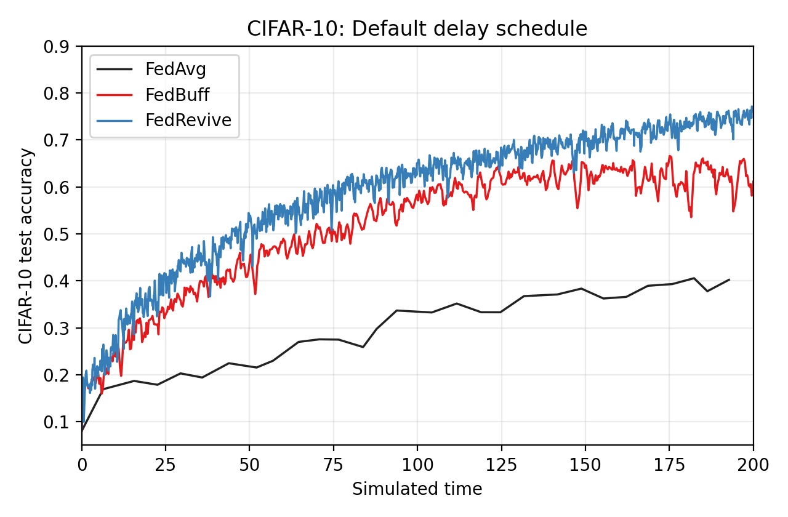
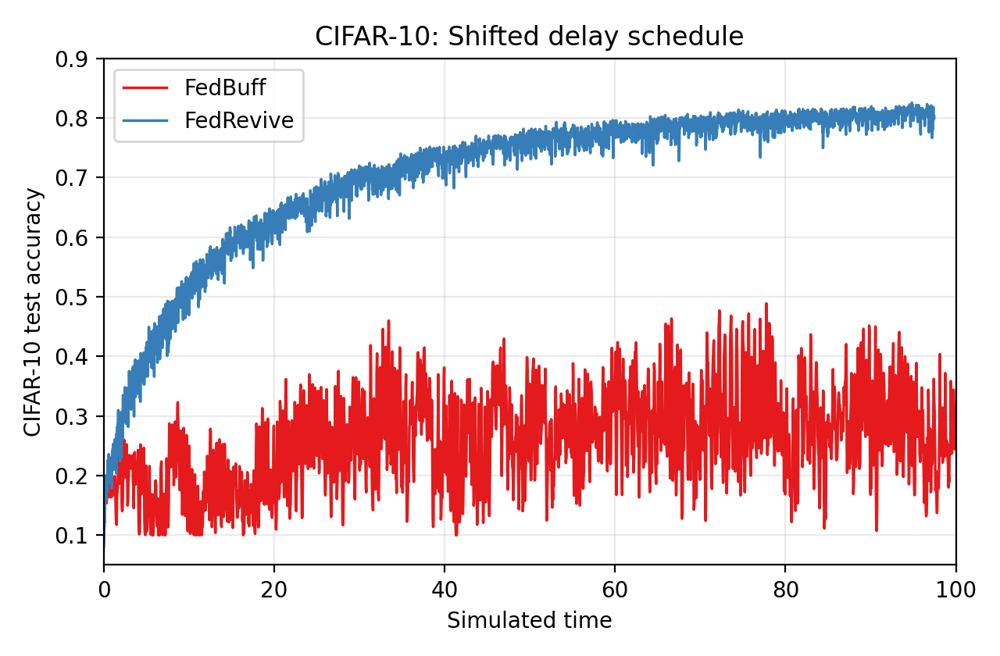
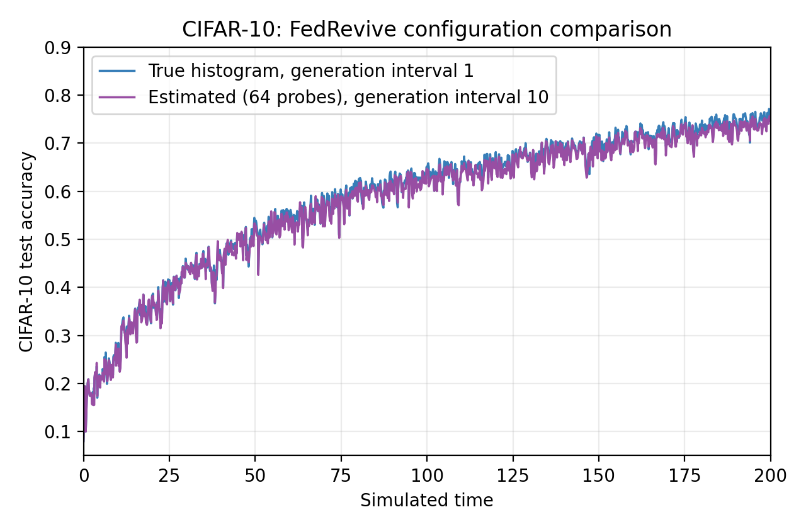

# FedRevive: Reviving Stale Updates with Data-Free Knowledge Distillation

This research project implements [FedRevive](https://arxiv.org/abs/2511.00655)
with the NVIDIA FLARE Collab API. It targets the CIFAR-10 experiment in the
paper and provides FedAvg, FedBuff, and FedRevive through one entry point.

See the [component migration notes](REFACTORING.md) for how the research
workflow uses the shared FedBuff recipe, KD helpers, and reproducible SimEnv.

FedRevive retains the ordinary parameter-space update from an asynchronous
client and supplements stale updates with server-side data-free knowledge
distillation (DFKD). Recent returned client models act as teachers, a
persistent meta-learned generator produces synthetic inputs, and a
staleness-dependent coefficient blends the client and distilled updates.

## Scope

The initial scope is the CIFAR-10 comparison of FedAvg, FedBuff, and FedRevive.
It uses the model, data partition, runtime distributions, and training settings
reported in the paper. It is intentionally separate from the other NVIDIA
FLARE CIFAR-10 examples.

The default `--arrival-mode simulated` uses the paper's seeded phase scheduler on
a small physical worker pool. For live training and explicit simulator plans,
`--arrival-mode actual` and `--arrival-mode replay` use the shared
`FedBuffRecipe` with the same FedRevive update transform. The plan is supplied
through `SimEnv`.

CIFAR-100, FEMNIST, 20NewsGroups, DD-FedRevive, and AFL-DW are outside this
initial contribution.

`--class-proportion-source true-histogram` reads each client's
prepared class histogram, while `--class-proportion-source estimated` derives
it entirely on the server from ordinary model uploads. `--generation-interval`
controls how many global model versions elapse between synthesis steps.
`--synthesis-label-distribution` selects uniform targets or targets sampled from
the mean of the buffered teachers' class proportions.

## Class-proportion estimation

When `--class-proportion-source estimated` is selected, the server probes only
each logical client's first two ordinarily uploaded models with fresh i.i.d.
Gaussian CIFAR-shaped inputs. It averages the resulting softmax vectors using
the CIFAR-10 probe temperature $T_{probe}=0.8$, uses the first estimate as a
running proxy until the second arrives, and then freezes the average. This adds
no client computation, label histogram, or message field. The implementation
also removes the prepared true proportions from its server-side manifest copy.

The paper does not report the number of Gaussian probe inputs. This
implementation uses 64, matching its reported synthesis batch size. One
reusable probing model serves all 1,000 logical clients. The shared probe uses a
temporary model copy, and the estimator keeps one ten-element sum and one count
per observed client. Use
`--class-proportion-probe-count` to change the total for a sensitivity run;
probes are forwarded in chunks of at most 64 so peak device memory remains
bounded.

FedRevive defaults to estimated class proportions, uniform synthesis targets,
and `--generation-interval 10`. All settings use
$K_{synth}=2$, $K_{KD}=10$, and an eight-model teacher buffer ($c=8$).
Distillation still occurs on every eligible stale arrival after warmup. Between
synthesis steps, the bounded synthetic pool is reused.

## Unified scheduling and aggregation

This section describes the deterministic scheduler used only for the controlled
paper experiment; real deployments use actual client arrivals directly.

The server exposes three scheduling parameters:

- Concurrency (`--concurrency`) is the maximum number of active assignments.
  The legacy `--num-active-jobs` spelling is also accepted.
- Buffer size (`--buffer-size`) is the number of returned updates required to create a
  new global model version.
- Minimum open slots (`--min-open-slots`) is the number of open execution slots required
  before the current global model is distributed to more clients.

All returned models pass through the same update function. The client delta is
computed against the exact model snapshot used by that assignment. The shared
`FedBuffTrainingCoordinator` accumulates accepted deltas in a running sum and
publishes only after `buffer_size` contributions. The method presets are:

| Method | Concurrency | Buffer size | Minimum open slots | Server learning rate |
|---|---:|---:|---:|---:|
| FedAvg | 100 | 100 | 100 | 1.4 |
| FedBuff | 100 | 2 | 1 | 0.05 |
| FedRevive | 100 | 1 | 1 | 0.10 |

Thus, FedAvg waits for all 100 results before producing and redistributing the
next global model; FedBuff immediately refills each open slot but creates a
version every two arrivals; and FedRevive immediately refills the open slot
and creates a version from each arrival. Explicit CLI overrides allow other
concurrency, buffer-size and refill configurations.

The Collab calls are genuinely nonblocking. Physical sites perform PyTorch
training while the server keeps other calls in flight. For reproducible runs,
the server uses a seeded logical event order: it selects clients, then samples
training time when each download event fires and upload time when each training
event fires. The server accepts completed calls in simulated upload order, so
host scheduling does not change logical participation, model snapshots, or
staleness.

This workflow also illustrates the flexibility of CollabAPI. Nonblocking
`collab.get_clients(...).train(...)` calls let the server express logical
scheduling, result ordering, and algorithm state directly in Python, while
`@collab.publish` exposes the corresponding client operation. The same behavior
can be implemented with FLARE's lower-level `Controller` and `Executor` APIs,
but doing so requires explicit `Task` and `Shareable` construction, callback
and result correlation, and additional lifecycle bookkeeping. The resource
controls below remain application logic rather than automatic CollabAPI
behavior.

### Composition and resource controls

| Component | Responsibility |
| --- | --- |
| `nvflare.collab.fedbuff_recipe` | Shared assignment acceptance, buffered publication, Collab calls, one bounded receipt queue and lifecycle |
| `update.py` | Optional `FedReviveUpdate`: proxies, shared teacher history, revival gates and delta blending |
| `dfkd.py` | Conditional generator, optimized latent/embedding tensors, Reptile update, weighted per-teacher objectives and sampling |
| `schedule.py` | Paper mode: seeded download/train/upload phases and logical-client eligibility |
| `workflow.py` | Paper mode: research reservations and physical-worker mapping over core calls/acceptance |
| `storage.py` | Paper mode: run-owned temporary tensor files with reference counts |
| `SimEnv` with a replay plan | Explicit assignment and acceptance order or timing, with evidence in the run's `simulation/` directory |
| `server.py` | Separate initial model loader, FedRevive model operations, and CIFAR evaluation/artifact observer |

`FedReviveWorkflow` inherits the protected call/lifecycle implementation from
`FedBuffWorkflow`; `PhaseCoordinator` inherits its numerical acceptance from
`FedBuffTrainingCoordinator`. Concurrency bounds active logical assignments.
Physical sites bound concurrent calls and the core receipt queue. One exact
base file is shared by every outstanding assignment for its version.
`TensorStore.retain` records these references at reservation and
`TensorStore.release` deletes the file after the last assignment is consumed.
Completed uploads wait on disk for their logical acceptance, then their files
are deleted as soon as the coordinator consumes them. This bounds temporary
model storage by outstanding assignments even in long or shifted runs.

The observer retains experiment evidence:

| Artifact | Contents |
| --- | --- |
| `run_config.json` | Resolved experiment options |
| `dfkd_config.json` | Resolved synthesis/KD defaults when FedRevive is enabled |
| `phases.jsonl` | Paper mode's incremental download/train/upload events and simulated times |
| `schedule.jsonl` | Dispatch/accept identities, versions and training seeds |
| `updates.jsonl` | Validated upload metadata/metrics, including actual-arrival seeds and shards |
| `revival.jsonl` | FedRevive gate decisions, blend weights and DFKD metrics |
| `accuracy_history.json`, `results.json` | Centralized evaluations and final run summary |
| `final_model/global_model.pt` | Final model |

The workflow discards pending uploads at its horizon and drains active calls
before releasing outstanding bases. Normal shutdown, managed aborts, and
handled failures remove temporary model files. A process killed before
cleanup can leave temporary files in that run's directory.
Before starting the simulator, the launcher rejects a job directory that
already exists or is reserved by another run under the effective workspace root.
Use a distinct `--workspace-root` for each repeat of the same method, including
when changing arrival modes. If `NVFLARE_SIMULATOR_WORKSPACE_ROOT` is set, it
selects the root instead. Exceptions stop training, and core cleanup ignores
late callbacks.

The shared teacher buffer owns CPU model snapshots. FedRevive owns client-level
class proxies, including refreshing retained teachers after the second probe.
`SyntheticPool.add` clones only new CPU images, and `SyntheticPool.sample_batch_indices`
plans KD batches as indices. Images are stacked only when a batch is used.
Ordinary KD uses the shared detached
teacher loss. Synthesis retains teacher-input gradients, optimized latent and
embedding tensors, raw-image pooling and repeated augmentation. The generic
trainer's same-batch multi-teacher policy and generic synthesizer's fixed-latent
policy are different; the corresponding FedRevive loops remain research code.

## FedRevive update

The server keeps the eight most recently returned client models. It adds each
return to this teacher buffer before processing the update. For an update with
staleness $\tau$, FedRevive uses

$$
\beta(\tau) = 1 - \frac{1}{2}\left(1 +
\cos\left(\frac{\pi\tau}{2s_{max}}\right)\right), \qquad s_{max}=75,
$$

clipped to $[0,1]$. If $\widetilde{\Delta}_i$ is the ordinary client delta
and $\widetilde{\Delta}^{KD}_i$ is the DFKD student delta, the processed update
is

$$
(1-\beta(\tau))\widetilde{\Delta}_i
+ \beta(\tau)\widetilde{\Delta}^{KD}_i.
$$

DFKD becomes eligible when the current global model is at version 50 or
later and the accepted update has nonzero staleness. Through current version
100, the student delta is zero and the server applies the client delta with
weight $1-\beta(\tau)$. These warmup thresholds are experiment settings.

1. On eligible versions divisible by `--generation-interval`, draw synthesis
   targets and adapt a fast copy of the persistent generator for two steps.
   The synthesis loss weights each teacher by its class proportions, even when
   target labels are uniform as described in Section 2.2 of the paper. The
   adversarial loss starts at the 100th synthesis call.
2. Apply a Reptile update to the persistent generator and add the best
   generated batch to the bounded 16,000-image pool.
3. After current version 100, plan ten batches per teacher using its class
   proportions. Prefer distinct images within each class when the pool has
   enough samples. Load one batch per teacher for each KD step and return the
   trained student's delta from the current global model.

All synthesis and KD work is server-side. No synthetic data is sent to clients.

## CIFAR-10 configuration

| Category | Setting |
|---|---|
| Logical clients | 1,000 |
| Concurrent jobs | 100 |
| Samples per logical client | 350 |
| Data heterogeneity | Dirichlet, $\alpha=0.5$ |
| Train/validation/KD split | 37,500 / 7,500 / 5,000 |
| Model | CIFAR ResNet-18 topology with non-normalizing feature-statistic trackers |
| Client optimizer | Adam |
| Client learning rate | $3\times10^{-4}$ |
| Client batch size | 32 |
| Local iterations | 25 |
| Teacher buffer | 8 models |
| Synthesis batch / steps | 64 / 2 |
| Generator interval | Configurable; 10 by default |
| Generator / latent learning rate | 0.003 / 0.001 |
| KD batch / iterations / learning rate | 32 per teacher / 10 / $10^{-4}$ |
| DFKD weights | adversarial 0.1, feature 0.003, one-hot 1.0 |
| Simulated-time budget | 200 |

The ResNet-18 follows the curve-producing architecture: each conventional
BatchNorm transform is replaced by a `StatTracker` that records per-channel
running mean and variance but returns its activation unchanged. Thus, these
statistics support the DFKD feature loss without normalizing client or server
activations.

Each logical client has persistent runtime characteristics. Local-training time
is exponential with a mean drawn from 1.0, 1.3, or 1.6 with probabilities
0.25, 0.50, and 0.25. Download time is 0.1. Upload time is uniform within 0.02
of a client mean drawn equally from 0.15 and 0.25.

The paper's Figure 3 uses a shifted delay schedule to test sensitivity to the
arrival process: every client's exponential local-training mean is 0.1,
download time is 0.02, and upload time is uniform within 0.01 of a persistent
client mean drawn equally from 0.05 and 0.10. All algorithm and optimization
settings remain unchanged. Because the delay schedule changes which client
updates become stale and which updates share a FedBuff boundary, it is stored
in the prepared-data manifest and checked by `job.py`; a run cannot silently
use a manifest prepared for the other schedule. The CIFAR-10 panel in Figure 3
uses a 100-unit simulated-time window.

## Setup and data preparation

Run from this directory using an NVIDIA FLARE `main` checkout:

```bash
cd research/fedrevive
python -m pip install -r requirements.txt
```

Prepare CIFAR-10 and the 1,000 deterministic logical shards once:

```bash
python prepare_data.py \
  --download-root /tmp/cifar10 \
  --output-root /tmp/fedrevive/cifar10 \
  --num-logical-clients 1000 \
  --client-data-size 350 \
  --alpha 0.5 \
  --setup-seed 10
```

Prepare a separate manifest for the shifted delay schedule. The same seed
recreates the identical logical CIFAR-10 shards while recording the alternate
runtime profiles:

```bash
python prepare_data.py \
  --download-root /tmp/cifar10 \
  --output-root /tmp/fedrevive/cifar10_shifted \
  --delay-schedule shifted \
  --num-logical-clients 1000 \
  --client-data-size 350 \
  --alpha 0.5 \
  --setup-seed 10
```

The prepared manifest and shards live outside the repository. Logical shards
can overlap because deterministic wraparound allocation is used when the
requested population exceeds the available training examples.

## Run the experiments

`set_seed` seeds Python, NumPy, and PyTorch on CPU and CUDA. The launcher uses
`--setup-seed` before data preparation or job construction, and the server
uses it to initialize the model and DFKD components. Once those components
are built, `--run-seed` starts the server's training RNG before any client
updates. It also seeds the simulated arrival sequence and the probe generator.
Each client training call uses its assignment's own seed for shuffled batches
and augmentation.

Each method uses the same entry point and defaults to its table preset. The
FedRevive defaults additionally select estimated class proportions, uniform
synthesis targets, and a generation interval of 10.

```bash
python job.py --method fedavg \
  --data-root /tmp/cifar10 --prepared-data-root /tmp/fedrevive/cifar10 \
  --max-time 200 --setup-seed 10 --run-seed 10

python job.py --method fedbuff \
  --data-root /tmp/cifar10 --prepared-data-root /tmp/fedrevive/cifar10 \
  --max-time 200 --setup-seed 10 --run-seed 10

python job.py --method fedrevive \
  --data-root /tmp/cifar10 --prepared-data-root /tmp/fedrevive/cifar10 \
  --max-time 200 --setup-seed 10 --run-seed 10
```

To run with true histograms, teacher-mean targets, and synthesis on every
eligible version:

```bash
python job.py --method fedrevive \
  --class-proportion-source true-histogram --generation-interval 1 \
  --synthesis-label-distribution teacher-mean \
  --data-root /tmp/cifar10 --prepared-data-root /tmp/fedrevive/cifar10 \
  --workspace-root /tmp/nvflare/fedrevive-true-histogram \
  --max-time 200 --setup-seed 10 --run-seed 10
```

After establishing the default-schedule baseline, run FedBuff and FedRevive
under the shifted schedule by selecting its matching manifest explicitly:

```bash
python job.py --method fedbuff \
  --delay-schedule shifted \
  --data-root /tmp/cifar10 \
  --prepared-data-root /tmp/fedrevive/cifar10_shifted \
  --workspace-root /tmp/nvflare/fedrevive-shifted \
  --max-time 100 --setup-seed 10 --run-seed 10

python job.py --method fedrevive \
  --delay-schedule shifted \
  --data-root /tmp/cifar10 \
  --prepared-data-root /tmp/fedrevive/cifar10_shifted \
  --workspace-root /tmp/nvflare/fedrevive-shifted \
  --max-time 100 --setup-seed 10 --run-seed 10
```

For the shifted run with teacher-mean targets, use the same three options and
`--workspace-root /tmp/nvflare/fedrevive-shifted-true-histogram`.

A CUDA-capable GPU is recommended for both client training and FedRevive's
server-side DFKD. Device selection defaults to `auto`; use `--client-device
cpu` when GPU sharing is not appropriate. Use `--num-clients` to size the
physical worker pool independently of logical concurrency, and `--workspace-root` to
select the output location.

For a small functional test, reduce both the number of physical clients and
concurrency, and cap the number of versions:

```bash
python job.py --method fedrevive \
  --num-clients 2 --concurrency 2 --buffer-size 1 --min-open-slots 1 \
  --local-iterations 1 --max-model-versions 54 --max-time 1000 \
  --workspace-root /tmp/nvflare/fedrevive-smoke \
  --eval-interval 54 --server-device cpu
```

## Actual arrivals

Use the production async recipe when host/RPC arrivals should determine acceptance:

```bash
python job.py --arrival-mode actual --method fedrevive \
  --num-clients 2 --concurrency 2 --buffer-size 1 --min-open-slots 1 \
  --workspace-root /tmp/nvflare/fedrevive-actual \
  --num-rounds 120 --data-root /tmp/cifar10 \
  --prepared-data-root /tmp/fedrevive/cifar10
```

Here concurrency cannot exceed the physical client count. Sites named `site-N` use prepared shard
`client-(N-1)`; sites named `client-N` use that shard directly. Each site keeps
its shard identity, and assignment-derived seeds are still applied. The core
recipe supplies actual arrival order. `--num-rounds` counts global publications
and also accepts the existing `--max-model-versions` spelling.
`--max-time` and prepared delay profiles apply only to paper mode. Seeds
alone do not make actual arrivals reproducible. This mode shares the algorithm
components but does not reproduce the paper's logical participation schedule.

## Replay a simulator plan

Use replay mode to run the same recipe with a fixed sequence or a virtual timing
plan supplied through `SimEnv`. For example, save this as `plan.json` after
preparing the shards above:

```json
{
  "format_version": 1,
  "async_execution": {
    "logical_sequence": ["client-0", "client-1", "client-1", "client-0"],
    "arrival_sequence": [1, 0, 2, 3],
    "train_seeds": [10000001, 10000002, 10000003, 10000004]
  }
}
```

```bash
python job.py --arrival-mode replay --simulation-plan plan.json --method fedrevive \
  --num-clients 1 --concurrency 2 --buffer-size 1 --num-rounds 4 \
  --workspace-root /tmp/nvflare/fedrevive-replay \
  --local-iterations 1 --client-device cpu --server-device cpu
```

Use prepared `client-N` names and supply one assignment per contribution in
`num_rounds * buffer_size`. The logical sequence and acceptance order stay the
same if you rerun with two physical clients and a fresh workspace. When a plan
omits `train_seeds`, the client uses the existing seed derived from
`--run-seed` and assignment ID. For timing plans and the evidence layout, see
the [simulation guide](../../docs/user_guide/data_scientist_guide/reproducible_simulation.rst).

To reproduce the paper schedule, use `--arrival-mode simulated`. Its logical
clients become eligible again after training while an earlier upload can
still be pending. Shared replay plans keep a logical client reserved until
its result is accepted and use their own timing and contribution rules.

## Adapt the workflow to another image dataset

1. Update `data.py` to prepare logical shards and class proportions for the
   dataset, then wire the training and evaluation dataset constructors in
   `client.py` and `server.py`. Keep shard names consistent with the manifest
   and any replay plan.
2. Update `model.py` and the model construction used by client training, server
   evaluation, and DFKD together. Use the same parameter shapes across those
   paths. If using the feature-statistics objective, expose the tracked
   features from the model.
3. Adjust the generator output shape, class count, probe input shape, and
   synthetic-data transforms in `dfkd.py` and `update.py` to match the inputs
   and labels used by the model. Run a short check through synthesis and KD
   warmup before comparing experiments.

## Evaluation protocol

For direct comparison under different settings, every reported point is a
centralized evaluation of the global model on the same official CIFAR-10 test
set. Clients do not evaluate global models. This avoids requiring every site to
evaluate every asynchronous version, which would interrupt asynchronous
progress and make the evaluation load method-dependent.

FedAvg is evaluated after each global version. FedBuff and FedRevive are
evaluated every ten versions to keep centralized evaluation cost bounded and
consistent between the asynchronous methods. A final evaluation is added only
when the last version was not already evaluated.
Because progression uses sampled simulated time, centralized evaluation changes
host runtime but not client completion order or simulated time.

The server writes `accuracy_history.json`, `results.json`, a final model, DFKD
pool checkpoints, and TensorBoard events in the NVFlare run directory.

## Results

The following historical curves use one seed (10) and the pre-migration Collab
workflow. Both FedRevive configurations used teacher-mean synthesis targets
and the earlier warmup and KD sampling rules. The paper reports averages over
three seeds.

### Default delay schedule

Figure 1 shows all three method presets over 200 simulated-time units.



| Method | Versions at stop | Final accuracy | Best accuracy |
|---|---:|---:|---:|
| FedAvg | 28 | 0.4022 | 0.4056 |
| FedBuff | 6,343 | 0.6111 | 0.6659 |
| FedRevive | 12,687 | 0.7462 | 0.7566 |

### Shifted delay schedule

Figure 2 shows FedBuff and FedRevive over approximately 100 simulated-time
units after only the delay schedule is changed. FedBuff exhibits large
fluctuations and reduced accuracy, while FedRevive remains stable under the
shifted arrival process. This FedRevive run reached the former 50,000-version
safety limit at simulated time 97.43; the example now defaults to a
100,000-version ceiling so the simulated-time budget remains the normal stop
condition for future runs.



| Method | Versions at stop | Time at stop | Final accuracy | Best accuracy |
|---|---:|---:|---:|---:|
| FedBuff | 25,662 | 100.00 | 0.3019 | 0.4886 |
| FedRevive | 50,000 | 97.43 | 0.8025 | 0.8253 |

### FedRevive configuration options

Figure 3 compares server-estimated class proportions using 64 Gaussian probes
and synthesis every ten versions with true histograms and synthesis every
eligible version.
Both runs use seed 10 and the same 1,270 centralized evaluation points, model
versions, and simulated arrival times.



| Class-proportion source | Generation interval | Final accuracy | Best accuracy | Final 51-evaluation mean |
|---|---:|---:|---:|---:|
| True histogram | 1 | 0.7612 | 0.7712 | 0.7483 |
| Estimated (64 probes) | 10 | 0.7462 | 0.7566 | 0.7376 |

The raw accuracy curves have a Pearson correlation of 0.9986 and a pointwise
mean absolute difference of 0.0091. Thus, the lightweight estimated setting
closely follows the true-histogram trajectory while avoiding client label
statistics and reducing synthesis frequency.

## License

This contribution is provided under the repository's Apache License 2.0. It
does not copy third-party implementation code, pretrained models, or assets.
It uses PyTorch and TorchVision under their BSD-style license, Kornia and
TensorBoard under Apache License 2.0, and downloads the
[CIFAR-10 dataset](https://www.cs.toronto.edu/~kriz/cifar.html) through
TorchVision. Those dependencies and data retain their respective terms.

## Repository layout

```text
fedrevive/
├── README.md
├── figs/
│   ├── figure_1.png
│   ├── figure_2.png
│   └── figure_3.png
├── requirements.txt
├── prepare_data.py
├── data.py
├── model.py
├── client.py
├── server.py             # Model loader, operations, evaluation observer
├── schedule.py           # Seeded research phases
├── storage.py            # Reference-counted temporary tensor files
├── update.py             # Optional FedRevive update transform
├── workflow.py           # Research composition over core async
├── fedrevive.py
├── dfkd.py
├── job.py
└── trace_resources.py
```

## Citation

```bibtex
@misc{askin2025fedrevive,
  title         = {Reviving Stale Updates: Data-Free Knowledge Distillation for Asynchronous Federated Learning},
  author        = {Baris Askin and Holger R. Roth and Zhenyu Sun and Carlee Joe-Wong and Gauri Joshi and Ziyue Xu},
  year          = {2025},
  eprint        = {2511.00655},
  archivePrefix = {arXiv},
  primaryClass  = {cs.LG},
  url           = {https://arxiv.org/abs/2511.00655}
}
```

Research projects under `research/` are community contributions and are not
maintained by the NVIDIA FLARE team after contribution.
