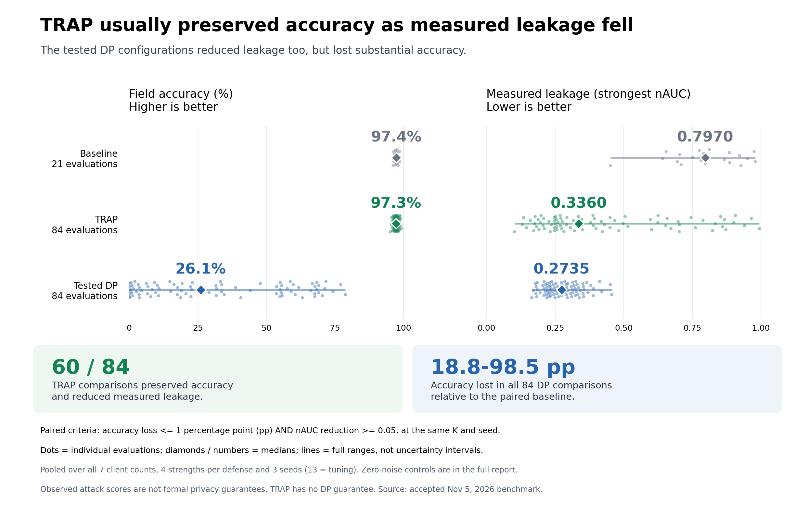

# TRAP: experimental memorization reduction

The TRAP components support **CPU and CUDA**. This research project composes
`PTTRAPLoss`, `FrozenReferenceScorer` and report-only memorization filters with
standard federated training. The [Hugging Face workflow](huggingface/README.md)
is the representative GPU example, validated on **H100** at SDK revision `778d632e`.
TRAP provides no differential privacy guarantee.

The TRAP method is introduced by Muhammed Ustaomeroglu et al. (2026) in
[TRAP: Understanding and Mitigating Privacy Memorization in Language Models](https://arxiv.org/abs/2609.32293),
arXiv:2609.32293. This project integrates the preprint's reference-based penalty
into federated fine-tuning with NVFlare.

## GPU workflow and SDK validation

The [Pythia Hugging Face workflow](huggingface/README.md) provides a larger runnable
integration: pinned model/tokenizer download, public-reference preparation,
completion-masked TRAP training, paired likelihood/TRA audits on task-specific
cohorts, expected-coverage checks, and separate final global-checkpoint evaluation.
On H100, **42 focused tests passed**, including both CUDA tests, and the actual
SDK completed two-client/two-round Pythia training, four paired client audits and
separate final global-checkpoint evaluation. Reference scores, loss and all 76
parameter-gradient tensors matched independent calculations with zero measured
error. The [SDK validation report](huggingface/SDK_VALIDATION.md) records numerical
checks, memory/runtime measurements and the bounded workload scope. It also records
subsequent fixes with local regression coverage, without claiming a new GPU run.

The audit adapter requires complete model state, including persistent buffers.
Adapter-only/LoRA updates need application-specific reconstruction and auditing.
The adoption guide explains memory budgeting, cooperative deadlines, missing audit
visibility, and the need for separate enforcement when release approval is required.

## Minimal smoke example

The root `job.py` uses a tiny model on CPU for two rounds without downloaded data
or checkpoints. It is an optional wiring check; its scores are not benchmark
results or evidence of reduced leakage.

From a clean virtual environment at the repository root:

```bash
python -m pip install -e .
python -m pip install -r research/memorization-reduction/requirements.txt
cd research/memorization-reduction
python job.py
```

The run prints the simulation artifact location. Each client's job run directory
contains `memorization_audits/*.json`. With successful execution, expect two
`completed` reports per client, one per round, each with 32 member and 32 nonmember
records for the `likelihood` score. These local audit records do not participate in
server model selection. `ce` measures the received model on the local held-out
cohort and selects checkpoints with `key_metric_mode="min"`.

To inspect the exported job instead of running it:

```bash
python job.py --export --export-dir ./jobs
```

`client.py` trains a separate reference on fixed public synthetic records before
freezing it. Only the target model is sent. The application checks reference/member
overlap. Real deployments must establish reference provenance, use representative
cohorts, choose attack scores and budget memory/compute. The example's random-token
data and short training are intentionally unsuitable for scientific conclusions.

The minimal smoke example passed again on November 10, 2026 at
[`62873bbcc`](https://github.com/holgerroth/NVFlare/commit/62873bbcc7882d0d1fce7266cf8086024e904416),
after the baseline moved to a context attribute. The unchanged `python job.py` ran
two clients for two rounds on macOS arm64, Python 3.12.9 and PyTorch 2.11.0.
All four paired reports completed with the expected site/round identities and
32 members/32 nonmembers. Baseline fingerprints agreed between clients within
each round and changed between rounds; a global checkpoint was written and all
three server/client error logs were empty. This exercises the real ClientRunner
input/output filter lifecycle. It does not launch `MultiProcessExecutor` workers
or repeat the H100 validation above.

## Project layout and shared components

`job.py`, `client.py`, and `model.py` contain the experiment-specific workflow under
`research/memorization-reduction/`. Reusable TRAP loss, reference scoring, filters,
auditors, and reporting components remain in the `nvflare/app_opt/pt` and
`nvflare/app_common` packages. Their API contracts are documented in the programming
guide and design document linked below.

`model.py` provides the model, deterministic local cohorts and a likelihood auditor.
`job.py` installs `AuditSnapshotFilter()` and
`MemorizationAuditFilter(auditor=SyntheticAuditor(...))` for `train` tasks. The
baseline is held in a private Python attribute on the original task `FLContext`,
outside its relayed properties; the output filter consumes it in the same process.
It is not copied to `MultiProcessExecutor` workers or cloned/later contexts. The
auditor is exported as a nested constructor
argument, with no supporting component registration or event handling.
The auditor reconstructs complete differences when used in a compatible FedOpt job;
this example itself uses full weights. Reference scoring and audit model copies add
memory and runtime costs. Audits are cooperative and report-only: failures do not
stop model transmission, and missing/unsupported measurements are never zero leakage.
No summary analytics are relayed by this example.

See the [programming guide](../../docs/programming_guide/memorization_reduction.rst)
and [design](../../docs/design/federated_memorization_reduction.md).

## Benchmark results

The separate [GB300 Pythia-70M TRAP–DP benchmark](TRAP_DP_RESULTS.md) includes all **525 fits
and 210 final evaluations** across seven client counts, four strengths per defense,
and three seeds (13 is tuning). TRAP passed the paired accuracy-and-leakage screen
in **60/84** comparisons; **24/84** also passed the separate cross-entropy screen.
The tested DP settings passed **0/84** under either screen in this bounded search.
TRAP provides no formal DP guarantee; these results do not establish optimal DP
performance or matched privacy budgets.



[Vector PDF](figures/trap-dp-final/accuracy-leakage-headline.pdf) ·
[Protocol](TRAP_DP_COMPARISON.md) · [All results and limitations](TRAP_DP_RESULTS.md) ·
[Complete scalar tables](results/trap-dp-final/README.md)

The plot pools client counts, strengths and seeds; dots are individual evaluations,
diamonds are medians, and lines are full ranges, not confidence intervals. Zero-noise
controls and CE outcomes are retained in the full report. The benchmark used the
frozen research implementation before this SDK refactor. The small `job.py` example
above demonstrates integration and does not reproduce these measurements.

This research integration is distributed under the repository's [Apache 2.0 license](../../LICENSE).
