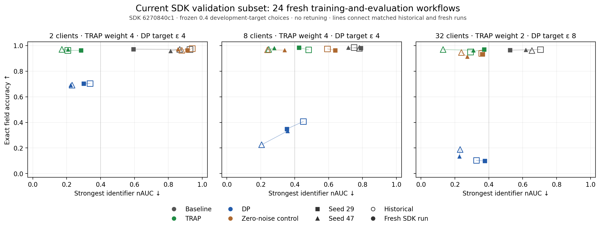

# GB300 validation of the TRAP SDK

Tested source: [`6270840c1d32510b22eb91a8a848bfb87246468d`](https://github.com/holgerroth/NVFlare/commit/6270840c1d32510b22eb91a8a848bfb87246468d).
This separately owned campaign retrained and evaluated **24 prespecified workflows** using the actual SDK loss,
reference scorer, auditor, context-attribute snapshot filters and reporter. It is a fixed subset validation,
with no retuning or parameter sweep. The original 525-fit benchmark and November 6 H100 measurements remain
separately identified. A later merge from main did not change the six SDK components or research workflow;
this evidence binds the complete checkout at the exact tested commit, not later framework changes.

A separate GPU/HF probe validates the subsequent inference-mask fix at
`28c5defc4433d5ed8cf7c7dc47828d722230eed9`. Its source and evidence are separately identified below;
the 24 benchmark workflows were not replayed or relabeled as that newer revision.

[All 24 result rows](results/sdk-validation-gb300-20261117/results.csv) ·
[Aggregate evidence and measurements](results/sdk-validation-gb300-20261117/validation-gb300.json) ·
[Subset PDF](figures/sdk-validation-gb300-20261117/sdk-validation-subset.pdf)

## Fixed workload

| Clients | Baseline config | Zero-noise config | TRAP weight / config | DP target epsilon / config |
|---:|---:|---:|---:|---:|
| 2 | 1 | 1 | 4 / 1 | 4 / 4 |
| 8 | 5 | 1 | 4 / 3 | 4 / 5 |
| 32 | 3 | 1 | 2 / 5 | 8 / 5 |

Each setting uses seeds 29 and 47. Configuration numbers retain their published learning-rate, clipping and
batch settings. TRAP/DP choices were frozen at the original 0.4 development leakage target, including
unfavorable outcomes. The target is a selection criterion, not a promise about final leakage.

The original data/partitions, seed-matched references, pretrained Pythia-70M initialization, fp32/no-TF32
policy, persistent optimizers, 40-epoch ceiling, patience-three stopping and validation-CE checkpoint choice
were preserved. Input and output audit filters both run at round zero and every five rounds. Each fresh fit
was evaluated with the original full benchmark evaluator after all selected checkpoints were frozen.

## GPU SDK and adoption gate

All **63 focused tests** and **22 CUDA scorer/loss
regressions** passed, with **zero skips**. This includes both CUDA RNG tests, optional masks, cache hit/miss
behavior, inference tensors, nonpersistent-buffer mutation/recreation, dtype/storage replacement and
device relocation. The actual Opacus clipping and secure CUDA noise backend passed before DP training.

The preserved zero-noise clipping comparison uses two original training records. It is a numerical
diagnostic with no DP guarantee, not an additional guarantee-bearing model fit. Long-sequence boundary
checks and secure-noise backend checks use synthetic inputs. These diagnostics remain separate from the
six new DP matrix mechanisms, and raw probe artifacts are not DP releases.

Independent calculations matched reference scores (maximum absolute error 0),
loss (0) and all 76 gradient tensors
(0). Tolerances (atol/rtol) stayed at reference 1e-5/1e-6, loss 1e-6/1e-6,
gradients 1e-6/1e-4, and audit aggregates 1e-6. Full/difference reconstruction, RNG isolation,
baseline ownership, report persistence and structured failure coverage passed.

The separate runnable Hugging Face workflow prepared a fresh reference, ran two real clients for two rounds,
persisted all four expected paired audits, passed coverage checking, exported the job, and audited its final
global checkpoint. Its small synthetic cohorts establish implementation/adoption behavior, not benchmark
efficacy. Its source and resource measurements are included in `validation-gb300.json`.

## Follow-up inference-mask validation

While the matrix ran, a reviewer identified a separate scoring-to-training failure: calling the scorer
inside `torch.inference_mode()` returns an inference mask that autograd cannot save for backward.
The fix copies such masks in `PTTRAPLoss`. The benchmark and HF training loops use their ordinary target
masks, so their existing path does not exercise that defect. The original campaign source stayed immutable.

After the matrix released its final GPU allocation, a fresh sibling probe at `28c5defc4433d5ed8cf7c7dc47828d722230eed9`
passed **65 focused tests** and **24 CUDA
scorer/loss cases**, with **zero skips**. Both inference-mask cases exercised online scoring, cache misses/hits
and backward gradients. It repeated numerical reference/loss/gradient parity, real-device relocation,
secure-noise compatibility and the complete HF adoption workflow with fresh reference preparation.
Reference/loss/gradient maximum absolute errors were 0,
0, and 0, respectively, at the unchanged
tolerances. It launched no benchmark matrix fits/finals. Independent CPU verification and successful
terminal parents bind the follow-up proof `1327a2813195f7080e39b7275a66518ac16e1e9a5bd5d06c39a100b8f75bb8e9`. Its distinct measurements and source
hashes are in `validation-gb300.json` under `post_fix_gpu_validation`.

The adoption measurements below sum elapsed time across the listed calls and show the maximum per-call
CUDA allocator/reservation and process-lifetime RSS peaks. Client calls can overlap; their summed durations
are not federation wall time. Phase wall times and sampled device measurements are retained in the JSON.

| Revision | Adoption phase | Sum call seconds | Peak allocated GiB | Peak reserved GiB | Peak host RSS GiB |
|---|---|---:|---:|---:|---:|
| 6270840c1 | Fresh reference preparation | 1.761 | 1.384 | 1.426 | 3.850 |
| 6270840c1 | Client training (four calls) | 2.249 | 1.679 | 2.043 | 3.435 |
| 6270840c1 | Paired client audits (four calls) | 11.628 | 1.974 | 2.047 | 3.704 |
| 6270840c1 | Final global audit | 7.165 | 0.591 | 0.633 | 3.850 |
| 28c5defc4 | Fresh reference preparation | 1.783 | 1.384 | 1.426 | 3.821 |
| 28c5defc4 | Client training (four calls) | 2.272 | 1.679 | 2.043 | 3.464 |
| 28c5defc4 | Paired client audits (four calls) | 11.383 | 1.974 | 2.047 | 3.724 |
| 28c5defc4 | Final global audit | 7.197 | 0.591 | 0.633 | 3.821 |

## Fresh subset outcomes

| Method | Finals | Median field accuracy | Median strongest nAUC | Accuracy + leakage passes | CE passes | Joint passes |
|---|---:|---:|---:|---:|---:|---:|
| baseline | 6 | 97.0% | 0.6667 | — | — | — |
| trap | 6 | 97.0% | 0.2970 | 5/6 | 2/6 | 2/6 |
| dp | 6 | 34.0% | 0.3275 | 0/6 | 0/6 | 0/6 |
| control | 6 | 96.3% | 0.5000 | 0/6 | 0/6 | 0/6 |

The paired screen permits at most one percentage point of field-accuracy loss and requires at least 0.05
reduction in strongest identifier nAUC against the baseline with the same K/seed. The independent CE screen
requires defended/baseline CE <= 1.01; joint requires both. nAUC is 2*abs(AUROC-0.5), maximized over the four
identifier attacks. All unfavorable outcomes remain in the tables. These six-row method summaries are
descriptive; two fixed seeds and three selected client counts do not establish general superiority.

| K | Seed | Method | Strength | Config | Field accuracy | Strongest nAUC | CE | Epoch selected / trained |
|---:|---:|---|---:|---:|---:|---:|---:|---:|
| 2 | 29 | baseline | 0 | 1 | 97.27% | 0.5940 | 0.012680 | 4 / 7 |
| 2 | 29 | trap | 4 | 1 | 96.26% | 0.2850 | 0.013349 | 17 / 20 |
| 2 | 29 | control | 0 | 1 | 96.26% | 0.9120 | 0.014865 | 13 / 16 |
| 2 | 29 | dp | 4 | 4 | 70.30% | 0.3010 | 0.087182 | 40 / 40 |
| 2 | 47 | baseline | 0 | 1 | 95.86% | 0.8120 | 0.011328 | 7 / 10 |
| 2 | 47 | trap | 4 | 1 | 96.97% | 0.2075 | 0.013873 | 8 / 11 |
| 2 | 47 | control | 0 | 1 | 97.27% | 0.8570 | 0.014485 | 7 / 10 |
| 2 | 47 | dp | 4 | 4 | 69.09% | 0.2240 | 0.094624 | 40 / 40 |
| 8 | 29 | baseline | 0 | 5 | 98.18% | 0.7900 | 0.012766 | 18 / 21 |
| 8 | 29 | trap | 4 | 3 | 98.48% | 0.4260 | 0.015758 | 15 / 18 |
| 8 | 29 | control | 0 | 1 | 96.36% | 0.6390 | 0.019232 | 8 / 11 |
| 8 | 29 | dp | 4 | 5 | 34.85% | 0.3540 | 0.172776 | 40 / 40 |
| 8 | 47 | baseline | 0 | 5 | 98.48% | 0.7155 | 0.017599 | 7 / 10 |
| 8 | 47 | trap | 4 | 3 | 98.08% | 0.2790 | 0.016457 | 8 / 11 |
| 8 | 47 | control | 0 | 1 | 96.46% | 0.3400 | 0.018923 | 8 / 11 |
| 8 | 47 | dp | 4 | 5 | 33.23% | 0.3580 | 0.176642 | 40 / 40 |
| 32 | 29 | baseline | 0 | 3 | 96.46% | 0.5250 | 0.015187 | 9 / 12 |
| 32 | 29 | trap | 2 | 5 | 96.97% | 0.3725 | 0.015633 | 15 / 18 |
| 32 | 29 | control | 0 | 1 | 93.43% | 0.3610 | 0.025782 | 10 / 13 |
| 32 | 29 | dp | 8 | 5 | 9.80% | 0.3770 | 0.186748 | 40 / 40 |
| 32 | 47 | baseline | 0 | 3 | 96.67% | 0.6180 | 0.015311 | 12 / 15 |
| 32 | 47 | trap | 2 | 5 | 96.36% | 0.3090 | 0.015335 | 18 / 21 |
| 32 | 47 | control | 0 | 1 | 91.41% | 0.2730 | 0.029434 | 7 / 10 |
| 32 | 47 | dp | 8 | 5 | 13.33% | 0.2270 | 0.185650 | 40 / 40 |

`results.csv` retains every utility field, token/record accuracy, CE, all seven directional membership attacks,
both greedy-recovery contexts, exposure/rank-one summaries, paired screens, matched historical differences,
timing/memory, checkpoint/reference identities and audit counts. The subset figure keeps both individual seeds
and distinguishes historical from fresh runs. Secure DP uses fresh randomness, so historical differences
were recorded rather than used to change settings or acceptance criteria.

Changes below are fresh minus matched historical values across six rows per method. Accuracy differences
are percentage points; nAUC differences are absolute. Ranges retain both seeds and all selected client counts.

| Method | Median accuracy change (pp) | Accuracy change range (pp) | Median nAUC change | nAUC change range |
|---|---:|---:|---:|---:|
| baseline | -0.101 | -1.212 to +0.606 | -0.0607 | -0.3330 to +0.0400 |
| trap | +0.455 | -0.606 to +1.818 | +0.0573 | -0.0560 to +0.1785 |
| dp | -0.303 | -5.859 to +10.707 | -0.0060 | -0.0970 to +0.1530 |
| control | -0.808 | -3.232 to +0.909 | +0.0188 | -0.0280 to +0.1000 |

## Evidence and resources

Independent CPU verification checked all 24 fits/finals, 10,080 retained score records, 168 directional
AUROC/nAUC recomputations and 168 actual-evidence rejection cases, with the original 1e-12 aggregate tolerance.
Source/input/checkpoint identities and successful GPU/verifier/dispatcher parents are bound in receipts.
Every expected report is accounted for: 7,348 reports, including
788 completed audits, 5,680 explicit schedule skips and
880 expected unsupported outcomes. Missing, duplicate, unknown-identity
and unexpected-status counts are all zero. Expected `no_local_development_members` outcomes remain unsupported;
they never mean zero leakage. Unexpected missing, duplicate or failed reports block acceptance.

The evaluator does not retain per-token predictions/losses, greedy generation text or raw candidate vectors.
CE/token checks therefore establish finite/range and immutable token-count consistency; recovery denominators
and saved candidate ranks are checked, and exposure is recomputed from ranks. No inference was regenerated
to verify the final aggregates.

New expenditure: **20.725556 allocated GPU-hours** and
**763.267222 CPU-core-hours** across **51 terminal
allocations**, including preparation, all dispatchers/verifiers, the probe and this report's completed CPU job.
Queue/dependency delays are separate. Historical accounting is unchanged; cumulative expenditure is
608.584444 GPU-hours / 22015.284444 CPU-core-hours.

The first report-only CPU allocation failed after 341 seconds because its collector looked for the historical
privacy ledger in the local packaging layout. Recovery used the canonical cluster-root ledger with the same
accepted SHA-256 and preserved every scientific check. That failure contributes
0.757778 CPU-core-hours to the totals; the fresh successful report is also charged.
No fit or evaluation was repeated. The original failed source, terminal allocation and diagnosis remain preserved.

| Method (six runs) | Sum fit wall hours | Sum final wall minutes | Max client allocated GiB | Max client reserved GiB | Max client host RSS GiB |
|---|---:|---:|---:|---:|---:|
| baseline | 0.478 | 4.58 | 22.508 | 76.709 | 7.565 |
| trap | 0.742 | 4.59 | 26.895 | 87.918 | 9.101 |
| dp | 2.507 | 4.57 | 23.140 | 80.561 | 8.970 |
| control | 0.672 | 4.55 | 22.876 | 70.996 | 6.871 |

The rows report synchronized client phase totals, audit time including lease waits, training allocator peaks
and per-process lifetime RSS. Stage resource tables additionally report whole-device/process-tree memory
sampled every 30 seconds across the allocations; samples can miss short peaks. Allocator, process and device
measurements have different scopes and must not be added together. Reference scoring is included in training
time. The largest sampled whole-device peak across the original campaign was
88.837 GiB.
The two benchmark references were reused without new construction cost; their historical training and
validation cost was 535.092392 seconds, already in historical accounting. The separate HF reference is fresh. Historical reference checkpoint hashes/fingerprints and current SDK
scorer fingerprints are retained separately. The scorer fingerprint also includes nonpersistent buffers;
it is not assumed to equal the historical checkpoint fingerprint.

The campaign used the validated PyTorch 25.09 container tag and inherited runtime with Transformers 5.12.1,
Opacus 1.6.0 and the hash-checked secure noise extension. Actual versions/hashes are in the machine-readable
receipt. Each benchmark lease used four GB300s with a 105-minute limit, bounded CUDA/storage preflights,
abnormal-exit cleanup and a corroborated 600-second stale-progress guard. No concurrent campaign GPU leases
or idle-reaper exemption was requested; CPU preparation, verification and reporting used CPU allocations.

## Privacy and scope

The six new DP output-path mechanisms are charged separately. All 228 historical entries are unchanged;
the cumulative **234 mechanisms** compose to epsilon
**157.129442503279** at delta **1e-5**, using canonical full-horizon RDP
curves after checking actual sampling/noise/horizon parameters. The new subset alone composes to
16.173362919843; these values are campaign expenditure, not any one model's nominal target.
Scalar epsilons were not added. Stopping-time epsilon remains diagnostic.

TRAP, baselines and zero-noise controls have no formal DP guarantee. Raw records, scores, configurations,
logs, checkpoints and complete proof/ledger artifacts stay on the cluster; this publication contains only
aggregates and provenance hashes. Audits remain report-only with cooperative deadlines. This validation
does not establish general production readiness or replace a separate release-enforcement mechanism.
