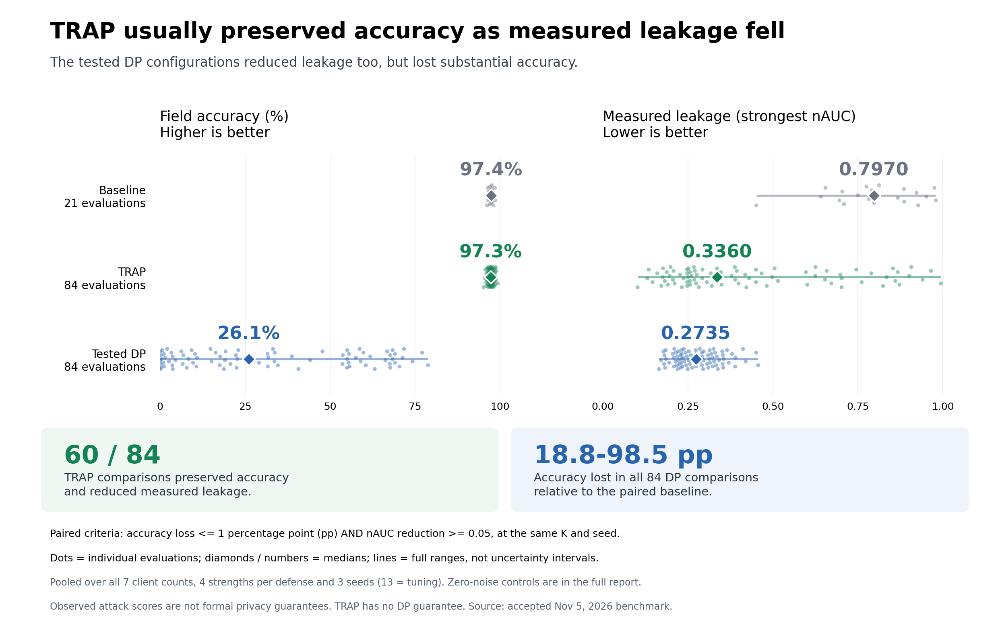
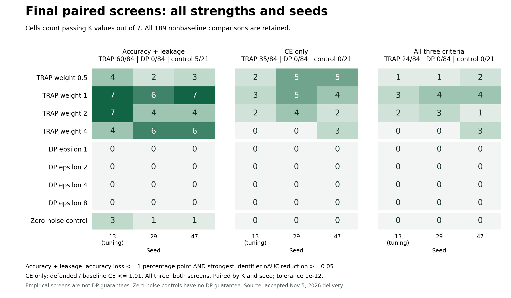
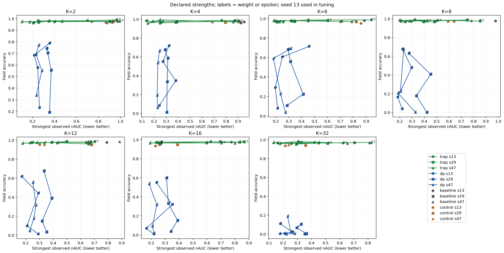
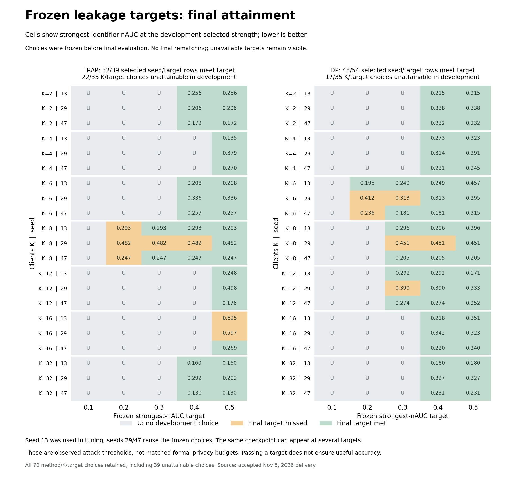

# Final TRAP–DP comparison results

Accepted November 5, 2026: **all 525 primary fits and 210 final evaluations are complete and independently checked**. The [protocol](TRAP_DP_COMPARISON.md), [complete scalar tables](results/trap-dp-final/README.md), and [provenance hashes](results/trap-dp-final/provenance.json) accompany this report.

This benchmark used the frozen research implementation that preceded the SDK API refactor in this PR. It motivates the reusable TRAP and audit components; it is not a rerun of the current PR revision. The [H100 SDK validation](huggingface/SDK_VALIDATION.md) separately checks the current classes. This benchmark uses an APEX-style dossier extraction/rare-secret task with Pythia-70M on GB300 GPUs. It is a reconstruction of the task recipe, not an exact numerical reproduction of the [TRAP preprint](https://arxiv.org/abs/2609.32293).

TRAP often reduced measured membership leakage while preserving field accuracy in this study. It passed the paired accuracy-and-leakage screen in **60/84** comparisons, but only **24/84** also passed the CE screen. DP passed **0/84** of either screen in the bounded search. This is evidence about the evaluated settings and attacks: TRAP has no formal DP guarantee, and these results do not establish the best attainable DP baseline.



[Headline figure PDF](figures/trap-dp-final/accuracy-leakage-headline.pdf) · [Exact plotted statistics](results/trap-dp-final/headline-comparison-statistics.json)

The headline view shows all **21 baseline, 84 TRAP and 84 DP final evaluations**. Median field accuracy is **97.4% / 97.3% / 26.1%**, respectively; median strongest measured leakage is **0.7970 / 0.3360 / 0.2735 nAUC**. Dots retain every run and lines show full ranges. These are descriptive medians pooled across K, strengths and seeds, not matched privacy budgets or uncertainty intervals. The paired comparisons establish the headline: **60/84** TRAP results preserve accuracy within one percentage point while reducing nAUC by at least 0.05; every tested DP result loses accuracy, by **18.8–98.5 percentage points**. The 21 zero-noise controls and CE results remain in the full comparison below.

The [separate SDK GPU validation](huggingface/SDK_VALIDATION.md) exercises the current classes in a bounded Pythia workflow, with numerical parity and resource measurements. It is not a rerun of this efficacy study.

## Complete comparison

Field accuracy measures exact extraction of five visible dossier fields on 198 ordinary test records. It is distinct from teacher-forced token accuracy and from whole-record accuracy; CE uses the full 200-record test mixture.

The study uses Pythia-70M, a fixed balanced union of 2,000 training records, K = 2/4/6/8/12/16/32 clients, and seeds 13/29/47. Seed **13 was used in tuning**; seeds 29 and 47 reuse the frozen configurations. Baseline, TRAP and DP each use the same six-configuration joint search over learning rate, clipping and target batch size, with a 40-epoch ceiling and validation-based stopping. This is a finite joint search, not a factorial search or proof of global optimization.

TRAP weights are 0.5/1/2/4; DP's declared single-fit epsilon targets are 1/2/4/8 at delta 1e-5. Their strength values are different quantities. Final results include every declared strength and seed, not a subset selected using final outcomes. The 21 zero-noise controls use fixed configuration 1 and have no DP guarantee.

| Method | Primary fits, including tuning | Final evaluations | Accuracy + leakage passes | CE passes | Joint passes |
|---|---:|---:|---:|---:|---:|
| Baseline | 56 | 21 | — | — | — |
| TRAP | 224 | 84 | **60/84** | **35/84** | **24/84** |
| DP | 224 | 84 | **0/84** | **0/84** | **0/84** |
| Zero-noise control | 21 | 21 | **5/21** | **0/21** | **0/21** |
| Total | **525** | **210** | | | |

Each nonbaseline evaluation is paired with the baseline at the same K and seed. The accuracy-and-leakage screen requires field-accuracy loss no greater than **1 percentage point** and strongest identifier nAUC reduction of at least **0.05**. The CE screen requires defended/baseline CE ≤ **1.01**. The joint screen requires both. These are descriptive point screens with the original 1e-12 numerical tolerance; they are not statistical non-inferiority tests. Baseline self-screens are not applicable.



[Vector PDF](figures/trap-dp-final/paired-screen-overview.pdf) · [All 189 paired comparisons](results/trap-dp-final/paired-screens.csv) · [Every strength/seed count](results/trap-dp-final/screen-counts-every-strength-and-seed.csv)

## Utility and observed leakage



This is the accepted final figure, copied without modification. Each K panel shows all strengths and seeds. Gray denotes baseline, green TRAP, blue DP and brown control; circles/squares/triangles denote seeds 13/29/47. Strength labels can be dense, particularly at K=16; the [210-row outcome table](results/trap-dp-final/all-210-final-outcomes.csv) and [individual results](results/trap-dp-final/individual-results.md) provide exact values. Lines connect declared strengths within a method/seed; they are not a fitted frontier. Panel axis ranges differ.

| Method | Field accuracy, min / median / max | Strongest identifier nAUC, min / median / max | CE, min / median / max |
|---|---|---|---|
| Baseline | 0.9616 / 0.9737 / 0.9859 | 0.4510 / 0.7970 / 0.9790 | 0.0107 / 0.0131 / 0.0161 |
| TRAP | 0.9515 / 0.9727 / 0.9929 | 0.1020 / 0.3360 / 0.9940 | 0.0099 / 0.0141 / 0.0214 |
| DP | 0.0010 / 0.2606 / 0.7879 | 0.1650 / 0.2735 / 0.4565 | 0.0654 / 0.1894 / 0.6205 |
| Zero-noise control | 0.9333 / 0.9636 / 0.9778 | 0.2150 / 0.6420 / 0.9400 | 0.0149 / 0.0189 / 0.0257 |

These pooled summaries mix K, strength and seed. They describe the observed range; they are not matched-privacy or matched-compute estimates. DP's low attack scores must be read alongside its substantial utility loss. TRAP's field accuracy remains high, but CE and leakage improvements are inconsistent across settings.

The strongest identifier nAUC is the maximum over log-probability, loss++, TRA and candidate-exposure attacks. Here **nAUC = 2 × |AUROC − 0.5|**, so reversing attack direction cannot hide separation. Directional AUROC remains available in the [full final scalar table](results/trap-dp-final/final-results-scalars.csv) and [attack figure](figures/trap-dp-final/attacks.png). TRA is strongest, including ties, in 43/84 TRAP and 67/84 DP finals; exposure is strongest in 27/84 TRAP finals. A single favorable attack is insufficient.

## Frozen leakage targets, including failures

Development choices were frozen at strongest-nAUC targets 0.1/0.2/0.3/0.4/0.5 before final evaluation. **39 of the 70 method/K/target choices were unattainable in development**: 22/35 for TRAP and 17/35 for DP. Neither method attained the 0.1 development target at any K. These unavailable choices remain unavailable rather than being replaced after final testing.



[Vector PDF](figures/trap-dp-final/frozen-target-attainment.pdf) · [All frozen choices and achieved outcomes](results/trap-dp-final/operating-points-with-achieved-targets-and-runtime.csv) · [All 105 cross-method K/target/seed pairs](results/trap-dp-final/all-frozen-cross-method-target-pairs.csv)

TRAP meets the final threshold in **32/39** selected seed/target rows and misses it in seven. DP meets it in **48/54** and misses it in six. A threshold pass concerns observed leakage only; it does not imply preserved utility. Examples of retained failures include TRAP at K=8/target 0.2 in all three seeds (0.293/0.482/0.247), and TRAP at K=16/target 0.5 in seeds 13/29 (0.625/0.597). DP meets that K=16 target in all three seeds, with field accuracies 0.3182/0.3323/0.3172.

Both methods have frozen choices in 36 paired seed/target rows; **32** meet the target for both. Within those 32 rows, TRAP has higher field accuracy and shorter selected-fit wall time in every row; its wall-time ratio to DP ranges from **0.166 to 0.479**. This is a conditional comparison: achieved leakage differs, checkpoints recur across targets, and the rows are not independent replications. It is not a claim of exact privacy matching or universal superiority.

## Training cost, memory and complete campaign accounting

| Method | Fits | Summed fit wall hours | Four-device fit reservation GPU-hours | Record draws | Completion-token draws | Maximum client GPU GB | Maximum client host GB |
|---|---:|---:|---:|---:|---:|---:|---:|
| Baseline | 56 | 5.822 | 23.290 | 1,650,000 | 170,778,300 | 24.408 | 13.331 |
| TRAP | 224 | 28.508 | 114.034 | 7,076,000 | 732,380,152 | 29.122 | 14.041 |
| DP | 224 | 87.706 | 350.824 | 16,610,695 | 1,719,194,633 | 24.800 | 9.110 |
| Zero-noise control | 21 | 2.482 | 9.929 | 521,983 | 54,029,297 | 24.516 | 6.042 |

Sources: [all-fit measurements](results/trap-dp-final/all-fits-scalars.csv), [method/phase totals](results/trap-dp-final/compute-by-method-and-phase.csv), and [selected-fit computation figure](figures/trap-dp-final/computation.png). GB means 10⁹ bytes; memory is the maximum client measurement, not summed node memory. Four-device fit reservation is four times fit wall duration, not measured active GPU utilization. Summed fit durations are not elapsed campaign time. Different stopping and record/token exposure contribute to runtime differences.

TRAP's selected fits use about **28.828–29.122 GB** peak client GPU memory versus **24.513–24.799 GB** for DP. Reference inference takes **24,972.103 client-seconds**, already included in TRAP's 94,039.683 training client-seconds. Do not add it twice. The reused references incur no new construction cost; a from-scratch comparison additionally includes **693.994 seconds** of historical reference training/validation. Shared historical startup cannot be attributed exactly. See [reference costs and amortization](results/trap-dp-final/reference-construction-and-amortization.csv).

Complete campaign expenditure is **764 distinct terminal allocations, 587.858889 allocated GPU-hours and 21,252.017222 CPU-core-hours**, including failed/cancelled work, preparation, dispatchers, CPU evidence observers, report generation and its completed verification allocation. These complete totals supersede partial-monitor totals and the earlier generated report's allocation subset. Queue/dependency waits are separate; [all allocation phases](results/trap-dp-final/allocation-cost-by-phase.csv) preserve them. The 53 successful final-evaluation GPU leases account for 17.961111 GPU-hours and 646.6 CPU-core-hours. Their 210 evaluator durations sum to 6,956.015 seconds; [durations by method](results/trap-dp-final/final-common-evaluation-time-by-method.csv) retain the full count and range. Utility and attacks were timed together, without an invented per-attack breakdown.

Timing qualification: 1,536 timing files for 254 retained seed-13 fits were absent from an earlier inventory. Four retained copies now agree on bytes, size and mtime, covering 8,790 timing records; 1,050 ordering checks passed. This establishes present consistency, not a contemporaneous historical immutability proof.

## Recovery evidence and privacy boundaries

Final membership evaluation uses **10 members and 200 nonmembers**. Nonzero member greedy recovery occurs in 1/21 baseline, 0/84 TRAP, 0/84 DP and 2/21 control finals for identifier-only prompts; for training prompts it occurs in 14/21, 7/84, 0/84 and 10/21 respectively. Zero recovery among ten members is not proof of zero risk. The [recovery/exposure figure](figures/trap-dp-final/recovery-exposure.png) also shows actual training record/token exposure.

Verification checked 88,200 saved score records, 1,470 directional AUROC/nAUC aggregates and 44,100 saved candidate-rank records, plus identities, frozen choices and successful parent allocations. It did not regenerate inference. Per-token predictions/losses, greedy generation text and raw candidate vectors were not retained; CE/token-accuracy checks establish finite values/range and encoded token counts, while recovery/exposure checks use saved denominators and ranks. TRA implied reference scores agree within evidence batches, with fixed reference checkpoint hashes verified.

Intermediate audit evidence contains **165,964** site/update records: 21,952 completed, 129,448 schedule-skipped and 14,564 unsupported because there were no local development members. Unsupported metrics remain missing, never zero leakage. Per-fit status counts remain in [all-fit measurements](results/trap-dp-final/all-fits-scalars.csv); the original site/update audit records are not included here.

The canonical privacy ledger retains **228 distinct output-path mechanism identities** and full-calibrated/adaptive-horizon composed **epsilon 152.13496880155347 at delta 1e-5**. This cumulative value composes the study's private expenditure; it is not any one model's nominal epsilon. All earlier charges, the failed r8 private attempt, its separate authorized retry and historical private smokes remain included. Observed stopping-time epsilon is diagnostic only. The accepted native scalar calculation differs in the last decimal places; the report preserves both calculations and the canonical value. See [primary bounds](results/trap-dp-final/canonical-primary-privacy-bounds.csv), [all 228 native entries](results/trap-dp-final/native-accepted-privacy-scalars-all228.csv), and [native composition](results/trap-dp-final/native-accepted-privacy-composition-scalars.json). The native full-horizon value is 152.1349688016121, versus canonical 152.13496880155347. Cross-environment RDP arithmetic reproduced the discrepancy; identical-curve epsilon conversion matched, but the exact library component was not isolated. Both calculations retain their original checks; no blanket tolerance waiver was introduced. The canonical value is the reported campaign charge.

DP's guarantee is conditional on the declared public routing/capacity, auxiliary references and validation assumptions. TRAP and zero-noise controls have no formal DP guarantee; the complete research bundle is not a DP release. DP uses per-record mean loss, Poisson sampling and per-record clipping, while baseline/TRAP use token-mean loss, shuffled sampling and aggregate clipping. The fixed zero-noise controls measure these combined implementation differences; they do not isolate noise alone. Previously examined holdouts, reused identities, small cohorts, balanced rather than intentionally heterogeneous partitions and the bounded search limit generalization. “Fully optimized DP” would overstate this experiment.

## Figures, tables and provenance

The [figure index](figures/trap-dp-final/README.md) contains all **eight PNG/PDF pairs**: five canonical final figures plus three scalar-derived overview figures. All strengths and seeds are retained. No confidence intervals are inferred from the descriptive seed summaries.

The [table index](results/trap-dp-final/README.md) links all 525 fit measurements, all 210 final outcomes, all 189 paired comparisons, every individual result, frozen-target failures, privacy bounds and compute totals. Tables and figures are copied byte-for-byte from the accepted local delivery and its checked scalar-derived overviews. [Provenance](results/trap-dp-final/provenance.json) records their SHA-256 hashes together with the original source, freeze, report and independent acceptance hashes. The original evidence remains unchanged.

This is a publication of measured results, not a self-contained training reproduction package. Raw dossiers, configurations, checkpoints, per-record scores, cluster logs, and private proof archives are not included. The protocol records the study design; the scalar tables support recomputing the reported comparisons and summaries. Full retraining requires the separately retained data, references, research source and environment. The adoption examples do not reproduce this full efficacy study.

All eight original PNGs and rendered PDFs were visually reviewed for the accepted delivery. The committed figures preserve those reviewed bytes. Some canonical strength annotations overlap; the complete tables supply exact values. To verify the published file bytes locally, from the repository root:

```bash
python - <<'PY_VERIFY'
import hashlib
import json
from pathlib import Path

root = Path("research/memorization-reduction")
manifest = json.loads((root / "results/trap-dp-final/provenance.json").read_text())
for name, expected in manifest["published_files"].items():
    data = (root / name).read_bytes()
    assert len(data) == expected["bytes"], name
    assert hashlib.sha256(data).hexdigest() == expected["sha256"], name
print(f"Verified {len(manifest['published_files'])} benchmark files")
PY_VERIFY
```

File hashes establish byte identity, not scientific validity by themselves. The acceptance checks and their measurement limitations are described above.
